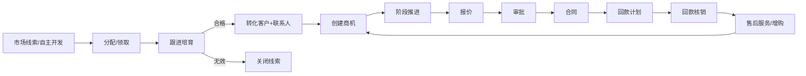

# 00 产品简报

## 1. 产品定位

**一句话：** 面向中小成长型 B2B 企业的「销售过程驱动」一体化 CRM，把「线索 → 客户 → 商机 → 合同 → 回款 → 服务」做成可配置、可自动化、可 AI 辅助的完整闭环。

### 1.1 目标用户

| 角色 | 核心诉求 |
|------|----------|
| 一线销售 | 快速录入跟进、看今日待办、移动端打卡、一键转商机 |
| 销售经理 | 看管道、催过程、批折扣、看预测、带教新人 |
| 销售运营 | 配流程、配字段、配分配规则、出报表 |
| 管理层 | 驾驶舱：目标达成、漏斗、回款、人效 |
| 售后/客服 | 工单闭环、客户 360、SLA |
| 系统管理员 | 账号权限、集成、审计 |

### 1.2 产品原则

1. **过程 > 结果记录**：强调阶段推进、下一步动作、赢率变化（纷享销客/销售易核心）
2. **对象模型清晰**：标准对象 + 自定义字段（Salesforce 思路）
3. **管道可视化**：拖拽阶段、卡点提醒（Pipedrive 思路）
4. **营销-销售-服务闭环**：线索来源可追溯到回款与服务（HubSpot 思路）
5. **AI 原生**：字段建议、话术、跟进摘要、风险预警、预测
6. **移动优先**：拜访/打卡/快速跟进是 P0；手机 IA 独立，不是桌面压缩
7. **多语言原生**：`zh-CN` / `en-US` Day 1；枚举 code 稳定，展示走词典
8. **时间金额 locale 正确**：Intl 格式化，按用户语言与时区展示

---

## 2. 对标能力矩阵

| 能力域 | 纷享销客 | 销售易 | Salesforce | HubSpot | Pipedrive | **本产品 MVP** |
|--------|:--------:|:------:|:----------:|:-------:|:---------:|:--------------:|
| 线索管理/分配 | ★★★ | ★★★ | ★★★ | ★★★ | ★★ | P0 |
| 客户/联系人 360 | ★★★ | ★★★ | ★★★ | ★★★ | ★★ | P0 |
| 商机管道 | ★★★ | ★★★ | ★★★ | ★★★ | ★★★ | P0 |
| 销售过程（阶段/任务/模板） | ★★★ | ★★★ | ★★ | ★★ | ★★★ | P0 |
| 活动/外勤打卡 | ★★★ | ★★ | ★ | ★ | ★ | P0 |
| 报价/合同/回款 | ★★★ | ★★★ | ★★★ | ★★ | ★ | P0 |
| 审批流 | ★★★ | ★★★ | ★★★ | ★★ | ★ | P0 |
| 报表/驾驶舱 | ★★★ | ★★★ | ★★★ | ★★★ | ★★ | P0 |
| 移动端 | ★★★ | ★★★ | ★★ | ★★ | ★★ | P0（响应式 Web + PWA） |
| 多语言/国际化 | ★★ | ★★ | ★★★ | ★★★ | ★★★ | P0（zh-CN + en-US） |
| 营销活动/表单 | ★★ | ★★★ | ★★★ | ★★★ | ★ | P1 |
| 售后工单 | ★★ | ★★★ | ★★★ | ★★★ | ★ | P1 |
| 渠道/分销 | ★★★ | ★★ | ★★★ | ★ | ★ | P2 |
| 自定义对象/字段 | ★★★ | ★★★ | ★★★ | ★★ | ★ | P1（字段级即可） |
| 开放 API/集成 | ★★★ | ★★★ | ★★★ | ★★★ | ★★ | P0（REST） |
| AI 助手/预测 | ★★ | ★★ | ★★★ | ★★★ | ★★ | P1 |

> 星级示意相对成熟度，不代表市场份额。

---

## 3. 范围边界

### 3.1 MVP（P0）必须有

- 多租户 SaaS 骨架 + 登录鉴权 + RBAC + 数据权限
- 多语言 UI（zh-CN / en-US）+ 用户语言/时区偏好
- 手机 IA（底部 Tab）覆盖：待办、客户、商机阶段、跟进/打卡
- PWA 最小集（manifest + 离线壳）
- 线索 → 客户/联系人/商机 转化链路
- 商机管道（可配置阶段）+ 赢率 + 预计成交日
- 活动跟进（任务/拜访/电话/记录）
- 产品目录 + 报价单
- 合同 + 回款计划/回款单
- 列表 + 表单 + 详情 360
- 基础报表（漏斗、目标、回款）
- 审批流（折扣/合同/回款）
- REST API + 操作审计

### 3.2 明确不做（MVP）

- 复杂 CPQ/多币种税则引擎
- 全渠道客服呼叫中心（仅工单）
- BI 自助拖拽建模（用固定报表 + 可保存筛选）
- 原生 iOS/Android **安装包**属 P1（Capacitor 壳，见 `11-cross-platform-mobile.md`）；P0 为响应式 Web + PWA
- RTL 语言、机器翻译业务数据、多语言 SEO
- 微信/企微深度连接器（预留 Webhook，接口占位）
- 复杂分润/佣金结算引擎（基础销售佣金中心已纳入，见 `12-locked-decisions.md` 变更记录 2026-10-21）

### 3.3 成功指标（产品）

| 指标 | 目标（上线 3 个月） |
|------|---------------------|
| 商机阶段推进有“下一步”比例 | ≥ 70% |
| 30 天活跃销售占比 | ≥ 60% |
| 线索 24h 首次跟进率 | ≥ 50% |
| 合同-回款自动对账覆盖率 | ≥ 80% |
| 销售周报生成耗时 | 从小时级 → 分钟级 |

---

## 4. 核心用户旅程（主链路）

**主链路必须打通：** 任一客户详情页能看到线索来源、开放商机、合同、回款、工单、活动时间线。

---

## 5. 名词表

| 术语 | 英文/对象名 | 定义 |
|------|-------------|------|
| 租户 | Tenant | 一家企业客户，数据隔离边界 |
| 线索 | Lead | 未验证的潜在客户线索，可转化为客户 |
| 客户 | Account | 公司/组织主体 |
| 联系人 | Contact | 客户下的自然人 |
| 商机 | Opportunity | 一次可度量的销售机会 |
| 管道 | Pipeline | 一组有序销售阶段 |
| 阶段 | Stage | 商机所处步骤，带赢率 |
| 活动 | Activity | 任务/日程/拜访/电话/跟进记录 |
| 报价 | Quote | 面向商机的正式报价 |
| 合同 | Contract | 签约法律文件摘要 |
| 回款 | Payment | 客户付款记录 |
| 工单 | Ticket | 客户问题/服务请求 |
| 数据权限 | Data Scope | 行级可见性（本人/团队/全部等） |
| 字段元数据 | Field Meta | 可配置的扩展字段定义 |
