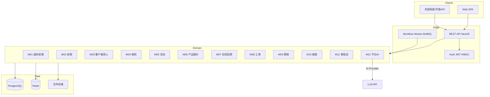

# 02 系统架构

## 1. 逻辑架构



---

## 2. 鉴权与安全

### 2.1 登录流

1. `POST /api/v1/auth/login` `{email, password}` → `{accessToken, refreshToken, user}`
2. `Authorization: Bearer <accessToken>` 访问 API
3. `POST /api/v1/auth/refresh` 刷新
4. 登出：拉黑 refresh（Redis jti）

密码：`bcrypt`（cost 12）。禁止明文日志密码/token。

### 2.2 授权模型

```
User --(n:n)-- Role --(n:n)-- Permission
User --belongs--> Department (树)
User.dataScope ∈ {SELF, TEAM, DEPARTMENT, ALL, CUSTOM}
```

**校验顺序（每个请求）：**

1. JWT 有效
2. 用户未禁用、租户有效
3. 功能权限 `permission`
4. 数据权限（列表自动过滤，单条再校验）

### 2.3 审计

写操作写入 `audit_logs`：
`{tenantId, userId, action, entity, entityId, before, after, ip, userAgent, at}`

---

## 3. 多租户隔离

**方案：共享库 + `tenant_id` 行级隔离（MVP）**

| 层 | 做法 |
|----|------|
| Prisma | Repository 基类强制 `where.tenantId` |
| Nest | `TenantGuard` 解析 JWT 注入 `req.tenantId` |
| 列表 | 追加 tenant + soft delete + data scope |
| 文件 | 路径 `/{tenantId}/{yyyy}/{id}` |
| 队列 Job | payload 必含 `tenantId` |
| 导出 | 文件名含 tenant 前缀 |

禁止手写 SQL 绕过租户条件；raw SQL 必须绑定参数并显式 tenant。

---

## 4. 模块边界（依赖规则）

```
auth/org  ← 被所有模块依赖
lead → account → opportunity → quote → contract → payment
activity, ticket, campaign 依赖 account/contact
report 跨模块只读，通过 Service 接口
workflow 被报价/合同/回款调用
platform 提供 webhook/api token，不反向依赖业务细节
```

- 横向模块禁止 import 其他模块的 Repository
- 共享逻辑放 `packages/shared` 或独立 Service 出接口
- 可选事件：`lead.converted`, `opportunity.stage_changed`, `contract.signed`

---

## 5. 核心跨模块事件

| 事件 | 生产者 | 消费者 | 载荷要点 |
|------|--------|--------|----------|
| `lead.assigned` | M02 | M11 通知 | leadId, ownerId |
| `lead.converted` | M02 | M03/M04 | accountId, opportunityId? |
| `opportunity.stage_changed` | M04 | M10/M12 | from, to, winRate |
| `opportunity.won` | M04 | M07 | opportunityId |
| `quote.submitted` | M06 | M11 | quoteId, discount |
| `contract.signed` | M07 | M07 | contractId |
| `payment.received` | M07 | M10 | paymentId, amount |

单号、幂等、Webhook/AI/定时任务等细则见 `13-spec-supplements.md`。
| `ticket.created` | M08 | M11 | ticketId, severity |

---

## 6. 文件与附件

- 表：`attachments`（entityType, entityId, fileName, mimeType, size, storageKey）
- MVP 本地磁盘；抽象 `StoragePort`，预留 S3
- 下载：`GET /api/v1/files/:id` 带权限校验

---

## 7. 可观测性

- 每请求 `x-request-id` 贯穿日志
- 多语言/移动规格见 `10-i18n-mobile.md`
- 登录、转化、阶段变更、审批、回款核销必须业务日志
- `GET /health`（db/redis）
