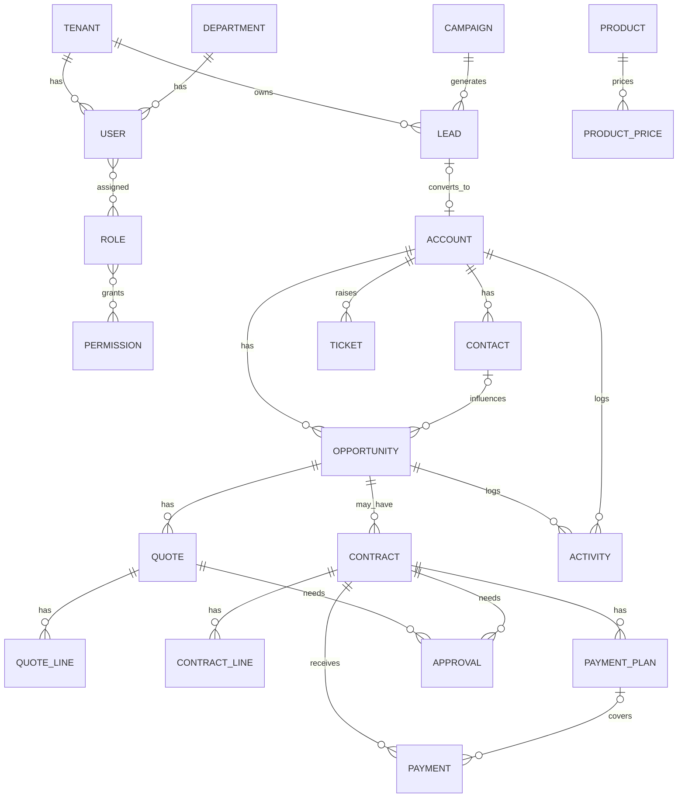

# 03 领域模型与状态机

## 1. 核心 ER（逻辑视图）



---

## 2. 标准对象一览

| 对象 | API 资源 | 主要关系 |
|------|----------|----------|
| Tenant | `/tenants` | 根 |
| User | `/users` | Department, Roles |
| Department | `/departments` | 树 |
| Role / Permission | `/roles`, `/permissions` | |
| Lead | `/leads` | Owner, Campaign, 转化产物 |
| Account | `/accounts` | Owner, ParentAccount |
| Contact | `/contacts` | Account |
| Opportunity | `/opportunities` | Account, Contact, Stage, Owner |
| Activity | `/activities` | 多态挂接 |
| Product / ProductPrice | `/products` | 价目 |
| Quote / QuoteLine | `/quotes` | Opportunity, Account |
| Contract / ContractLine | `/contracts` | Account, Opportunity? |
| PaymentPlan / Payment | `/payment-plans`, `/payments` | Contract |
| Ticket | `/tickets` | Account, Contact? |
| Campaign | `/campaigns` | |
| ApprovalInstance | `/approvals` | quote/contract/payment |
| Attachment | `/files` | 多态 |
| AuditLog | `/audit-logs` | 只读 |
| FieldMeta | `/field-definitions` | 自定义字段 |
| Webhook | `/webhooks` | 平台 |

---

## 3. 关键状态机

### 3.1 Lead.status

```
NEW ──accept──► ACCEPTED ──cultivate──► CULTIVATING ──convert──► CONVERTED
  │                │                        │
  └────close───────┴──────────close────────► CLOSED_LOST
```

| 状态 | 含义 | 允许转换 |
|------|------|----------|
| NEW | 新建未跟进 | ACCEPTED, CULTIVATING, CLOSED_LOST |
| ACCEPTED | 已接受/已分配 | CULTIVATING, CLOSED_LOST, CONVERTED |
| CULTIVATING | 培育中 | CONVERTED, CLOSED_LOST |
| CONVERTED | 已转化 | 终态 |
| CLOSED_LOST | 关闭 | 终态 |

非法转换 → `40900`。

### 3.2 默认管道「标准B2B管道」

| 顺序 | code | 名称 | 赢率% | 进入要求 |
|------|------|------|-------|----------|
| 1 | PROSPECTING | 初步接洽 | 10 | 下一步动作 |
| 2 | DISCOVERY | 需求确认 | 25 | 需求要点 |
| 3 | PROPOSAL | 方案/报价 | 50 | 至少一份报价 |
| 4 | NEGOTIATION | 谈判 | 75 | |
| 5 | WON | 赢单 | 100 | 金额>0 |
| 6 | LOST | 输单 | 0 | 失败原因 |

- 可前进/回退；进 WON/LOST 需 `opportunity:close`
- 每次变更写 `opportunity_stage_histories`
- 赢单引导创建合同

### 3.3 Quote.status

```
DRAFT → SUBMITTED → APPROVED → SENT → ACCEPTED
                 ↘ REJECTED → DRAFT
```

`ACCEPTED` 可生成合同。

### 3.4 Contract.status

```
DRAFT → APPROVING → EFFECTIVE → FINISHED
       ↘ REJECTED → DRAFT
EFFECTIVE 可终止 → TERMINATED
```

### 3.5 Payment.status

```
DRAFT → SUBMITTED → CONFIRMED → RECONCILED
       ↘ REJECTED → DRAFT
```

### 3.6 Ticket.status

```
NEW → PROCESSING → WAITING_CUSTOMER → RESOLVED → CLOSED
                 ↘ CLOSED
```

### 3.7 ApprovalInstance.status

```
PENDING → APPROVED | REJECTED | CANCELED | WITHDRAWN
```

---

## 4. Lead 转化规则

**输入：** `leadId`, `mode`: `create_account` | `link_account`，可选新建商机

1. 状态必须是 `ACCEPTED | CULTIVATING`
2. 同名客户可合并或新建（同租户 name 精确匹配提示）
3. 创建 Contact、Account、可选 Opportunity
4. Lead → CONVERTED，写转换外键
5. 转化后 Lead 只读
6. 事务原子

---

## 5. 金额计算（统一）

```
line.amount = qty * unitPrice * (1 - discountRate)   // discountRate 0~1
doc.subtotal = Σ line.amount
doc.taxAmount = subtotal * taxRate                   // 默认 0
doc.total = subtotal + taxAmount
```

- `discountRate > 0.2` 触发折扣审批（阈值可租户配置）
- 合同：`amountDue = total - receivedAmount`

---

## 6. 数据权限（行级）

| dataScope | 可见 |
|-----------|------|
| SELF | ownerId = me OR createdBy = me OR 参与人含 me |
| TEAM | 同 managerId 团队 |
| DEPARTMENT | 同部门树 |
| ALL | 全租户 |
| CUSTOM | 共享给我的（entity_shares） |

MVP 实现：`ownerId` + `departmentId` + `entity_shares` + 查询拼装。
