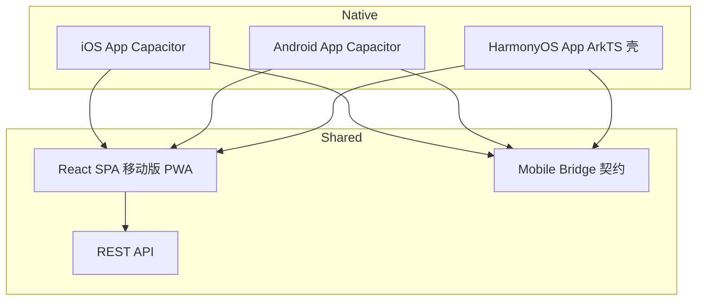

# 11 三端手机客户端规格（iOS / Android / HarmonyOS）

> 与 `10-i18n-mobile.md` 连续阅读。本文件锁定 **Apple iOS、Android、华为鸿蒙 HarmonyOS** 的交付形态、能力适配与验收。  
> **强制**：不得只交付「桌面网页缩一下」；三端安装/运行路径必须在规格内可验收。

---

## 0. 总原则

| 原则 | 含义 |
|------|------|
| 业务单源 | 仍只有一套 REST API、一套权限/状态机/金额规则 |
| 设计单源 | 同一设计 Token、同一移动 IA（底部 Tab） |
| 代码尽量共享 | iOS/Android 共享 Web/RN 代码；鸿蒙共享契约与部分逻辑 |
| 平台能力按需桥接 | 定位打卡、推送、相机、分享走 **Mobile Bridge** 抽象 |
| 商店合规 | 隐私协议、权限文案、数据出境/年审（国内安卓备案）写入发布清单 |

---

## 1. 交付矩阵（锁定）

| 阶段 | iOS (Apple) | Android | HarmonyOS | 说明 |
|------|:-----------:|:-------:|:---------:|------|
| P0 | Safari/PWA | Chrome/PWA | 浏览器/PWA（能装则装） | 响应式 Web，见规格 10 |
| P1 | **App Store 安装包** | **APK/AAB** | **鸿蒙安装包（.app / 上架 AGC）** | 三端原生壳 |
| P2 | 推送/小组件深化 | 推送/厂商通道 | 元服务、服务卡片 | 增强 |

**P1 是本次「要支持三端」的主交付**；P0 不作废，仍是迭代与内测最快路径。

---

## 2. 技术路线（锁定，不得自行换型）

### 2.1 主路线：Web 核心 + 原生壳（推荐默认）



| 端 | 壳技术 | 业务 UI | 包产物 |
|----|--------|---------|--------|
| **iOS** | Capacitor 6 + Swift 壳工程 | **同一 React SPA**（本地或远程 URL + 资源内置） | `.ipa` → App Store |
| **Android** | Capacitor 6 + Kotlin 壳 | 同上 | `.aab` / `.apk` → Play / 国内商店 |
| **HarmonyOS** | **DevEco + ArkTS** 薄壳（`Web` 组件） | 默认加载同一 SPA；打卡等原生页可用 ArkTS | `.app` → AppGallery Connect |

**为什么选这条：**

1. 与已锁定的 React/TS 栈 90%+ 复用，只需维护一套业务 UI + 词典  
2. 三端能力通过 **同一 Bridge 接口** 注入，平台差异隔离在壳工程  
3. 鸿蒙 NEXT 不能再跑 Android APK，单独 ArkTS 壳是现实约束下的最短合规路径  

### 2.2 备选（仅当主路线受阻，需用户批准）

| 备选 | 适用 | 代价 |
|------|------|------|
| React Native / Expo | 要更「原生」手势与列表性能 | 三端 UI 仍要兼顾；鸿蒙需额外方案 |
| Flutter（含 ohos 移植） | 一套 Dart 三端 | 与现有 React 栈分裂，AI 文档需重写 |
| 鸿蒙纯 ArkTS 重写移动 IA | 鸿蒙体验优先 | 双端双 UI，成本高 |

**默认不走备选。** 换型必须书面确认。

### 2.3 目录增量

```
apps/
  web/                      # 已有：移动响应式 + PWA
  mobile/
    capacitor.config.ts
    ios/                    # Capacitor iOS 工程（生成后入库必要文件）
    android/                # Capacitor Android 工程
packages/
  mobile-bridge/            # TS 接口 + mock + 契约测试
  harmony/
    EntryAbility/
    pages/                  # ArkTS 壳 + 可选原生打卡页
    webview/                # 加载 SPA 与 JS Bridge
```

---

## 3. Mobile Bridge（跨端能力契约）

`packages/mobile-bridge` 导出 TS 接口；Web 降级实现；壳实现原生。

```ts
export type PlatformId = 'web' | 'ios' | 'android' | 'harmony'

export interface MobileBridge {
  getPlatform(): PlatformId
  getAppVersion(): Promise<string>
  // 设备
  getDevice(): Promise<{ model: string; os: string; osVersion: string }>
  // 权限与定位（打卡）
  requestPermissions(names: Array<'location' | 'camera' | 'notify'>): Promise<Record<string, 'granted' | 'denied'>>
  getCurrentPosition(): Promise<{ lat: number; lng: number; accuracy: number }>
  reverseGeocode(lat: number, lng: number): Promise<{ address: string }>
  // 系统
  scanCode?(): Promise<{ text: string }>
  pickImage?(): Promise<{ uri: string; mime: string }>
  openExternal(url: string): Promise<void>
  callPhone(tel: string): Promise<void>
  shareText?(text: string): Promise<void>
  // 推送（P2 可先占位）
  registerPush?(): Promise<{ token: string | null }>
  // 存储
  secureGet(key: string): Promise<string | null>
  secureSet(key: string, value: string): Promise<void>
}
```

### 3.1 平台实现对照

| 能力 | Web/PWA | iOS Capacitor | Android Capacitor | HarmonyOS ArkTS |
|------|---------|---------------|-------------------|-----------------|
| getCurrentPosition | Geolocation API | CLLocationManager | FusedLocation / Geolocation | `@kit.MapKit` 或 `geoLocationManager` |
| reverseGeocode | 后端代理 / 浏览器受限 → 手工 | CLGeocoder | Geocoder | 地理编码 Kit 或后端统一代理 |
| camera/pickImage | `<input type=file>` | UIImagePicker | Photo Picker | PhotoViewPicker |
| callPhone | `tel:` | `tel:` / Native | `tel:` / Intent | `tel:` 或 `openLink` |
| 推送 | Web Push（P2） | APNs | FCM + 国内厂商 | Push Kit |
| 安全存储 | httpOnly Cookie 优先 | Keychain | Keystore | Universal Keystore |
| 热更新 UI | 静态资源可发版 | 可用远程 URL 策略（需审核） | 同左 | Web 资源同左 |

**规则：**

1. 业务代码 **只依赖 `MobileBridge`**，禁止 `if (platform === 'ios')` 散落业务  
2. 无 Bridge / 权限拒绝时必须降级（如打卡 → 手工地址）  
3. 坐标 WGS-84；国内若需 GCJ-02 显示，**只在展示层**转换并标注（打卡上传原始 WGS-84）  
4. 逆地理失败率高：**统一走后端** `POST /api/v1/geo/reverse`（可配高德/腾讯 key，key 不入库到前端）

---

## 4. 三端壳规格

### 4.1 通用

| 项 | 要求 |
|----|------|
| 环境 | `dev` / `staging` / `prod` 三配置；API Base 可切换 |
| 启动 | 原生 Splash ≤ 1.5s，再进 SPA |
| 版本 | `marketing`（1.2.3）+ `build`（整数）；与 `GET /health` 版本展示一致 |
| 深链 | `aicrm://app/leads/{id}` 等，登录后跳转 |
| 退出登录 | 清空 Bridge 安全存储与 WebView Cookie |
| 无障碍 | 主路径按钮有 accessibilityLabel（中/英） |
| 隐私 | 首次启动弹隐私协议；权限用到再申请；字典键 `privacy.*` |

### 4.2 iOS（Apple）

| 项 | 要求 |
|----|------|
| 最低系统 | iOS 15+ |
| 设备 | iPhone 优先，iPad 可用同一布局 |
| 工具 | Xcode 15+，Capacitor iOS |
| 必需权限文案 | `NSLocationWhenInUseUsageDescription`（打卡）、`NSCameraUsageDescription`（P1）、`NSPhotoLibraryUsageDescription` |
| 分发 | App Store Connect；开中国大陆区 |
| 合规 | ATT 如用 IDFA；隐私营养标签；账号删除入口（若可注册） |
| 推送 | APNs（P2） |

### 4.3 Android

| 项 | 要求 |
|----|------|
| 最低系统 | Android 8.0 (API 26) |
| 工具 | Android Studio + Capacitor Android |
| 权限 | `ACCESS_FINE_LOCATION`、`CAMERA`（P1）；运行时申请 |
| 打包 | 正式 AAB；调试 APK；**签名文件不入库** |
| 国内分发 | 华为/小米/OPPO/vivo 等；需 ICP/备案与隐私政策 |
| 目标 SDK | 按当年上架要求（文档保持 `targetSdk` 在 CI 可升级） |
| 推送 | FCM（海外）+ 厂商通道预留接口 |

### 4.4 HarmonyOS（鸿蒙）

| 项 | 要求 |
|----|------|
| 目标 | **HarmonyOS NEXT**（API 12+）；同时记录 HarmonyOS 3/4 可先用「Web 服务/云手机浏览」过渡 |
| 工具 | DevEco Studio + ArkTS |
| 壳 | `EntryAbility` + `Web` 组件加载 SPA（`file://` 资源或受控 https） |
| Bridge | ArkTS ↔ JS：`javaScriptProxy` / `postMessage` 对齐 `MobileBridge` |
| 权限 | `ohos.permission.APPROXIMATELY_LOCATION` / `LOCATION`；弹窗使用场景说明 |
| 分发 | AppGallery Connect（AGC）上架；应用市场签名 |
| 明确 | **不提供、不安装 Android APK**；鸿蒙 NEXT 与安卓生态隔离 |
| 可选增强 | 待办/跟进/打卡三个页面 ArkTS 原生重写（P2），接口仍同一 REST |

### 4.5 应用身份（示例）

| 项 | 值 |
|----|-----|
| 显示名 | 工作名 `AI-CRM` / 中文「智销 CRM」（可改，改后进词典 `app.name`） |
| Bundle ID / App ID | `com.example.aicrm`（发布前由用户定，写入配置） |
| 图标 | 1024 主图标，自动生成三端尺寸 |
| 主色 | `#2F6BFF`（与 Web 一致） |

---

## 5. 移动功能矩阵（三端一致）

功能定义同 `10-i18n-mobile.md` §4.3，此处只标**原生增强**：

| 功能 | Web/PWA | iOS | Android | HarmonyOS |
|------|:-------:|:---:|:-------:|:---------:|
| 底部 Tab 五入口 | ✓ | ✓ | ✓ | ✓ |
| 今日待办 / 快速跟进 | ✓ | ✓ | ✓ | ✓ |
| 商机改阶段 | ✓ | ✓ | ✓ | ✓ |
| 线索转化简化流 | ✓ | ✓ | ✓ | ✓ |
| 拜访打卡 GPS | 受限 | ✓ | ✓ | ✓ |
| 打卡手工地址降级 | ✓ | ✓ | ✓ | ✓ |
| `tel:` 拨号 | ✓ | ✓ | ✓ | ✓ |
| 双语 UI | ✓ | ✓ | ✓ | ✓ |
| 推送（P2） | 弱 | APNs | FCM/厂商 | Push Kit |
| 扫码（P2） | 相机受限 | ✓ | ✓ | ✓ |

---

## 6. 工程与 CI

| 项 | 约定 |
|----|------|
| 共享 | `packages/shared` + `packages/mobile-bridge` 被 Web 与鸿蒙文档共用 |
| 构建 Web | `pnpm -C apps/web build` 产物同步进 Capacitor `www/` 与鸿蒙 `rawfile/` |
| 构建 iOS | `pnpm mobile:ios:open` + fastlane（可选） |
| 构建 Android | `pnpm mobile:android:build` |
| 构建 HarmonyOS | DevEco 命令行或文档化手工打包步骤（`docs` 附录） |
| 版本 | 三端 build 号建议统一 `date+git`；提交说明含 `app(version)` |
| 秘钥 | 证书/Profiles/签名/推送证书不进 Git；用 `docs/secrets-checklist.md` 占位索引 |

**npm scripts（建议）：**

```bash
pnpm mobile:build:web          # 构建 SPA
pnpm mobile:sync:cap           # 同步 iOS/Android www
pnpm mobile:ios                # 打开 Xcode
pnpm mobile:android            # Gradle assemble
pnpm mobile:harmony:sync       # 同步 rawfile 到鸿蒙工程
```

---

## 7. 权限与隐私文案（词典键）

必须同时提供 zh-CN / en-US：

```
permission.location.title
permission.location.whenInUse
permission.camera.title
privacy.policy.title
privacy.consent.agree
app.name
```

示例（zh-CN）：  
- 打卡定位：`用于记录拜访位置，仅在您打卡时获取。`  
- 相机：`用于上传合同或名片照片。`

---

## 8. 发布清单（三端）

- [ ] 隐私政策与用户协议 URL 可访问（中/英）
- [ ] 隐私政策内声明：定位用途、数据存储地、第三方 SDK（地图/推送）
- [ ] iOS 隐私营养标签与权限文案
- [ ] Android 国内上架：备案、隐私、权限用途
- [ ] HarmonyOS AGC：权限用途、隐私、应用分类
- [ ] 版本号、更新说明（zh/en）
- [ ] 账号注销/退出与本地数据清理
- [ ] 弱网启动超时提示（词典 `error.network`）

---

## 9. 测试与 DoD（三端）

### 9.1 Bridge 契约测试（必须）

对 `MobileBridge` 每个方法：mock 壳 + web 降级行为一致（权限拒绝、超时）。

### 9.2 真机冒烟（每端至少 1 台）

| 步骤 | 期望 |
|------|------|
| 安装启动 | 进登录页，中/英可切 |
| 登录 | 进工作台底部 Tab |
| 新建跟进 | 成功写入并出现在时间线 |
| 打卡 | 有定位写入坐标；拒绝定位可手工地址 |
| 电话 | 拉起系统拨号 |
| 杀进程再进 | 会话保持或回到登录且提示清晰 |
| 弱网 | 可读缓存壳 + 错误文案 |

### 9.3 切片 DoD 增量

- [ ] 新原生能力已进 Bridge，不在业务层写平台分支
- [ ] 三端 Deep Link 至少：`/login`, `/home`, `/accounts/:id`, `/opportunities/:id`
- [ ] 三端应用名/图标/启动页一致品牌
- [ ] iOS/Android/鸿蒙 各附 30 秒冒烟录屏或截图集（放 `docs/evidence/`）

---

## 10. 里程碑增量（并入 08）

| 里程碑 | 增量任务 |
|--------|----------|
| **M0.5 三端壳（Week 0.5–1）** | Capacitor iOS/Android 工程、鸿蒙 ArkTS Web 壳、MobileBridge mock、双语应用名、调试 API 切换 |
| **M1** | 打卡 Bridge（定位+手工）、iOS/Android 权限文案 |
| **M2** | 鸿蒙壳联调商机改阶段；深链 |
| **M6** | 三端真机冒烟、隐私/发布清单、（可选）推送占位 |
| **M6+ 商店包** | TestFlight / 内测 APK / AGC 测试；用户证书与上架（需用户侧） |

---

## 11. 风险

| 风险 | 缓解 |
|------|------|
| 鸿蒙 WebView 与 Chrome/Safari 兼容差异 | 仅用保守 CSS；三端截图对比 |
| App Store 审核拒（动态化/隐私） | 资源可内置；隐私标签完整；避免热改原生代码 |
| 国内安卓碎片与保活 | 不做保活；通知走正规通道 |
| 定位纠偏坐标系 | 统一 WGS-84 上传；展示层可选转换 |
| 三端商店账号/证书 | **用户负责**；文档只给清单 |
| Capacitor 远程 URL 审核风险 | P1 默认 **内置资源**，远程仅开发构建 |

---

## 12. 与其他文档修订点

安全基线与限流见 `13-spec-supplements.md` §11–12；单号/幂等见同文件 §1–2。

| 文件 | 修订 |
|------|------|
| `10-i18n-mobile.md` | P1/P2 形态改为引用本文件 |
| `00-product-brief` | 「明确不做原生」改为「P1 三端安装包」 |
| `01-tech-stack` | Capacitor / DevEco ArkTS / mobile-bridge |
| `07-dev-guide` | 禁止散落平台分支；Bridge 优先 |
| `08-milestones` | M0.5 三端壳 |
| `09-acceptance` | AC-10 三端冒烟 |
