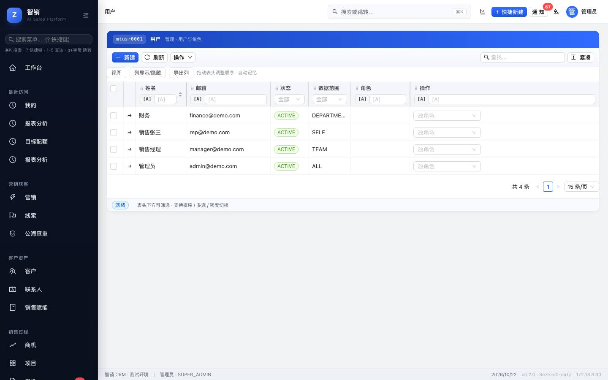
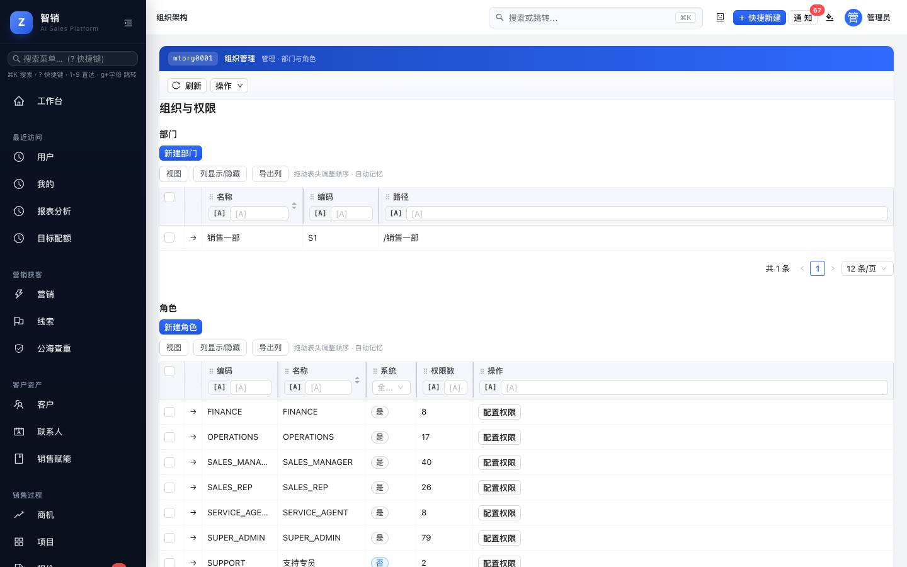
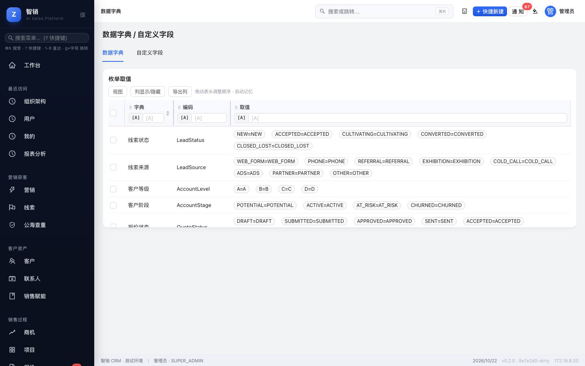
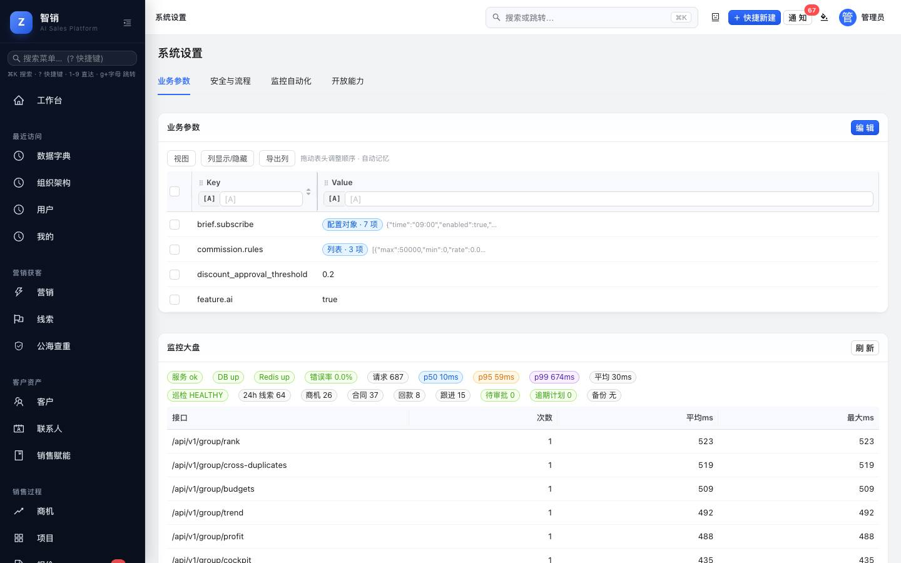
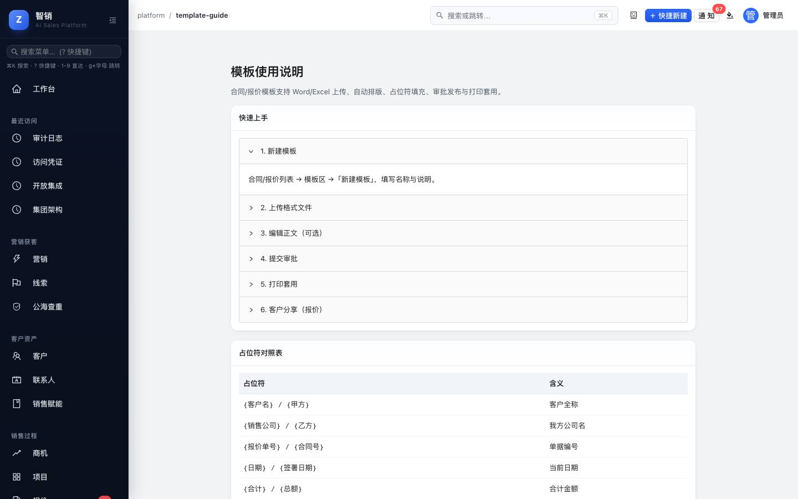
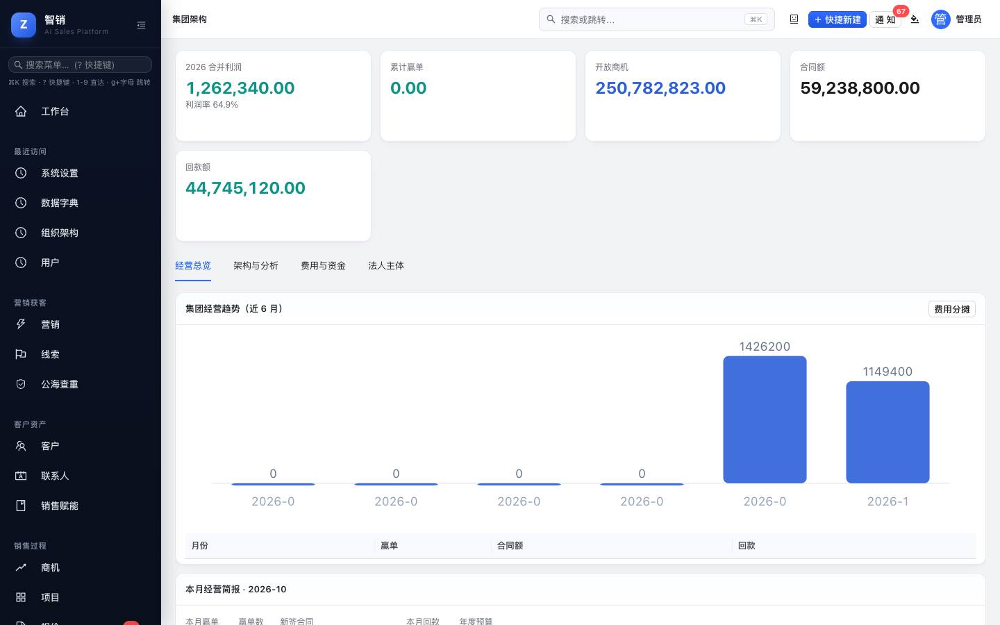
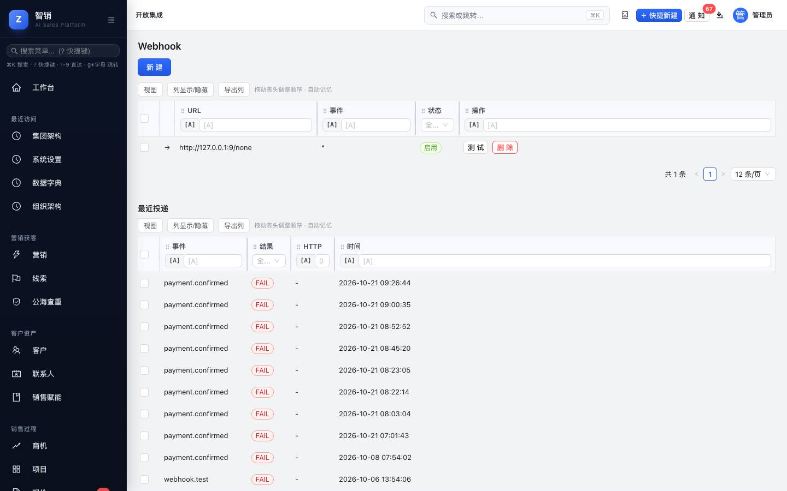
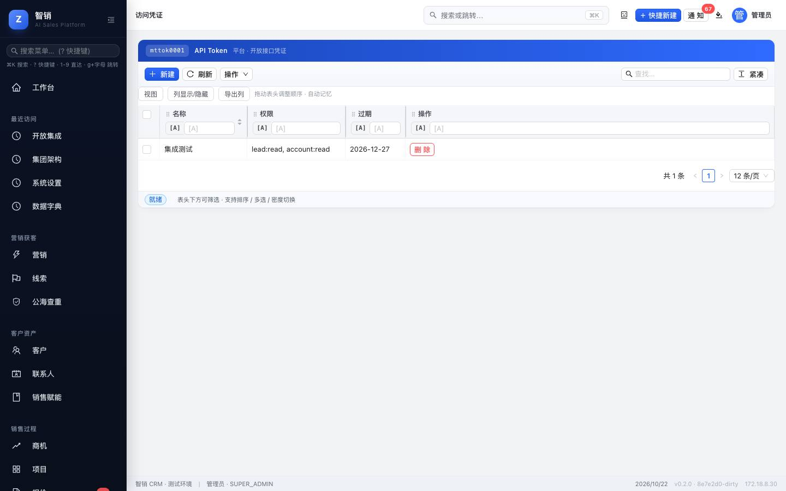
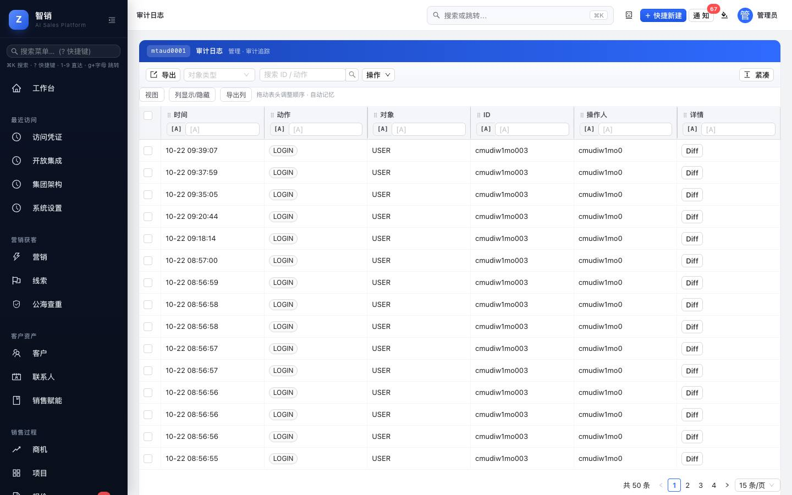
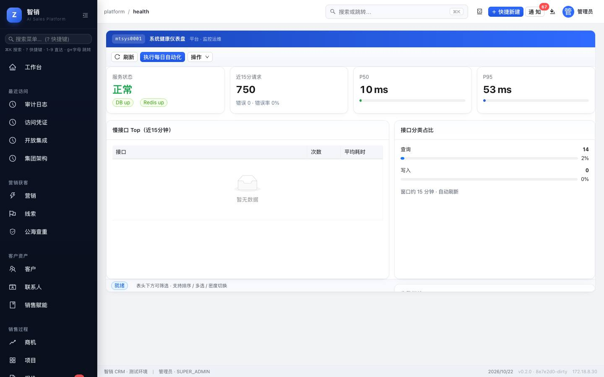

# 智销 CRM 管理员手册

> 适用版本：v0.2.0 及以后 · 适用对象：系统管理员（超级管理员角色 `SUPER_ADMIN`）
> 日常业务操作见《[用户手册](user-manual.md)》；服务器部署、备份与安全运维见仓库根目录 `README.md` 的「部署」一节。

## 目录

1. [管理员职责与入口](#1-管理员职责与入口)
2. [上线初始化清单](#2-上线初始化清单)
3. [用户](#3-用户)
4. [组织：部门与角色权限](#4-组织部门与角色权限)
5. [数据权限与共享](#5-数据权限与共享)
6. [字段：数据字典与自定义字段](#6-字段数据字典与自定义字段)
7. [系统设置（平台管理）](#7-系统设置平台管理)
8. [模板管理](#8-模板管理)
9. [集团多主体](#9-集团多主体)
10. [开放集成：Webhook 与 Token](#10-开放集成webhook-与-token)
11. [审计日志](#11-审计日志)
12. [系统健康仪表盘](#12-系统健康仪表盘)
13. [数据导入与导出](#13-数据导入与导出)
14. [安全建议](#14-安全建议)
15. [常见问题](#15-常见问题)

---

## 1. 管理员职责与入口

管理功能集中在左侧菜单 **平台管理** 分组：

| 菜单 | 用途 |
|------|------|
| 集团 | 法人主体、预算、资金、费用、合并报表 |
| 组织 | 部门树、角色与权限 |
| 用户 | 账号、角色、数据范围、启停 |
| 字段 | 数据字典、自定义字段、枚举取值 |
| Webhook | 向外部系统推送业务事件 |
| Token | 外部系统调用 API 的访问凭证 |
| 系统健康仪表盘 | 服务状态、接口性能、慢接口 |
| 模板使用说明 | 报价 / 合同模板的制作方法 |
| API 文档 | 接口目录与调用示例 |
| 审计 | 谁在什么时候改了什么 |
| 平台管理 | 系统设置：业务参数、审批阈值、电子签、自动化、修改密码 |

> 所有用户看到的菜单相同，但非管理员打开管理页面时，后台会按角色权限拒绝查看或修改。

---

## 2. 上线初始化清单

新环境交付给业务使用前，按顺序完成：

1. **修改超级管理员密码**（平台管理 → 安全与流程 → 修改密码）。演示账号的默认密码是公开的。
2. **停用不用的演示账号**（见 [3.3](#33-停用与启用)）。
3. **建部门树**（[4.1](#41-部门)），再 **建用户** 并分配角色与数据范围（[3](#3-用户)）。
4. **核对角色权限**（[4.2](#42-角色与权限)），按公司分工调整。
5. **设置报价审批阈值**：折扣率与金额（[7.2](#72-安全与流程)）。
6. **维护产品与价目**（商务履约 → 产品价格）。
7. **上传报价 / 合同模板**（[8](#8-模板管理)）。
8. 如需对接其他系统，配置 **Webhook / Token**（[10](#10-开放集成webhook-与-token)）。
9. 用一个销售账号走一遍「线索 → 商机 → 报价 → 合同 → 回款」，确认权限与流程符合预期。

---

## 3. 用户

菜单：**平台管理 → 用户**。

### 3.1 新建用户

1. 点 **新建**，填写 **姓名**、**邮箱**（登录名）、**电话**、**初始密码**（至少 8 位）、**数据范围**。
2. 保存后，在列表的 **角色** 列下拉选择一个或多个角色，选中即生效。
3. 把邮箱与初始密码通过安全渠道告知本人。

### 3.2 内置角色

| 角色 | 编码 | 典型权限 |
|------|------|----------|
| 超级管理员 | `SUPER_ADMIN` | 全部权限 |
| 销售经理 | `SALES_MANAGER` | 线索分配与转化、客户共享、商机推进与预测、报价与合同、回款登记、审批同意 / 驳回、目标查看、自定义字段查看 |
| 销售 | `SALES_REP` | 本人线索、客户、联系人、商机、跟进打卡；报价新建与提交；查看合同与回款、目标、自定义字段 |
| 运营 | `OPERATIONS` | 线索分配、产品与价目、管道配置、营销活动与表单、自定义字段 |
| 财务 | `FINANCE` | 合同查看、回款登记 / 确认 / 核销、报价查看、报表 |
| 客服 | `SERVICE_AGENT` | 客户与联系人查看、工单处理与流转、跟进记录、自定义字段查看 |

一个用户可以有多个角色，权限取并集。

> 所有登录用户都能读取在职同事的**姓名**（用于显示负责人、分配与筛选），不需要任何权限点；邮箱、电话等完整资料仍需「用户查看」权限。

### 3.3 停用与启用

点用户行首 **→** 打开编辑，**状态** 选 `DISABLED` 保存即停用；**立即生效**，该账号无法再登录，已登录的页面下一次操作也会被退出。改回 `ACTIVE` 恢复。

> 离职员工请**停用而不是删除**，以保留其历史数据与审计记录；需要时把其客户转给他人（[5.3](#53-转移负责人)）。

### 3.4 密码

- 新用户的初始密码在新建时设置。
- 所有角色都可在 **平台管理 → 安全与流程 → 修改密码** 修改自己的密码（需输入当前密码）。
- **忘记密码**：在 **用户** 列表该行点 **重置密码**，输入新密码（至少 8 位）。重置后通过安全渠道告知本人，并提醒其登录后自行修改。需要「用户编辑」权限，只能重置本租户的用户。

---

## 4. 组织：部门与角色权限

菜单：**平台管理 → 组织**。

### 4.1 部门

**新建部门**：填写 **名称**、**编码**、**上级** 部门，形成部门树。部门用于「部门」数据范围与报表的团队维度。

### 4.2 角色与权限

- 角色列表显示 **编码**、**名称**、是否 **系统** 内置、**权限数**。
- **新建角色**：填写编码与名称后，点 **配置权限** 勾选该角色拥有的权限点。
- 内置角色也可调整权限，但建议复制出自定义角色再改，便于回溯。

权限点按模块划分，主要有：

| 模块 | 权限点（示例） |
|------|----------------|
| 组织 | 用户查看 / 编辑 / 删除，部门、角色、系统设置的查看与编辑 |
| 线索 | 查看、编辑、删除、分配、转化、关闭 |
| 客户 / 联系人 | 查看、编辑、删除、共享 |
| 商机 | 查看、编辑、删除、改阶段、关闭（赢 / 输）、提交预测 |
| 报价 | 查看、编辑、删除、提交、发送、接受 |
| 合同 / 回款 | 合同查看 / 编辑 / 删除 / 生效 / 完结；回款登记 / 确认 / 核销 |
| 工单 | 查看、编辑、删除、流转 |
| 营销 | 活动与表单的查看、编辑、删除 |
| 审批 | 查看、同意、驳回、撤回、定义审批流 |
| 平台 | Webhook、Token、自定义字段、文件上传 / 下载、审计查看 |

> 权限修改**立即生效**，用户刷新页面即可，无需重新登录。

---

## 5. 数据权限与共享

### 5.1 数据范围

每个用户有一个 **数据范围**，决定能看到哪些记录：

| 数据范围 | 能看到 |
|----------|--------|
| 本人 `SELF` | 自己负责的记录 |
| 团队 `TEAM` | 自己 + 直属下级负责的记录 |
| 部门 `DEPARTMENT` | 本部门（含下级部门）的记录 |
| 全部 `ALL` | 全公司（本租户）所有记录 |

功能权限（能不能做）与数据范围（能对哪些数据做）同时生效。

### 5.2 共享

负责人或管理员可把单个客户 / 商机 **共享** 给其他人：**协作者** 可编辑，**查看者** 只读。适合跨团队协作的大客户。

### 5.3 转移负责人

编辑客户、商机、线索时修改 **负责人** 即可转移；线索也可勾选后 **批量分配**。离职交接时建议先在列表按原负责人筛选，再逐批处理。

### 5.4 集团主体权限

启用集团功能后，可限定用户只能看到某些法人主体下的客户（见 [9](#9-集团多主体)）。未配置时不限制。

---

## 6. 字段：数据字典与自定义字段

菜单：**平台管理 → 字段**。

| 页签 | 用途 |
|------|------|
| 数据字典 | 查看系统各对象的字段与枚举取值（如线索状态、来源） |
| 自定义字段 | 给客户、线索、商机、联系人增加扩展字段 |

**新建自定义字段**：

1. 自定义字段页签 → **新建**。
2. 选择 **对象**（ACCOUNT 客户 / LEAD 线索 / OPPORTUNITY 商机 / CONTACT 联系人），填写 **API 名**（英文，如 `industryCode`）、**标签**（界面显示名）、**类型**（文本 / 数字 / 日期 / 枚举）、是否 **必填**。
3. 保存后，该字段出现在对应对象的详情页供填写。

**编辑**：点行首 **→**。创建后只能修改 **标签** 和 **必填**；对象、API 名、类型不可改（避免已有数据失效）。不再使用的字段把 **启用** 开关关掉即可隐藏。

---

## 7. 系统设置（平台管理）

菜单：**平台管理 → 平台管理**（即系统设置）。

### 7.1 业务参数

以「配置键 / 值」形式维护的业务开关：

| 配置键 | 默认值 | 含义 |
|--------|--------|------|
| `discount_approval_threshold` | `0.2` | 报价任一行折扣率**超过**此值即需审批（0.2 = 20%） |
| `amount_approval_threshold` | `200000` | 报价总额**达到**此值即需审批（在「安全与流程 → 审批流配置」中修改） |
| `contract_approval_amount` | `100000` | 合同额**达到**此值时，点「生效」先进入审批；设为 `0` 关闭合同金额审批 |
| `lead.assign_rule` | `LOAD_BALANCE` | 线索自动分配规则：`LOAD_BALANCE` 分给未关闭线索最少的销售；`ROUND_ROBIN` 按顺序轮流；`MANUAL` 关闭自动分配 |
| `lead.assign_on_create` | `true` | 非销售人员（管理员、经理、官网表单、导入）创建的线索是否立即分给销售；销售自己录入的始终归本人 |
| `file.max_size_mb` | `10` | 单个附件大小上限（MB），最大 100 |
| `quote.no_prefix` / `contract.no_prefix` / `payment.no_prefix` / `ticket.no_prefix` | `QT` / `HT` / `SK` / `GD` | 单号前缀，1–8 位字母、数字或短横线；修改后新单据使用新前缀，已有单号不变 |
| `i18n.default_locale` | `zh-CN` | 新建用户的默认语言（`zh-CN` 或 `en-US`） |

> 线索自动分配**只分给角色为「销售」（`SALES_REP`）的在职用户**；租户里没有销售时不会自动分配。

点值旁的 **编辑** 修改，保存即时生效。

#### 多币种与汇率

同一页的 **多币种与汇率** 卡片：

1. **本位币**：报表、业绩、佣金、预测统一折算成本位币汇总，默认人民币（CNY）。只能在录入第一条汇率之前修改。
2. **录入汇率**：选币种，填「1 单位该币种 = 多少本位币」（如 1 USD = 7.2 CNY 填 7.2）和生效日期。同一币种可录多条，按日期生效。
3. 录入汇率后，新建商机、报价、合同时就能选这个币种；报价和合同不选时沿用关联商机的币种。**没有汇率的外币不允许保存**。
4. 折算规则：单据保存时按单据日期当天或之前最近的一条汇率折算并记下来（合同按签约日，回款按回款日，回款计划跟随合同）。之后再改汇率**不影响已折算的单据**；如果是补录或更正汇率，点 **重新折算** 按当前汇率表重算全部单据。
5. 各单据详情显示原币金额和币种；报表中的金额都是本位币。
6. **每日自动更新**：打开开关并选择币种，系统每天 07:30 从欧洲央行参考汇率（工作日公布，约 30 种货币）拉取并按公布日期录入，也可点 **立即更新**。同一天已手工录入的汇率优先，不会被覆盖；汇率表「来源」列区分手工与自动。服务器需能访问 `api.frankfurter.dev`。

### 7.2 安全与流程

- **修改密码**：修改当前登录管理员自己的密码。
- **审批流配置**：设置报价的 **折扣审批阈值**（任一行折扣超过则走审批）与 **金额审批阈值**（报价总额 ≥ 则走审批），点 **保存阈值**；下方列出各审批流及启用状态。
  - **谁来审批**：报价审批定义为两级——第 1 级为申请人的直属上级，第 2 级为上级的上级（停用的上级会被跳过、继续向上找）。上级链不够长时，缺的那级交给一位尚未参与该审批的超级管理员；申请人不能审批自己的报价，同一人不会被安排两级。因此请为每位用户在 **用户** 中设置好 **上级**。
  - 如果找不到任何可用的审批人（例如租户里唯一的超级管理员自己提交需审批的报价），提交会被拒绝，提示「找不到可用的审批人」。需要时请再添加一位超级管理员。
  - **合同金额审批**：合同额达到 `contract_approval_amount`（默认 10 万）时，点 **生效** 后合同进入「审批中」，审批人规则与报价相同（以点「生效」的人为申请人）；全部通过后自动生效，被驳回的合同可修改后点 **重新提交**。未达到金额的合同点 **生效** 直接生效。在审批流列表中停用「合同金额审批」可关闭此审批。合同 **变更单** 另有审批。
- **电子签服务商**：选择 **内置用印（本地）**、**e签宝** 或 **法大大**，填写机构号与回调地址并启用。使用第三方服务商需先与其签约获取账号。

### 7.3 监控与自动化

- **监控大盘**：服务状态、数据库与缓存连接，点 **刷新** 更新。
- **销售自动化**：系统每天会定时执行以下任务，这里可手动立即执行一次：

| 按钮 | 作用 |
|------|------|
| 线索自动分配 | 把滞留的新线索（状态仍为「新建」，且下次跟进已逾期 7 天，或创建超过 3 天仍未设跟进时间）按 `lead.assign_rule` 重新分给**销售**，每次最多 50 条；规则为 `MANUAL` 时不执行 |
| 生成续费商机 | 为即将到期的合同生成续费商机 |
| 跟进超时提醒 | 给逾期未跟进的负责人发提醒 |
| 客户旅程自动化 | 按客户阶段触发旅程动作 |
| 漏斗自动推进 | 处理满足条件的商机阶段推进与停滞提醒 |
| 一键跑当日自动化 | 依次执行以上全部 |

公海自动回收（线索 7 天未跟进、客户 30 天无活动）也在每日任务中执行。

- **群机器人通知**：把系统通知自动转发到企业微信、钉钉或飞书群。
  1. 在群设置里添加「自定义机器人」（企业微信：群机器人；钉钉：自定义机器人，安全设置建议选「加签」；飞书：自定义机器人），复制 Webhook 地址。
  2. 点 **新建**，选渠道、粘贴地址；钉钉 / 飞书选了加签就填密钥；勾选要转发的通知分类（审批、线索、报价、合同、回款、客户运营、商机漏斗、系统）。
  3. 点 **发送测试消息**，群里收到即配置正确。之后每条站内通知都会按分类转发到群，并注明接收人。
  4. 地址只接受三家官方域名；密钥保存后不会再显示。
- **手机推送**：显示 iOS（APNs）、Android（FCM）与鸿蒙（华为 Push Kit）推送是否已配置。凭证由运维在服务器环境变量里设置（见仓库 README「配置项」与 `docs/18-mobile-build.md`）。配置后，站内通知会同时推送到接收人已登录的手机 App，点推送直接打开对应单据。

### 7.4 开放能力

开放 API 说明与 **复制 curl 示例**；接口目录见 **平台管理 → API 文档**。

#### 企业微信 / 钉钉 / 飞书：通讯录同步与扫码登录

同一页的 **企业微信 / 钉钉 / 飞书** 卡片。每个平台需要先在其后台创建「企业自建应用」：

| 平台 | 要填的凭证 | 需要开通 / 登记 |
|------|-----------|----------------|
| 企业微信 | 企业 ID（CorpID）、AgentId、Secret | 应用「可见范围」决定能同步的部门与成员；在「企业微信授权登录」中设置可信域名 |
| 钉钉 | Client ID（AppKey）、Client Secret | 通讯录只读、个人手机号等权限；在「登录与分享」添加回调地址 |
| 飞书 | App ID、App Secret | 通讯录读取权限与数据范围；在「安全设置」添加重定向 URL |

1. 点 **配置**，填好凭证，打开 **启用**，保存后点 **测试连接**。
2. 把卡片上显示的 **扫码回调地址**（形如 `https://你的域名/login/sso/wechat_work`）登记到平台后台。
3. 点 **立即同步**，或打开 **每天自动同步通讯录**（每天 02:30）。同步规则：
   - 部门按平台的部门树建立或更新（只改名称与上级，不删除 CRM 自己建的部门）。
   - 成员先按已绑定账号、再按邮箱、再按手机号匹配已有用户，匹配上就记录绑定并更新所在部门。
   - CRM 里没有的人建为**停用账号**（登录邮箱是占位地址），由管理员核对后在 **用户** 中启用、改邮箱并分配角色。
   - 平台上离职或禁用的人在 CRM 中自动停用；若一次要停用的人数异常（超过 30%），本次跳过停用并提示，请检查应用的可见范围。
4. 启用后，登录页出现 **企业微信扫码登录** 等按钮。扫码后按「已绑定账号 → 邮箱 → 手机号」找到在职用户并登录；找不到时提示联系管理员。登录页地址带 `?tenant=租户编码` 可指定租户（单租户部署无需）。
5. 用户也可在 **我的 → 第三方账号绑定** 自行绑定或解绑。一个平台账号只能绑定一个 CRM 用户。

> 密钥加密保存，保存后不再显示。扫码登录记录在审计日志中；每次同步的结果显示在卡片的「上次同步」。

---

## 8. 模板管理

报价模板在 **报价 → 操作 → 报价模板管理**，合同模板在 **合同 → 合同模板** 页签。

1. 新建模板，填写名称与类型（标准 / 渠道 / 定制）。
2. 上传 Word（.docx）或 Excel（.xlsx）格式文件，系统自动解析为可编辑正文，保留标题、表格、字号等排版。
3. 在正文中插入占位符（客户名称、金额、产品明细等），打印时自动填充。
4. 模板可 **发布 / 取消发布**、**共享给团队**，修改有 **版本历史** 可对比和恢复；需要时可开启模板审批。

详细的占位符对照表、格式支持与常见问题见 **平台管理 → 模板使用说明**。

> 旧版 .doc / .xls 只能尽力解析，排版可能走样，建议另存为 .docx / .xlsx 后再上传。

---

## 9. 集团多主体

菜单：**平台管理 → 集团**。适用于有多个法人主体（子公司、分公司）的企业。

| 页签 | 内容 |
|------|------|
| 经营总览 | 各主体累计赢单、开放商机、合同额、回款、利润与利润率；**驾驶舱大屏** 可投屏展示 |
| 架构与分析 | 主体层级树、主体能力对比、目标分摊 |
| 费用与资金 | 年度预算与执行、费用报销与审批、跨主体资金调拨、资金池、共享费用分摊 |
| 法人主体 | 维护主体档案；把客户归属到主体；设置用户可见的主体范围 |

合并报表可导出 CSV / PDF（集团报表页）。

---

## 10. 开放集成：Webhook 与 Token

### 10.1 Webhook（推送事件给外部系统）

菜单：**平台管理 → Webhook**。

1. **新建**：填写 **URL**（接收地址）、**事件**（逗号分隔，`*` 为全部）、**Secret**（签名密钥）。
2. **测试**：向该地址发送一条测试事件，结果记在投递日志中。
3. 接收方应校验请求头 `X-ZhiXiao-Signature`（格式 `t=时间戳,v1=HMAC-SHA256`），防止伪造。
4. 投递失败会记录响应码，可在日志中排查。

### 10.2 Token（外部系统调用 API）

菜单：**平台管理 → Token**。

- **新建** 时填写名称（建议写明给哪个系统用），生成的 Token **只显示一次**，请立即复制保存到对方系统。
- 不用的 Token 及时停用；怀疑泄露时立即停用并重新生成。

---

## 11. 审计日志

菜单：**平台管理 → 审计**。

所有写操作（新建、修改、删除、状态变化）都会记录：操作人、时间、对象、操作类型，以及 **字段级变更详情**（修改前 → 修改后）。可按对象类型、操作人、时间筛选并导出。

---

## 12. 系统健康仪表盘

菜单：**平台管理 → 系统健康仪表盘**。

- **服务状态**：数据库、缓存是否正常
- **近 15 分钟请求**：请求量、P50 / P95 响应时间
- **慢接口 Top**、**接口分类占比**
- **告警阈值**：超过阈值时在工作台与通知中预警

底部状态栏与 `/api/v1/health` 都会显示当前运行的版本号与提交哈希，部署后可据此确认线上版本。

---

## 13. 数据导入与导出

- **导入**：商务履约 → 数据导入，支持线索、联系人、客户 CSV（UTF-8），按名称 / 邮箱 / 手机去重。大批量导入前先用 10 条试导。
- **导出**：各列表 **导出列** / **操作** 菜单可导出 CSV、Word、PDF；报表页右上角导出 CSV。导出范围受导出人的数据权限限制。

---

## 14. 安全建议

- 管理员账号只给必要的人；日常业务使用普通角色账号。
- 定期在 **审计** 中抽查敏感操作（删除、权限变更、批量导出）。
- 离职立即 **停用** 账号，并转移其客户与商机。
- Token、Webhook 密钥只经安全渠道传递，不写进邮件正文或聊天记录。
- 服务器、数据库、Redis、运维面板等基础设施密码由运维保管，不写入代码与文档（上线前检查见 README「上线前安全检查」）。

---

## 15. 常见问题

| 问题 | 处理 |
|------|------|
| 用户说看不到某些数据 | 检查其 **数据范围**；或请负责人 **共享**；集团模式下检查主体可见范围 |
| 用户操作提示「missing permission」 | 给其角色补充对应权限点，用户刷新页面即可 |
| 报价不需要 / 需要审批的判断不对 | 检查 **审批流配置** 的折扣阈值（0.2 表示 20%）与金额阈值；两者满足其一即需审批 |
| 线索没有自动分配 | 检查 `lead.assign_rule` 不是 `MANUAL`、租户里有在职的「销售」角色用户；销售自己录入的线索归本人，不会被分配 |
| Webhook 对方收不到 | 用 **测试** 查看投递日志中的响应码；确认对方地址能从服务器访问 |
| 用户忘记密码 | **用户** 列表点 **重置密码**，见 [3.4](#34-密码) |
| 提交报价 / 合同生效提示「找不到可用的审批人」 | 申请人没有上级且没有其他超级管理员；为其设置上级，或再添加一位超级管理员 |
| 某个角色收不到通知 | 通知对所有登录用户开放（2026-10-22 之前的版本只有带「审批查看」权限的角色能看），部署新版后即可 |
