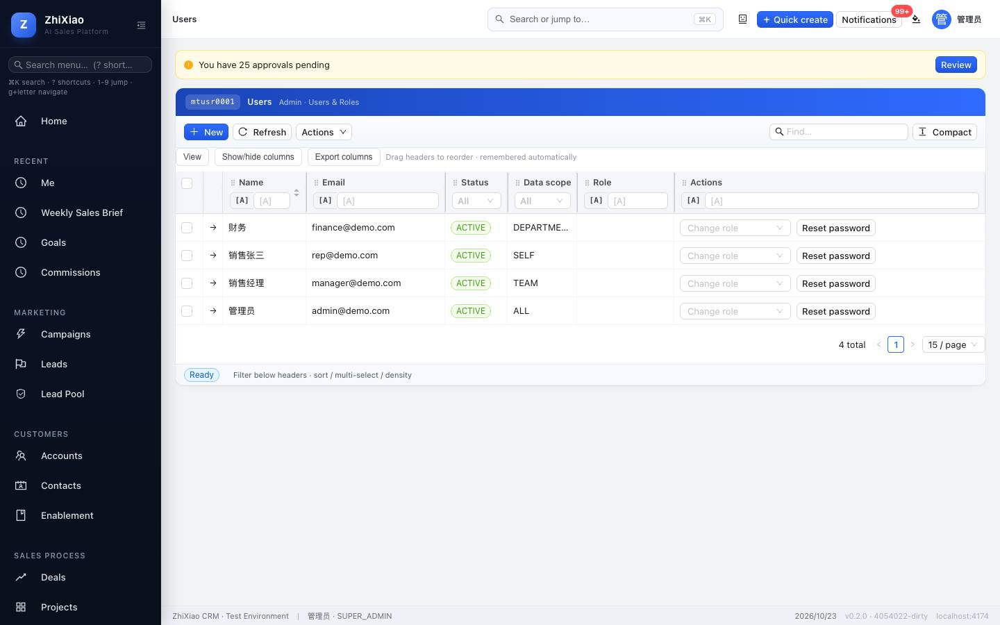
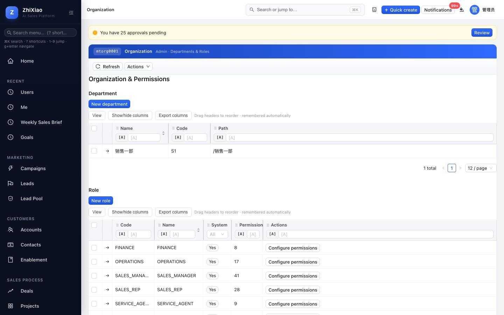
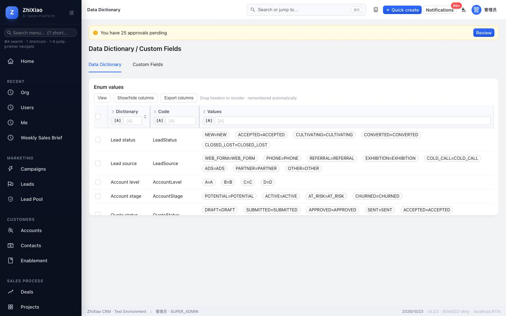
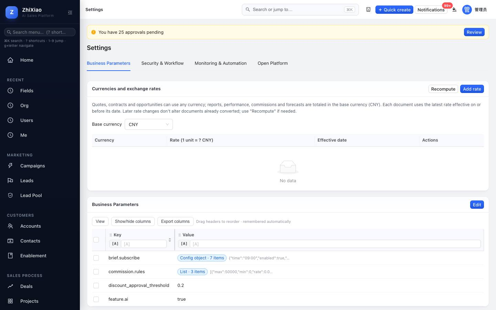
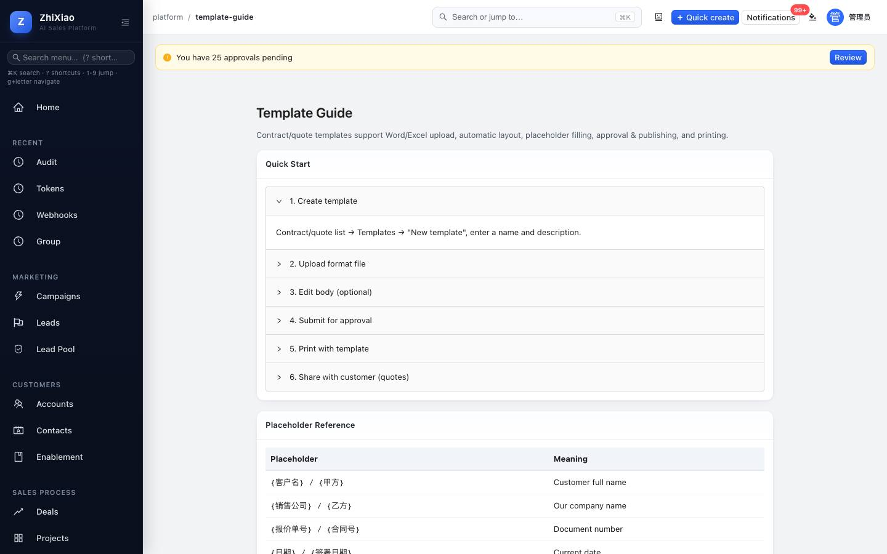
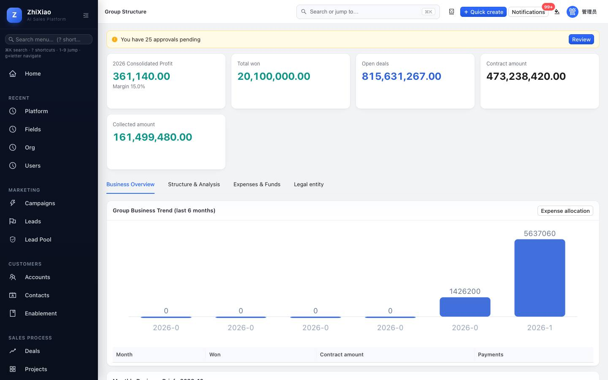
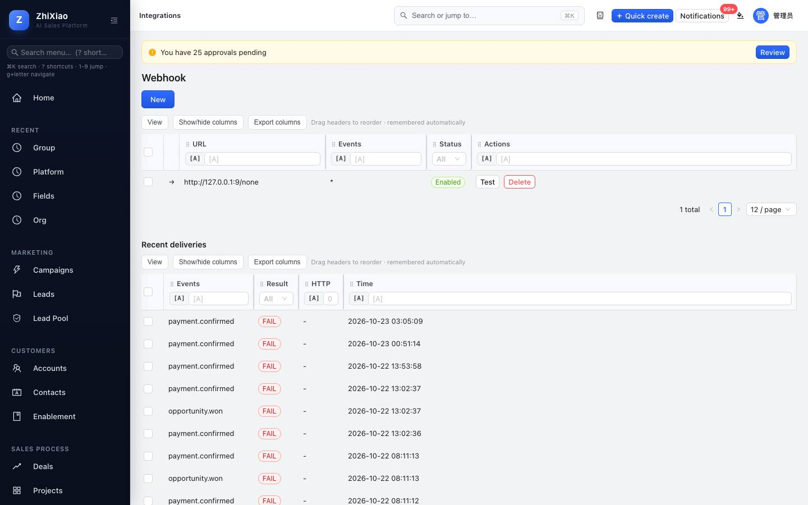
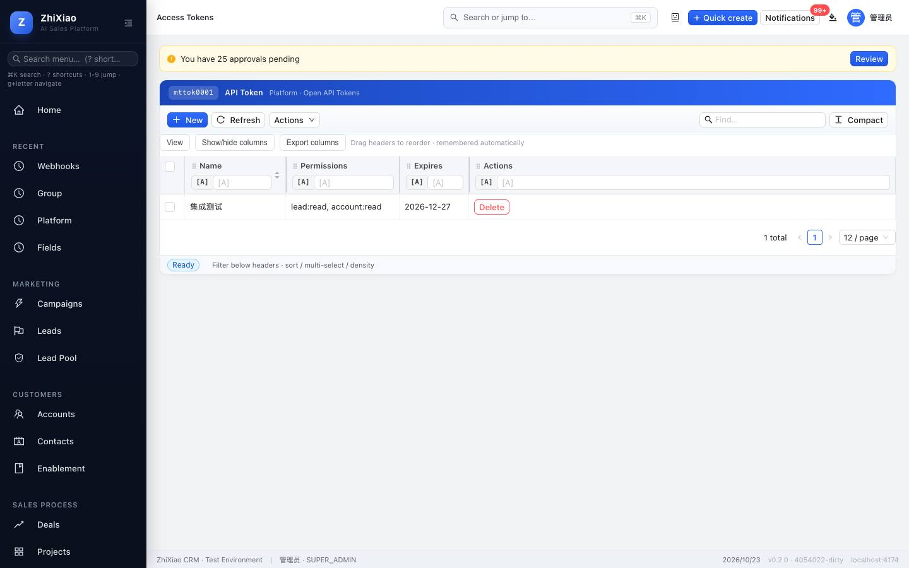
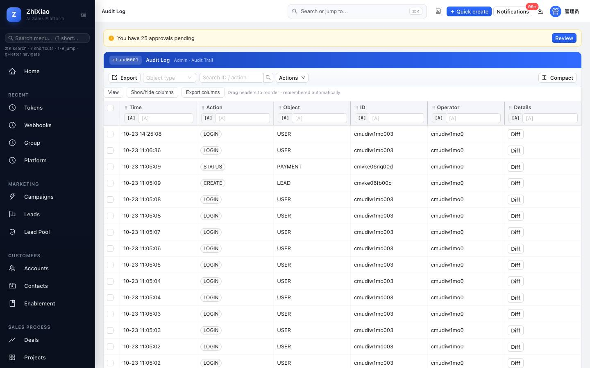
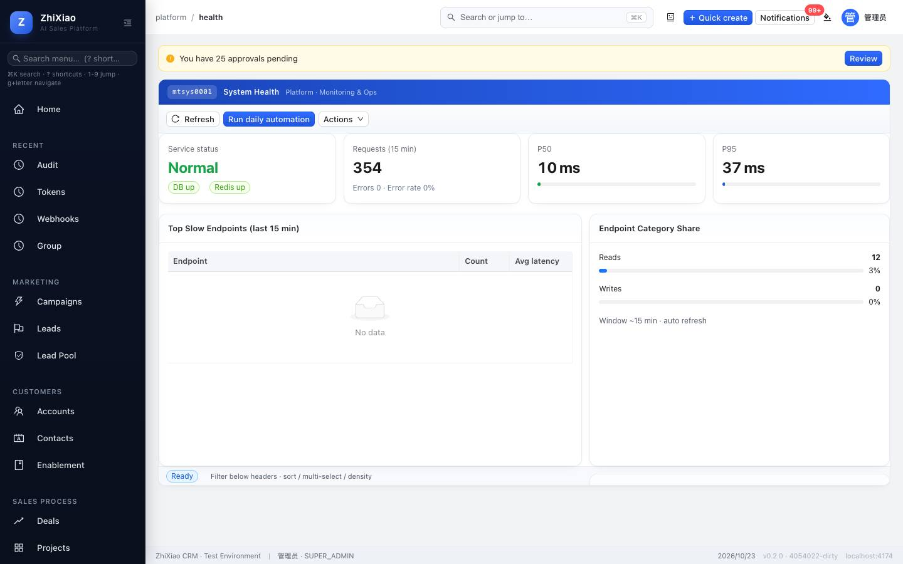

# ZhiXiao CRM Administrator Guide

> Applies to: v0.2.0 and later · For: system administrators (super admin role `SUPER_ADMIN`)
> For everyday business tasks see the [User Guide](user-manual.md); for server deployment, backups and operations see the "部署" (Deployment) section of `README.md` in the repository root.

## Contents

1. [Administrator duties and entry points](#1-administrator-duties-and-entry-points)
2. [Go-live checklist](#2-go-live-checklist)
3. [Users](#3-users)
4. [Organization: departments, roles and permissions](#4-organization-departments-roles-and-permissions)
5. [Data scope and sharing](#5-data-scope-and-sharing)
6. [Fields: data dictionary and custom fields](#6-fields-data-dictionary-and-custom-fields)
7. [Settings](#7-settings)
8. [Templates](#8-templates)
9. [Group with multiple entities](#9-group-with-multiple-entities)
10. [Integrations: webhooks and tokens](#10-integrations-webhooks-and-tokens)
11. [Audit log](#11-audit-log)
12. [System health](#12-system-health)
13. [Data import and export](#13-data-import-and-export)
14. [Security recommendations](#14-security-recommendations)
15. [FAQ](#15-faq)

---

## 1. Administrator duties and entry points

Administration lives in the **Platform** group of the left menu:

| Menu | Use |
|------|-----|
| Group Structure | Legal entities, budgets, funds, expenses, consolidated reports |
| Organization | Department tree, roles and permissions |
| Users | Accounts, roles, data scope, enable / disable |
| Data Dictionary | Data dictionary, custom fields, enum values |
| Integrations | Push business events to external systems (webhooks) |
| Access Tokens | Credentials for external systems calling the API |
| System Health | Service status, API performance, slow endpoints |
| Template Guide | How to build quote / contract templates |
| API Docs | Endpoint catalog and call examples |
| Audit Log | Who changed what, and when |
| Settings | Business parameters, approval thresholds, currencies, e-sign, automation, group bots, mobile push, AI provider, change password |

> Everyone sees the same menus, but when a non-administrator opens an admin page, the server refuses to show or change anything their role doesn't allow.

---

## 2. Go-live checklist

Before handing a new environment to the business, work through these in order:

1. **Change the super admin password** (Settings → Security & Workflow → Change Password). Demo accounts from the development seed use a publicly known password; production initial accounts use a random password shown once in the setup log.
2. **Add a second super admin.** Applicants cannot approve their own quotes or contracts, so with a single super admin some approvals have nobody to go to.
3. **Disable unused demo accounts** (see [3.3](#33-disabling-and-enabling)).
4. **Build the department tree** ([4.1](#41-departments)), then **create users** with roles and data scope ([3](#3-users)), setting each user's **manager**.
5. **Review role permissions** ([4.2](#42-roles-and-permissions)) and adjust them to how your company works.
6. **Set the quote approval thresholds**: discount rate and amount ([7.2](#72-security--workflow)).
7. **Set the base currency and exchange rates** if you sell in more than one currency ([7.1](#71-business-parameters)).
8. **Maintain products and price books** (Revenue → Products).
9. **Upload quote / contract templates** ([8](#8-templates)).
10. If other systems need to connect, configure **webhooks / tokens** ([10](#10-integrations-webhooks-and-tokens)); optionally set up group bots, mobile push and the AI provider ([7.3](#73-monitoring--automation), [7.4](#74-open-platform)).
11. Walk through "lead → deal → quote → contract → payment" with a sales account to confirm permissions and flows behave as expected.

---

## 3. Users

Menu: **Platform → Users**.

### 3.1 Creating a user

1. Click **New** and fill in **Name**, **Email** (the sign-in name), **Phone**, **Initial password** (at least 8 characters) and **Data scope**.
2. After saving, pick one or more roles in the **Roles** column of the list; the change applies immediately.
3. Send the email and initial password to the person through a secure channel.

### 3.2 Built-in roles

| Role | Code | Typical permissions |
|------|------|---------------------|
| Super admin | `SUPER_ADMIN` | Everything |
| Sales manager | `SALES_MANAGER` | Lead assignment and conversion, account sharing, deal stages and forecasts, quotes and contracts, payment registration, approve / reject, view goals, view custom fields |
| Sales rep | `SALES_REP` | Own leads, accounts, contacts, deals, follow-ups and check-ins; create and submit quotes; view contracts, payments, goals and custom fields |
| Operations | `OPERATIONS` | Lead assignment, products and price books, pipeline configuration, campaigns and forms, custom fields |
| Finance | `FINANCE` | View contracts; register / confirm / reconcile payments; view quotes; reports |
| Service agent | `SERVICE_AGENT` | View accounts and contacts, handle and transfer tickets, follow-ups, view custom fields |

A user can have several roles; permissions are combined.

> Every signed-in user can read the **names** of active colleagues (to show owners, assign and filter) without any permission; full profiles with email and phone still need the "view users" permission.

### 3.3 Disabling and enabling

Click **→** at the start of the user's row to edit, set **Status** to `DISABLED` and save. This takes effect **immediately**: the account can no longer sign in, and an open session is signed out on its next action. Set it back to `ACTIVE` to restore it.

> Disable employees who leave rather than deleting them, to keep their history and audit trail; transfer their accounts to someone else if needed ([5.3](#53-transferring-ownership)).

### 3.4 Passwords

- A new user's initial password is set when the user is created.
- Every role can change its own password under **Settings → Security & Workflow → Change Password** (the current password is required).
- **Forgotten password**: click **Reset password** on the user's row in **Users** and enter a new password (at least 8 characters). Tell the person through a secure channel and ask them to change it after signing in. Requires the "edit users" permission and only works for users in your tenant.

---

## 4. Organization: departments, roles and permissions

Menu: **Platform → Organization**.

### 4.1 Departments

**New department**: fill in **Name**, **Code** and **Parent** to build the department tree. Departments drive the "department" data scope and the team dimension in reports.

### 4.2 Roles and permissions

- The role list shows **Code**, **Name**, whether it is a **system** role, and the **number of permissions**.
- **New role**: enter a code and name, then click **Configure permissions** and tick the permissions the role should have.
- Built-in roles can be changed too, but copying them into a custom role first makes changes easier to trace.

Permissions are grouped by module:

| Module | Permissions (examples) |
|--------|------------------------|
| Organization | View / edit / delete users; view and edit departments, roles and settings |
| Leads | View, edit, delete, assign, convert, close |
| Accounts / contacts | View, edit, delete, share |
| Deals | View, edit, delete, change stage, close (won / lost), submit forecast |
| Quotes | View, edit, delete, submit, send, accept |
| Contracts / payments | View / edit / delete / activate / finish contracts; register / confirm / reconcile payments |
| Tickets | View, edit, delete, transfer |
| Marketing | View, edit, delete campaigns and forms |
| Approvals | View, approve, reject, withdraw, define approval flows |
| Platform | Webhooks, tokens, custom fields, file upload / download, view audit log, AI assistant |

> Permission changes take effect **immediately**; the user only needs to refresh the page.

---

## 5. Data scope and sharing

### 5.1 Data scope

Each user has a **data scope** that decides which records they can see:

| Data scope | Can see |
|------------|---------|
| Own `SELF` | Records they own |
| Team `TEAM` | Their own records plus those of their direct reports |
| Department `DEPARTMENT` | Records in their department, including sub-departments |
| All `ALL` | Every record in the company (tenant) |

Functional permissions (what you can do) and data scope (which records you can do it to) apply together.

### 5.2 Sharing

An owner or administrator can **share** a single account or deal with others: **collaborators** can edit, **viewers** are read-only. Useful for large accounts handled across teams.

### 5.3 Transferring ownership

Change the **Owner** when editing an account, deal or lead; leads can also be assigned in bulk. For a hand-over, filter the list by the previous owner first and work through it in batches.

### 5.4 Entity visibility in a group

With the group features enabled, you can limit users to accounts under certain legal entities (see [9](#9-group-with-multiple-entities)). Without that configuration there is no restriction.

---

## 6. Fields: data dictionary and custom fields

Menu: **Platform → Data Dictionary**.

| Tab | Use |
|-----|-----|
| Data dictionary | The fields and enum values of each object (such as lead status and source) |
| Custom fields | Add extra fields to accounts, leads, deals and contacts |

**New custom field**:

1. Custom fields tab → **New**.
2. Choose the **object** (ACCOUNT / LEAD / OPPORTUNITY / CONTACT), fill in the **API name** (Latin letters, such as `industryCode`), the **label** shown in the interface, the **type** (text / number / date / enum) and whether it is **required**.
3. After saving, the field appears on the detail page of that object.

**Editing**: click **→** at the start of the row. After creation only the **label** and **required** flag can change; object, API name and type are fixed so existing data stays valid. Turn **Enabled** off to hide a field you no longer use.

---

## 7. Settings

Menu: **Platform → Settings**.

### 7.1 Business parameters

Business switches kept as key / value pairs:

| Key | Default | Meaning |
|-----|---------|---------|
| `discount_approval_threshold` | `0.2` | A quote needs approval when any line's discount **exceeds** this (0.2 = 20%) |
| `amount_approval_threshold` | `200000` | A quote needs approval when its total **reaches** this (edit it under Security & Workflow → approval flow configuration) |
| `contract_approval_amount` | `100000` | A contract whose amount **reaches** this goes to approval when **Activate** is clicked; `0` turns contract amount approval off |
| `lead.assign_rule` | `LOAD_BALANCE` | Automatic lead assignment: `LOAD_BALANCE` gives the lead to the rep with the fewest open leads; `ROUND_ROBIN` takes turns; `MANUAL` turns auto-assignment off |
| `lead.assign_on_create` | `true` | Whether leads created by non-sales users (admins, managers, web forms, imports) are assigned to a rep right away; leads a rep creates always stay with that rep |
| `file.max_size_mb` | `10` | Maximum attachment size in MB, up to 100 |
| `quote.no_prefix` / `contract.no_prefix` / `payment.no_prefix` / `ticket.no_prefix` | `QT` / `HT` / `SK` / `GD` | Document number prefixes, 1–8 letters, digits or hyphens; new documents use the new prefix, existing numbers don't change |
| `i18n.default_locale` | `zh-CN` | Default language for new users (`zh-CN` or `en-US`) |
| `feature.ai` | `true` | Whether the AI assistant is shown in the interface (deal detail and elsewhere) |
| `ai_provider` | `mock` | Legacy AI switch, replaced by Open Platform → AI assistant provider (see 7.4) |

> Automatic lead assignment **only assigns to active users with the sales rep role (`SALES_REP`)**; a tenant with no sales reps gets no automatic assignment.

Click **Edit** next to a value to change it; the change applies as soon as it is saved.

#### Currencies and exchange rates

The **Currencies and exchange rates** card on the same tab:

1. **Base currency**: reports, performance, commissions and forecasts are totaled in this currency; CNY by default. It can only be changed before the first exchange rate is added.
2. **Add rate**: choose a currency and enter "1 unit of this currency = how much base currency" (for 1 USD = 7.2 CNY, enter 7.2) and the effective date. A currency can have several rates, each effective from its date.
3. Once a rate exists, the currency can be chosen when creating deals, quotes and contracts; quotes and contracts default to the related deal's currency. **A foreign currency without a rate cannot be saved.**
4. Conversion: when a document is saved, it is converted with the latest rate effective on or before the document's date, and the converted amount is stored (contracts use the signing date, payments the payment date, payment plans follow their contract). Later rate changes **do not affect documents already converted**; after adding or correcting rates, click **Recompute** to recalculate every document from the current rate table.
5. Document details show the original amount and currency; amounts in reports are always in the base currency.
6. **Update daily**: turn it on and choose currencies; every day at 07:30 the system fetches the European Central Bank reference rates (published on working days, about 30 currencies) and records them effective from the published date. **Update now** runs it immediately. A rate entered by hand for the same day takes precedence and is not overwritten; the **Source** column shows manual or automatic rates. The server must be able to reach `api.frankfurter.dev`.

### 7.2 Security & Workflow

- **Change Password**: change the signed-in administrator's own password.
- **Approval flow configuration**: set the quote **discount threshold** (approval when any line's discount exceeds it) and **amount threshold** (approval when the quote total is at or above it), then click **Save thresholds**; the approval flows and whether they are enabled are listed below.
  - **Who approves**: quote approval has two levels: level 1 is the applicant's direct manager, level 2 is that manager's manager (disabled managers are skipped and the search continues upwards). When the chain is too short, the missing level goes to a super admin who isn't already part of the approval; applicants cannot approve their own quotes and nobody is assigned twice. So set each user's **manager** under **Users**.
  - If no approver can be found (for example the only super admin submits a quote that needs approval), the submission is refused with "No approver available". Add another super admin if needed.
  - **Contract amount approval**: when a contract reaches `contract_approval_amount` (100,000 by default), clicking **Activate** puts it into **Approving**, with the same approver rules as quotes (the person clicking **Activate** is the applicant). Once fully approved it becomes active automatically; a rejected contract can be edited and **resubmitted**. Contracts below the amount become active directly. Disable "Contract amount approval" in the approval flow list to turn it off. Contract **change orders** have their own approval.
- **E-sign provider**: choose **Built-in seal (local)**, **e签宝 (eSignBao)** or **法大大 (Fadada)**, enter the organization ID and callback URL, and enable it. Third-party providers need a contract and account with the provider first.

### 7.3 Monitoring & Automation

- **Monitoring**: service status, database and cache connections; click **Refresh** to update.
- **Sales automation**: these jobs run every day; you can also run one immediately here:

| Button | What it does |
|--------|--------------|
| Auto-assign leads | Reassigns stuck new leads (still "New" and either 7 days past the next follow-up date, or created more than 3 days ago without a follow-up date) to **sales reps** according to `lead.assign_rule`, up to 50 at a time; does nothing when the rule is `MANUAL` |
| Create renewal deals | Creates renewal deals for contracts about to expire |
| Follow-up reminders | Reminds owners whose follow-ups are overdue |
| Customer journey automation | Triggers journey actions by account stage |
| Funnel automation | Advances qualifying deals and sends stall reminders |
| Run today's automation | Runs all of the above in order |

Automatic return to the pool (leads with no follow-up for 7 days, accounts with no activity for 30 days) also runs in the daily jobs.

- **Group bot notifications**: forward system notifications to WeCom, DingTalk or Feishu group chats automatically.
  1. In the group settings, add a custom bot (WeCom: group bot; DingTalk: custom robot, preferably with the "signature" security setting; Feishu: custom bot) and copy its webhook URL.
  2. Click **New**, choose the channel and paste the URL; for DingTalk / Feishu with signing enabled, enter the secret; tick the notification categories to forward (approvals, leads, quotes, contracts, payments, customer success, pipeline, system).
  3. Click **Send test message**; if it appears in the group, the bot is set up. From then on every in-app notification in those categories is posted to the group, naming the recipient.
  4. Only the three providers' official webhook domains are accepted; the secret is never shown again after saving.
- **Mobile push**: shows whether iOS (APNs), Android (FCM) and HarmonyOS (Huawei Push Kit) push are configured. Credentials are set by operations in server environment variables (see "Configuration" in the repository README and `docs/18-mobile-build.md`). Once configured, in-app notifications are also pushed to the recipient's signed-in mobile apps, and tapping a push opens the related record.

### 7.4 Open Platform

Open API notes and **Copy curl example**; the endpoint catalog is under **Platform → API Docs**.

**AI assistant provider**: by default, the AI assistant on deal detail pages (summary, next steps, deal risk) returns results from built-in rules. To use a real model:

1. Choose **Claude (Anthropic)** or **OpenAI-compatible API** as the **Provider**; for the latter, the DeepSeek, Qwen, Kimi and OpenAI buttons fill in the URL and model.
2. Enter the **API key** (created in the provider's console), click **Save**, then **Test connection**.
3. The record's business data and recent activities are sent to the model, so make sure that fits your data policy. When the external API fails, the built-in result is used, and the result is labeled "Generated by AI" or "Built-in mock result".
4. The key is stored encrypted and never shown again; saving with the key field empty keeps the existing key. If the server's encryption key (`SETTINGS_SECRET`) changes, enter the key again.

#### WeCom / DingTalk / Feishu: directory sync and scan sign-in

Use the **WeCom / DingTalk / Feishu** card on the same tab. For each platform, first create an internal ("self-built") app in its admin console:

| Platform | Credentials | Also required |
|----------|-------------|---------------|
| WeCom | Corp ID, AgentId, Secret | The app's visible scope decides which departments and members are synced; set this system's domain as a trusted domain for WeCom sign-in |
| DingTalk | Client ID (AppKey), Client Secret | Read-only contacts and personal mobile permissions; add the callback URL under sign-in settings |
| Feishu | App ID, App Secret | Contacts read permission and data scope; add the redirect URL under security settings |

1. Click **Configure**, fill in the credentials, turn on **Enabled**, save, then click **Test connection**.
2. Register the **Scan callback URL** shown on the card (for example `https://your-domain/login/sso/wechat_work`) in the platform console.
3. Click **Sync now**, or turn on **Sync the directory daily** (runs at 02:30). How sync works:
   - Departments are created or updated from the platform's tree (only names and parents change; departments created in the CRM are not deleted).
   - Members are matched to existing users by linked account, then email, then mobile number; a match records the link and updates the department.
   - People not in the CRM are created as **disabled accounts** with a placeholder email. An administrator reviews them under **Users**, enables them, sets the email and assigns roles.
   - People who left or were disabled on the platform are disabled in the CRM. If an unusually large share (over 30%) would be disabled at once, that step is skipped with a warning; check the app's visible scope.
4. Once enabled, the sign-in page shows buttons such as **Sign in with WeCom**. After scanning, the active user is found by linked account → email → mobile; if none matches, the user is asked to contact an administrator. Add `?tenant=<tenant code>` to the sign-in URL to choose the tenant (not needed with a single tenant).
5. Users can link or unlink their own accounts under **Me → Linked accounts**. A platform account can be linked to only one CRM user.

> Secrets are stored encrypted and never shown again. Scan sign-ins are recorded in the audit log; the result of each sync is shown under **Last sync** on the card.

---

## 8. Templates

Quote templates are under **Quotes → Actions → Quote Template Management**; contract templates are on the **Contracts → Contract Templates** tab.

1. Create a template with a name and type (standard / channel / custom).
2. Upload a Word (.docx) or Excel (.xlsx) file; it is converted into an editable body that keeps headings, tables, font sizes and other layout.
3. Insert placeholders (account name, amount, product lines, etc.) in the body; they are filled in when printing.
4. Templates can be **published / unpublished** and **shared with the team**; edits keep a **version history** you can compare and restore; template approval can be turned on if needed.

The full placeholder list, supported formats and common problems are under **Platform → Template Guide**. Placeholders keep their Chinese names (such as `{客户名}`) in every interface language.

> Legacy .doc / .xls files are parsed on a best-effort basis and the layout may break; save them as .docx / .xlsx before uploading.

---

## 9. Group with multiple entities

Menu: **Platform → Group Structure**. For companies with several legal entities (subsidiaries, branches).

| Tab | Content |
|-----|---------|
| Overview | Each entity's total wins, open deals, contract value, collections, profit and margin; the **cockpit screen** can be shown on a large display |
| Structure & analysis | Entity hierarchy, entity comparison, goal allocation |
| Expenses & funds | Annual budgets and execution, expense claims and approval, inter-entity transfers, cash pool, shared cost allocation |
| Legal entities | Entity records; assign accounts to entities; set which entities each user can see |

Consolidated reports can be exported as CSV / PDF from the group report page. Amounts from deals, contracts and payments in other currencies are converted to the base currency.

---

## 10. Integrations: webhooks and tokens

### 10.1 Webhooks (pushing events to external systems)

Menu: **Platform → Integrations**.

1. **New**: enter the **URL** that receives events, the **events** (comma-separated, `*` for all) and a **Secret** for signing.
2. **Test**: sends a test event to the URL; the result is recorded in the delivery log.
3. The receiver should verify the `X-AI-CRM-Signature` header (format `t=timestamp,v1=HMAC-SHA256`) to reject forged requests.
4. Failed deliveries record the response code so you can troubleshoot from the log.

### 10.2 Tokens (external systems calling the API)

Menu: **Platform → Access Tokens**.

- When creating a token, give it a name that says which system uses it; the token is **shown only once**, so copy it into the other system right away.
- Disable tokens you no longer use; if one may have leaked, disable it immediately and create a new one.

---

## 11. Audit log

Menu: **Platform → Audit Log**.

Every write (create, update, delete, status change) is recorded with who did it, when, the object, the action and **field-level changes** (before → after). Filter by object type, user and time, and export.

---

## 12. System health

Menu: **Platform → System Health**.

- **Service status**: whether the database and cache are healthy
- **Requests in the last 15 minutes**: volume, P50 / P95 response times
- **Slowest endpoints** and **endpoint categories**
- **Alert thresholds**: alerts appear on Home and in notifications when exceeded

The status bar and `/api/v1/health` both show the running version and commit hash, so you can confirm what is live after a deployment.

---

## 13. Data import and export

- **Import**: Revenue → Data import supports lead, contact and account CSV files (UTF-8), skipping duplicates by name / email / phone. Try 10 rows before a large import.
- **Export**: **Export columns** / **Actions** on each list export CSV, Word and PDF; reports export CSV from the top right. Exports are limited to the exporting user's data scope.

---

## 14. Security recommendations

- Give administrator accounts only to people who need them; use ordinary role accounts for daily work.
- Spot-check sensitive actions (deletions, permission changes, bulk exports) in the **Audit Log** regularly.
- **Disable** accounts as soon as people leave, and transfer their accounts and deals.
- Pass tokens and webhook secrets only through secure channels, never in email bodies or chat.
- Infrastructure passwords (servers, database, Redis, admin panels) are kept by operations and never written into code or documents (see "上线前安全检查" (pre-launch security check) in the README).

---

## 15. FAQ

| Problem | What to do |
|---------|------------|
| A user can't see some data | Check their **data scope**, or ask the owner to **share** it; in group mode check which entities they can see |
| A user gets "missing permission" | Add the permission to their role; the user only needs to refresh |
| A quote does / doesn't go to approval unexpectedly | Check the discount threshold (0.2 means 20%) and amount threshold under approval flow configuration; meeting either one requires approval |
| Leads aren't assigned automatically | Make sure `lead.assign_rule` isn't `MANUAL` and the tenant has active users with the sales rep role; leads a rep creates stay with that rep |
| The AI assistant is missing or its content looks like a sample | It is hidden when `feature.ai` is `false`; without a provider under Open Platform → AI assistant provider (or when the call fails) it returns built-in results, labeled "Built-in mock result" |
| A foreign currency can't be chosen on a document | Add an exchange rate for it under Business Parameters → Currencies and exchange rates |
| Group bot messages don't arrive | Click **Test** on the bot and read the error; check the webhook URL, the DingTalk / Feishu secret, and the bot's keyword or IP rules |
| The webhook receiver gets nothing | Use **Test** and check the response code in the delivery log; make sure the URL is reachable from the server |
| A user forgot their password | Click **Reset password** in **Users**; see [3.4](#34-passwords) |
| Submitting a quote or activating a contract says "No approver available" | The applicant has no manager and there is no other super admin; set a manager for them, or add another super admin |
| A role receives no notifications | Notifications are open to every signed-in user (before 2026-10-22 only roles with "view approvals" could see them); deploy the current version |
