# ZhiXiao CRM User Guide

> Applies to: v0.2.0 and later · For: sales reps, sales managers, sales operations, finance, customer service and other everyday users
> System administrators should also read the [Administrator Guide](admin-manual.md).
> Screenshots come from a test environment and the lists show demo data. Everyone sees the same menus, but whether you can view, create or change something depends on your role permissions and data scope.

## Contents

1. [Getting started](#1-getting-started)
2. [Home](#2-home)
3. [Marketing: campaigns, leads, lead pool](#3-marketing)
4. [Customers: accounts, contacts, customer success](#4-customers)
5. [Sales process: deals, projects, quotes, follow-ups, calendar, cadences](#5-sales-process)
6. [Revenue: contracts, payments, invoices, renewals, e-sign, products, service](#6-revenue)
7. [Analytics: report center, quotas, commissions, forecast, weekly brief](#7-analytics)
8. [Collaboration: todos, approvals, notifications, Me, Help Center](#8-collaboration)
9. [Mobile](#9-mobile)
10. [FAQ](#10-faq)

---

## 1. Getting started

### 1.1 Sign in

1. Open the system address in your browser (ask your administrator for it). The latest Chrome, Edge or Safari is recommended.
2. Enter your **Email** and **Password**, then click **Confirm**.
3. After your first sign-in, change the initial password (see [8.4](#84-me-and-changing-your-password)).
4. If your administrator has enabled WeCom, DingTalk or Feishu sign-in, buttons such as **Sign in with WeCom** appear below the form. Scan the code with the mobile app to sign in without a password.

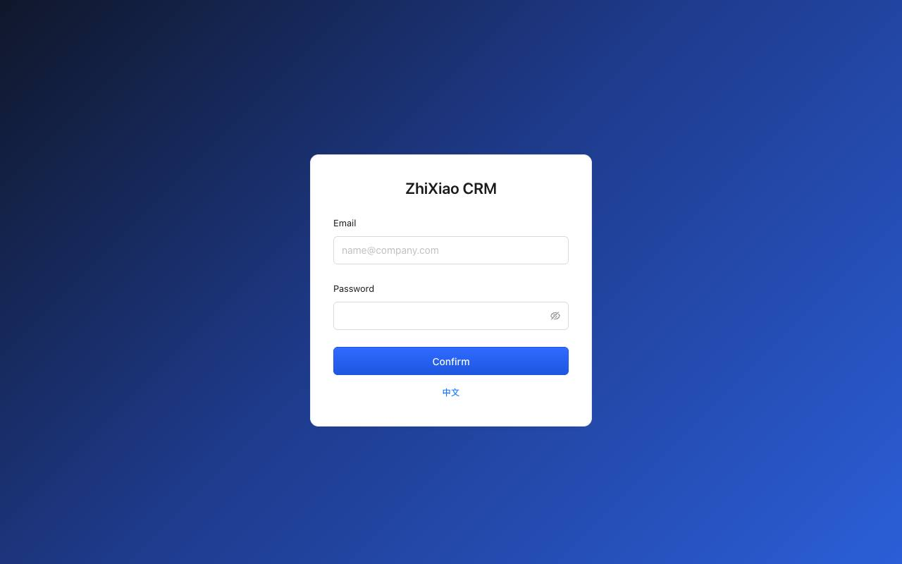

The **English / 中文** link switches the interface language. The change applies immediately and is saved to your account.

### 1.2 Layout

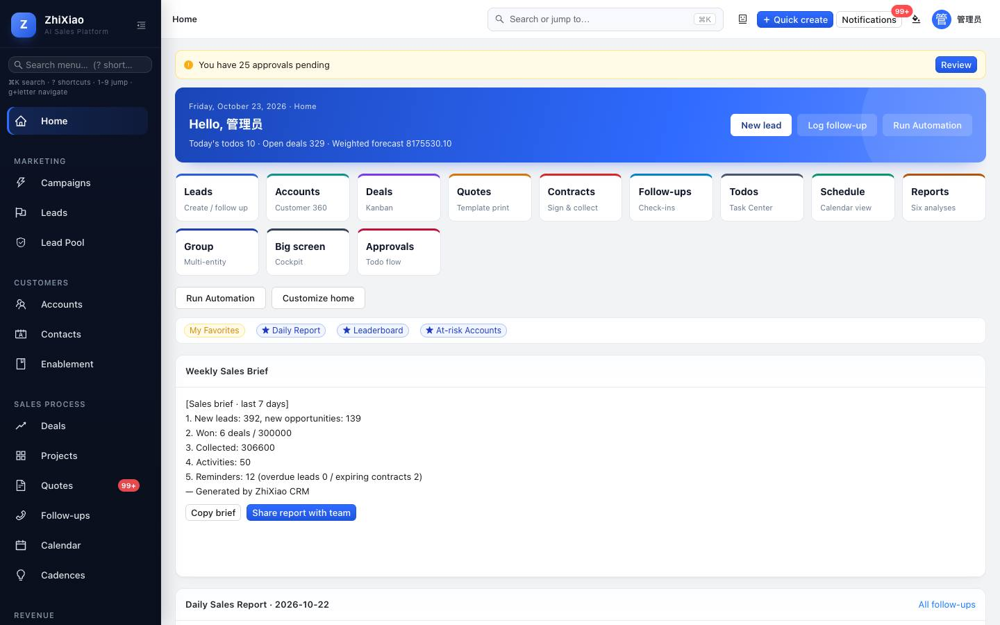

| Area | Description |
|------|-------------|
| Left menu | Grouped by area: Marketing, Customers, Sales Process, Revenue, Analytics, Collaboration, Platform. **Recent** at the top lists pages you visit often; the search box above the menu finds menu items by name |
| Top search | Search accounts, leads, deals, contacts and other records, or jump to a page (shortcut ⌘K / Ctrl+K) |
| **Quick create** | Create a lead, account, contact, deal or follow-up in one click |
| **Notifications** | The red number is your unread count; click to open the Notification Center |
| Avatar | Profile, theme, sign out |
| Status bar (bottom) | Current user, role, date and system version (include it when reporting a problem) |

### 1.3 Working with lists

Most lists (leads, accounts, deals, contracts…) work the same way:

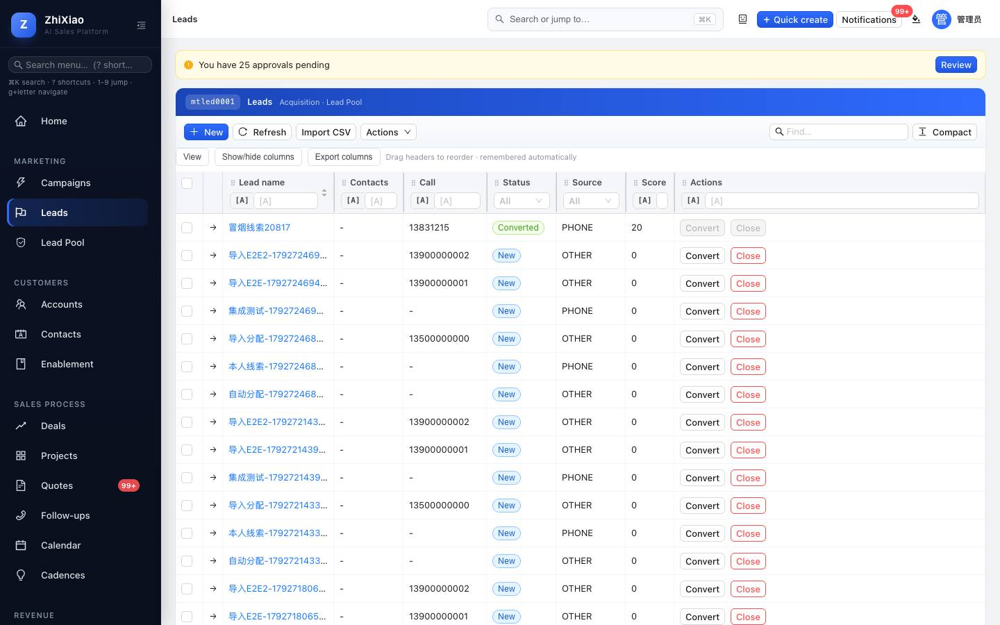

| Task | How |
|------|-----|
| Open / edit a record | Click the name to open the detail page; click **→** at the start of a row to edit in a dialog |
| Filter by column | Use the input under each column header; the `[A]` badge switches the operator (equals / contains / is empty, etc.) |
| Sort | Click a column title |
| Arrange columns | Drag headers to reorder, drag column edges to resize; **Show/hide columns** chooses which columns appear. Your layout is remembered |
| Save a view | **Views** → save the current filters and columns; views can be shared with your team |
| Bulk actions | Tick the checkboxes on the left; bulk buttons appear at the top (bulk close, bulk delete drafts, etc.) |
| Export | **Export columns** chooses the fields; the **Actions** menu exports CSV / Word / PDF |
| Row density | **Compact** at the top right toggles row height |

Filters are written into the page address, so you can copy the address and send it to a colleague to share the same results.

### 1.4 Keyboard shortcuts

Press `?` at any time to see the shortcut list.

| Shortcut | Action |
|----------|--------|
| ⌘K / Ctrl+K | Command palette: search records, jump to pages, quick create |
| 1 – 9 | Jump to: 1 Home, 2 Leads, 3 Accounts, 4 Deals, 5 Quotes, 6 Contracts, 7 Projects, 8 Report Center, 9 Todos |
| g then h / l / a / o / c / r / t | Go to Home / Leads / Accounts / Deals / Calendar / Report Center / Follow-ups (press within 1.5 s) |
| c | Quick create |
| Esc | Close a dialog or drawer |

Shortcuts are disabled while you are typing in an input.

---

## 2. Home

The page you see after signing in. It collects what needs your attention today:

- **Banner**: today's todo count, open deals, weighted forecast; **New lead**, **Log follow-up**, **Run Automation** (runs reminders and auto-assignment once, now)
- **Shortcut cards**: Leads, Accounts, Deals, Quotes, Contracts, Follow-ups, Todos, Schedule, Reports, Group, Big screen, Approvals
- **My Favorites**: records you starred (☆) are collected here
- **Widgets**: weekly sales brief, todo center, daily sales report, smart reminders, account health, data quality, leaderboard, monthly goal progress, customer satisfaction, at-risk accounts, funnel alerts, stage conversion and more

Click **Customize home** to choose which widgets appear and in what order.

---

## 3. Marketing

### 3.1 Campaigns

Menu: **Marketing → Campaigns**. Record marketing activities (trade shows, online promotions, etc.) with budget, dates and status (planned / in progress / ended). Leads collected through a campaign form go straight into the leads list with the source campaign recorded, so campaign conversion shows up in reports.

### 3.2 Leads

Menu: **Marketing → Leads** (shortcut `2`). A lead is a potential customer that has not been qualified yet.

**Lead status**: New → Accepted → Nurturing → Converted / Closed

| I want to… | How |
|------------|-----|
| Create a lead | **New** at the top left; **Lead name** and **Source** (web form, phone, referral, trade show, cold call, ads, channel partner, other) are required |
| Import in bulk | **Import CSV**, or the **Revenue → Data import** wizard (see [6.9](#69-data-import)) |
| Assign to a rep | A manager ticks leads and picks a rep in **Assign selected to…**; new leads left untouched for a long time are also reassigned automatically. The assignee gets a notification |
| Log a follow-up | Open the lead and use **Quick follow-up** to record a call, visit or note and set the next follow-up date |
| Convert | **Convert** in the row or on the detail page: choose **New account** or **Link existing account**, optionally creating a contact and a deal at the same time |
| Close | **Close** in the row with a reason; tick several and use **Batch close** |

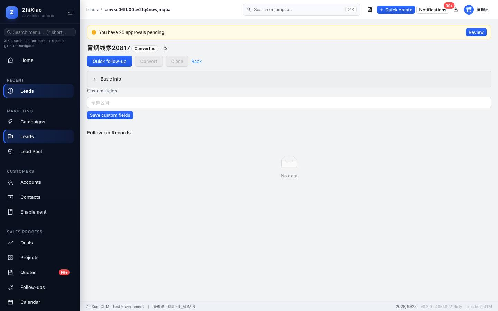

> **Automatic return**: a lead with no follow-up for 7 days goes back to the pool. Keep follow-ups and the "next follow-up" date up to date.

### 3.3 Lead pool

Menu: **Marketing → Lead Pool**.

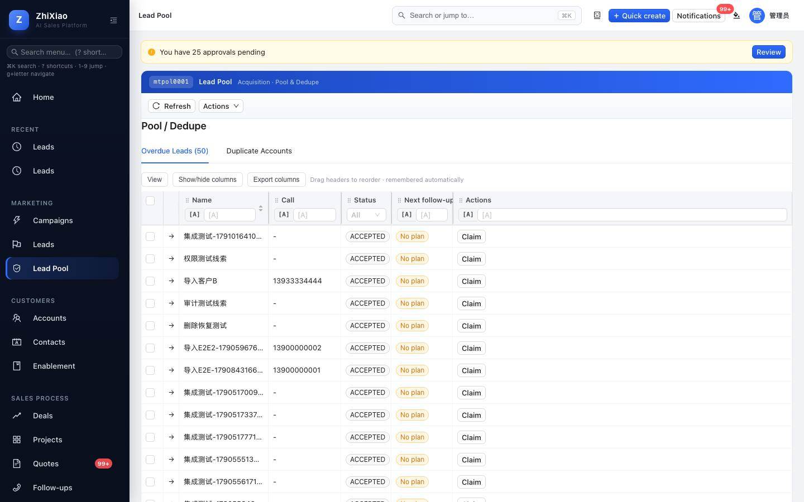

- **Pool**: leads and accounts with no owner, or returned automatically. Any sales rep with permission can **Claim** them.
- **Duplicates**: finds likely duplicate accounts by name, phone and more; the **merge wizard** combines them into one. Contacts, deals, contracts and so on are moved to the account you keep.

> An account with no activity for 30 days is also returned to the pool.

---

## 4. Customers

### 4.1 Accounts

Menu: **Customers → Accounts** (shortcut `3`).

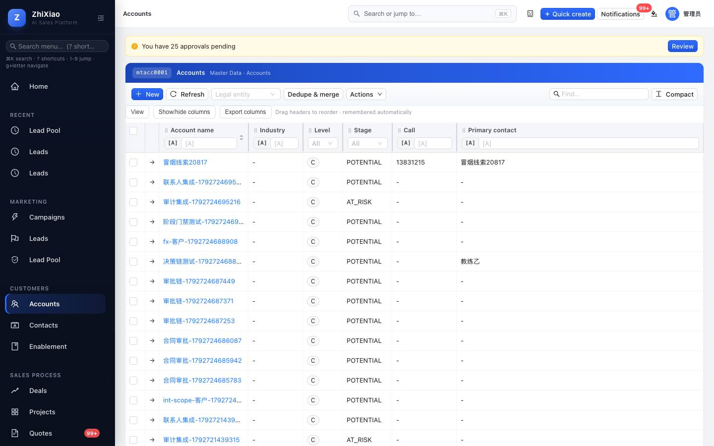

Switch quickly by account stage (Prospect / Active / At risk / Churned) at the top of the list; **Assign to me** shows only the accounts you own.

**Account 360**: click an account name.

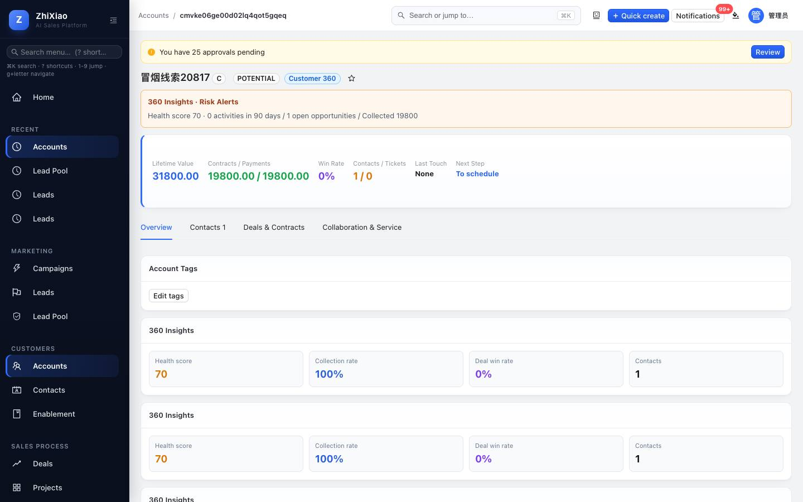

| Tab | Content |
|-----|---------|
| Overview | Basic information, 360 insights (health, collection rate, win rate, contacts), account hierarchy, tags, interaction timeline, interaction calendar, customer journey, NPS |
| Deals & Contracts | The account's deals, contracts, payments and financial summary (outstanding, collection rate) |
| Collaboration & Service | Contacts and decision chain, service tickets, shared members |

Common actions:

- **Edit tags**: the **Account Tags** card on the overview → Edit
- **Share**: share the account with colleagues (collaborators can edit, viewers are read-only)
- **Follow**: the ☆ next to the title; followed records appear in **My Favorites** on Home
- **Custom fields**: extra fields set up by your administrator are filled in on the detail page

Amounts in the 360 summary are totaled in the base currency (see [5.3](#53-quotes)).

### 4.2 Contacts

Menu: **Customers → Contacts**.

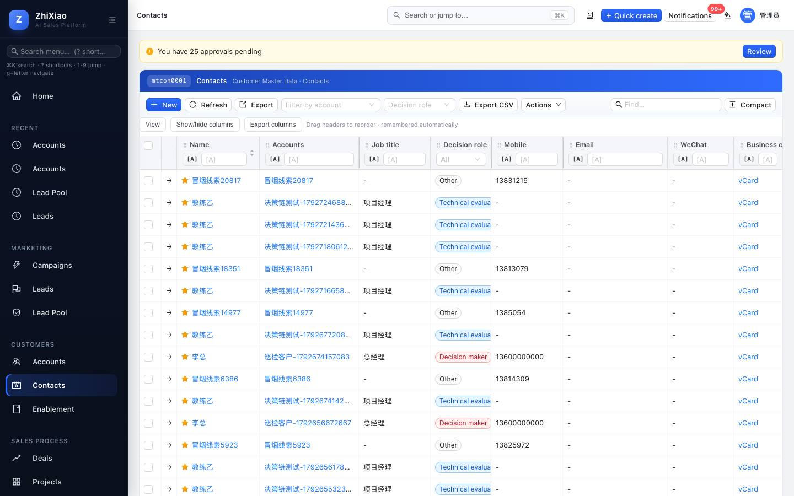

- A contact always belongs to an account; creating it from the account detail page is easiest.
- **Decision role**: economic buyer, user, technical evaluator, internal coach, other. Before a deal can move to **Negotiation**, the account needs at least one contact (decision chain).
- Each account can have one **primary contact**, used by default on quotes, contracts and other documents.
- On a phone, tap a number to call it.

### 4.3 Customer success

Menu: **Customers → Customer Success**.

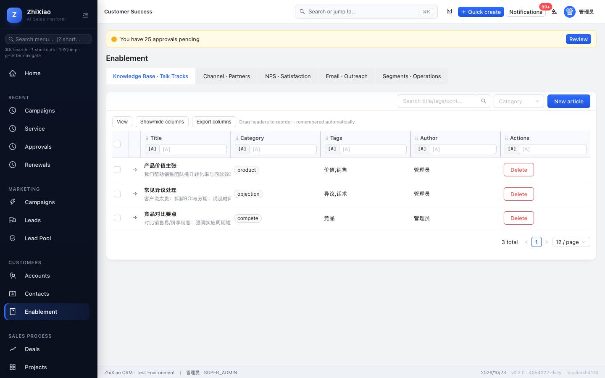

| Tab | Use |
|-----|-----|
| Knowledge · Scripts | Product introductions, objection handling, competitor comparisons; search by category and tag |
| Channels · Partners | Channel partner directory and the leads and deals each partner brought |
| NPS · Satisfaction | Record customer survey scores; low scores trigger alerts and follow-up tasks |
| Email · Outreach | Email templates, with open and click tracking |
| Segments · Operations | Group accounts by conditions and combine with automatic outreach (see [6.10](#610-segment-dashboard)) |

---

## 5. Sales process

### 5.1 Deals

Menu: **Sales Process → Deals** (shortcut `4`).

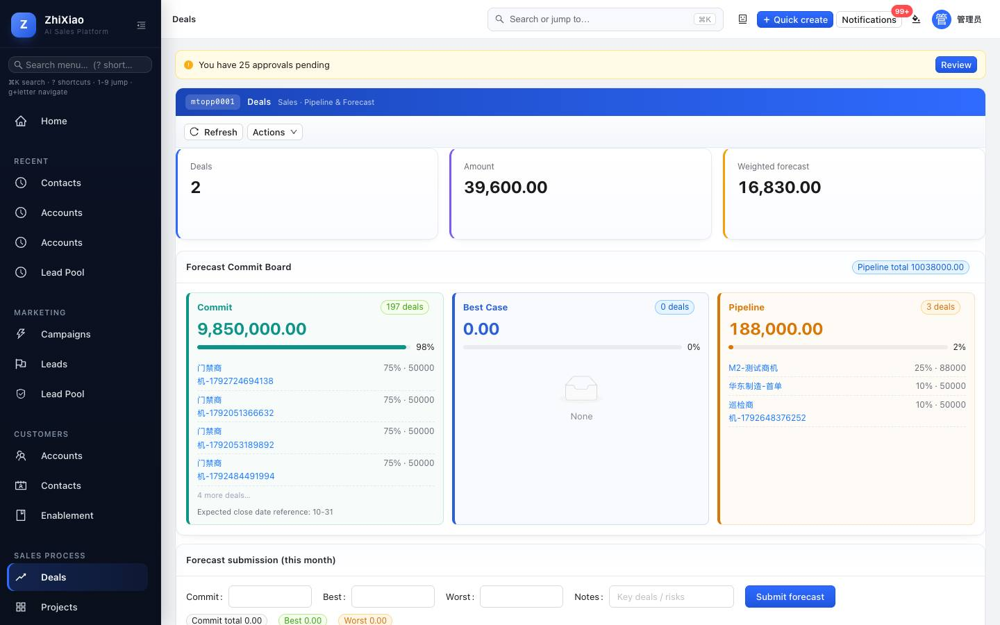

**Standard stages**: Prospecting → Discovery → Proposal → Negotiation → Won / Lost

**Moving a deal forward**: drag the card to the next column on the board, or choose the stage at the top left of the detail page. The system checks required information (**stage gate**) and lists everything that is missing at once:

| Moving to | Needs first |
|-----------|-------------|
| Discovery | Deal amount |
| Proposal | Deal amount, expected close date, at least one quote |
| Negotiation | Deal amount, expected close date, next step, account contacts (decision chain) |
| Won | Deal amount |

> Administrators can change these rules; follow the prompts you see.

**Won / Lost**: the **Won** or **Lost** button on the detail page. A lost deal needs a reason, used in loss analysis.

**Forecast**: managers use **Submit forecast** on the Deals page to submit Commit / Best / Pipeline for the month; the submissions feed the forecast accuracy statistics.

**Currency**: a deal can be in any currency your administrator has set an exchange rate for; leave it empty to use the base currency. Board column totals, forecasts and reports are shown in the base currency.

**Deal detail**:

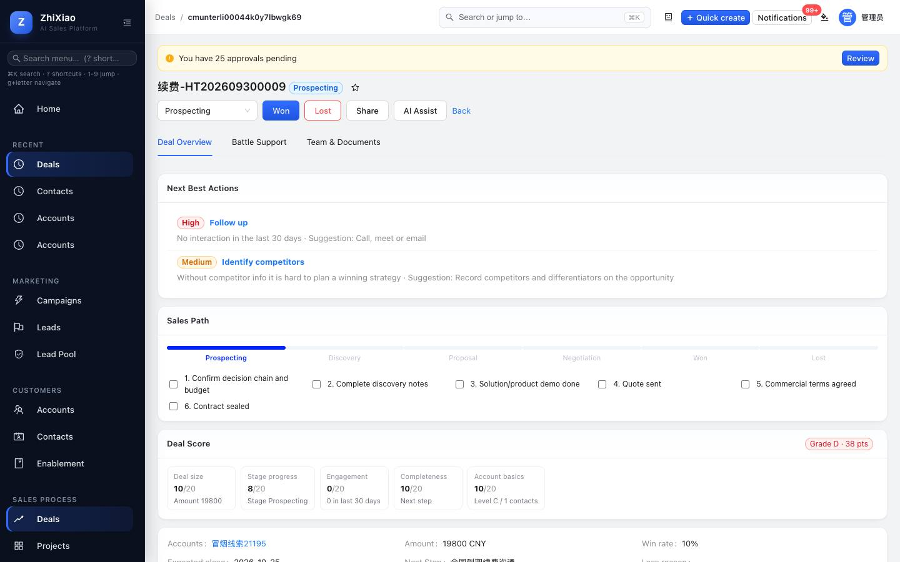

| Tab | Content |
|-----|---------|
| Deal Overview | Next Best Actions, sales path checklist (tick items off), Deal Score, basic information, interaction timeline |
| Battle Support | Buying committee, competitors, sales coaching, deal room |
| Team & Documents | Deal team members, related quotes and contracts |

**Share**: **Share** on the detail page adds collaborators to the deal.

### 5.2 Projects

Menu: **Sales Process → Projects** (shortcut `7`). For project-based selling where one account has several quotes and contracts. The project page totals quotes, contracts, collected payments and gross margin, and offers budget variance alerts, project health, milestones with a Gantt view, and a project calendar.

### 5.3 Quotes

Menu: **Sales Process → Quotes** (shortcut `5`).

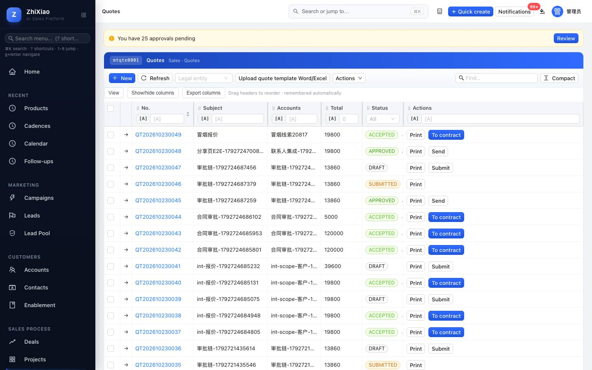

**Quote status**: Draft → In approval → Approved → Sent → Accepted; Rejected if approval is declined

1. **Create**: choose the account and deal, add product lines (quantity, discount); totals are calculated as you go. You can start from a quote template. The currency defaults to the deal's currency; a foreign currency can only be chosen once your administrator has added an exchange rate for it.
2. **Submit**: if any line's discount exceeds the threshold (20% by default) or the quote total reaches the amount threshold (200,000 by default), the quote goes to approval and can only be sent and accepted after it is approved. Otherwise it is approved straight away.
   Approval goes first to your **direct manager**, then to **your manager's manager**; if there is no manager, a super admin approves. You cannot approve your own quote.
3. **Send**: email it to the customer, or create a **share link / QR code** so the customer can view and confirm it online.
4. **Accept**: mark it **Accepted** once the customer confirms.
5. **Create contract**: an accepted quote becomes a contract in one click, with product lines copied over.

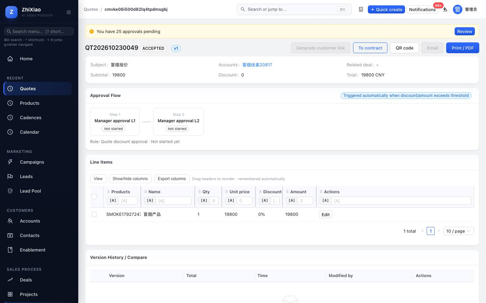

The quote detail shows the approval flow, line items, **version history / comparison**, **Print / PDF** and Word export. Quote templates are managed under **Actions → Quote Template Management** in the list (for uploading Word/Excel template files, see **Platform → Template Guide**).

### 5.4 Follow-ups

Menu: **Sales Process → Follow-ups** (shortcut `g` `t`). Records every interaction with customers.

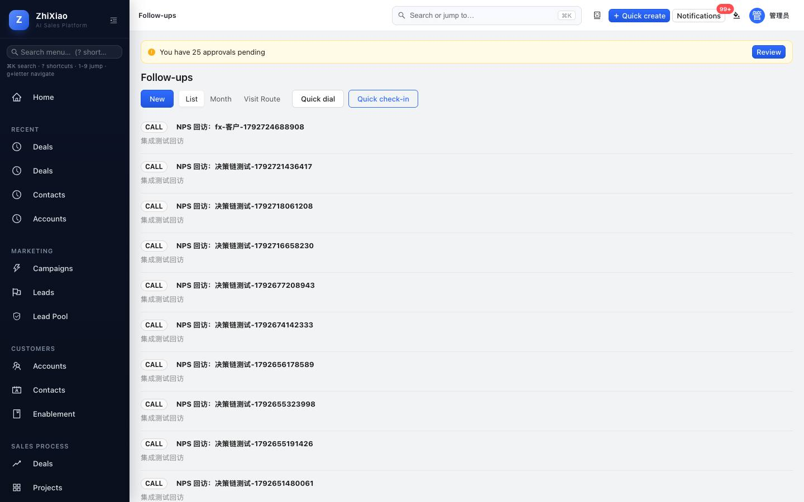

- **Type**: task, visit, call, email, note
- **Status**: Planned, Completed, Cancelled
- **Visit check-in**: when creating a visit on your phone, tap **Check in** and allow location access to record where you are; if location fails, use **Manual check-in address**
- Views: **List**, **Month**, **Visit Route** (the order of today's planned visits and where check-ins happened)

### 5.5 Calendar

Menu: **Sales Process → Calendar** (shortcut `g` `c`). See all planned follow-ups, meetings and tasks in **Month view** or **Agenda**, filtered by type (call, visit, email, task, meeting).

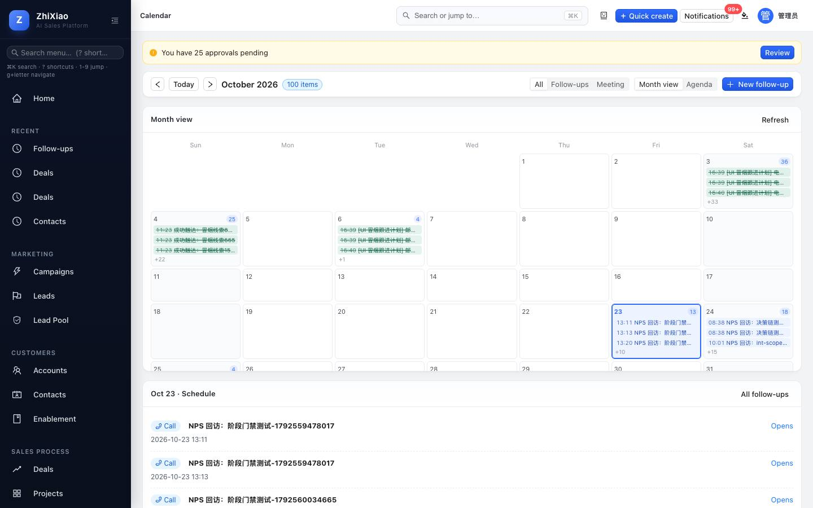

### 5.6 Cadences

Menu: **Sales Process → Cadences**. Plan a sequence of follow-up steps by day (for example "day 1 call, day 3 send materials, day 7 visit"). **Launch cadence** on a lead or account generates the planned tasks, which appear in the calendar and your todos. A cadence can be shared with the team.

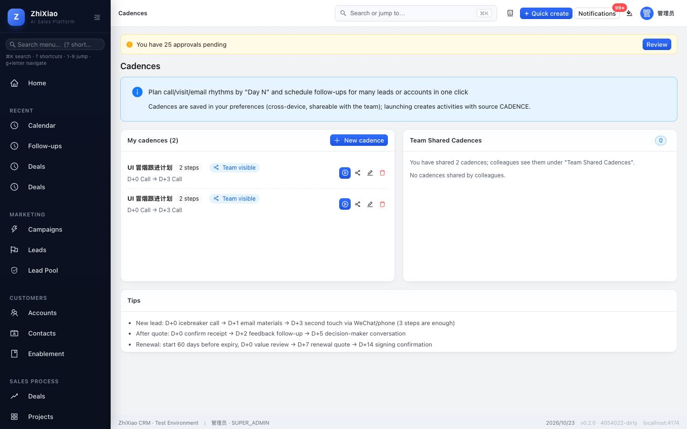

---

## 6. Revenue

### 6.1 Contracts

Menu: **Revenue → Contracts** (shortcut `6`).

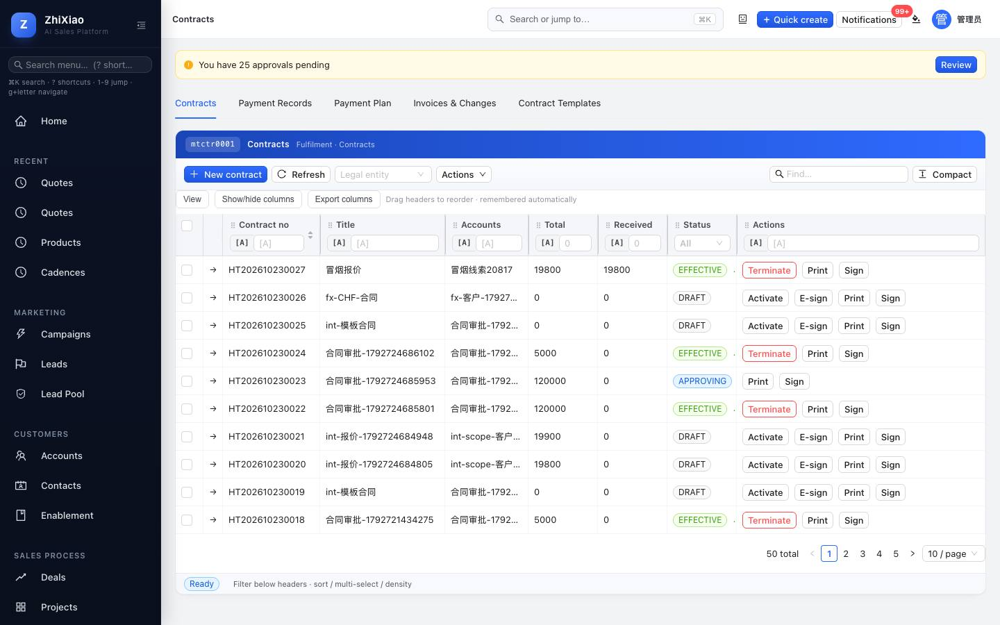

**Contract status**: Draft → Approving → Active → Finished; can also be Rejected or Terminated.

**Payment status**: Draft → Submitted → Confirmed → Reconciled (or Rejected).

Tabs at the top of the page:

| Tab | Use |
|-----|-----|
| Contracts | The main contract list |
| Payment Records | Each amount actually received |
| Payment Plan | Installments due (unpaid / partially paid / paid / overdue) |
| Invoices & Changes | Invoice registration, voiding / red-letter invoices, contract change orders |
| Contract Templates | Standard, channel, custom and other contract templates |

**Typical flow**:

1. **Create a contract** (or convert a quote), choose a template, edit the terms and product lines. The currency defaults to the deal's currency.
2. **Activate**: once a draft is correct, someone with the "activate contract" permission (such as a sales manager) clicks **Activate**. If the contract amount reaches the approval amount (100,000 by default), it goes to **Approving** first and becomes active automatically once approved; if rejected, fix it and click **Resubmit**.
3. **Sign / seal**: on the contract signing page, upload attachments, apply the e-seal and print the contract.

   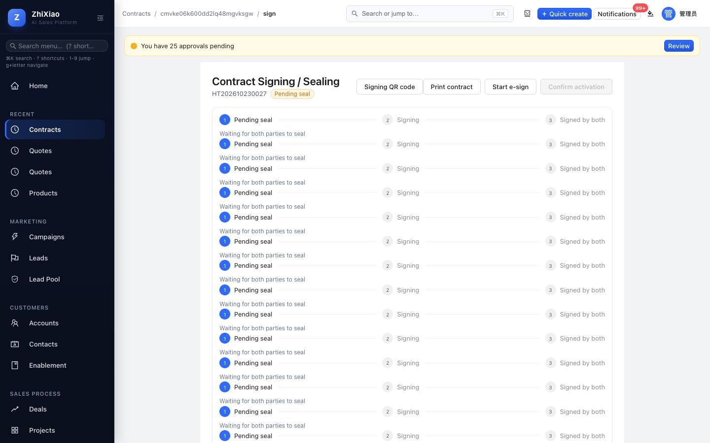

4. After activation, **Configure payment plan** and record payments as they arrive; finance **confirms** and **reconciles** them.
5. **Register invoices**: the total invoiced cannot exceed the contract amount; the system alerts on differences between contract, invoices and payments.
6. **Change orders**: register a change order when the amount or terms change; once approved, the contract amount is adjusted automatically.
7. Mark the contract **Finished** when fully delivered.

### 6.2 Renewals

Menu: **Revenue → Renewals**. Lists contracts that have expired or expire within 30 / 60 / 90 days, and creates a renewal quote in one click.

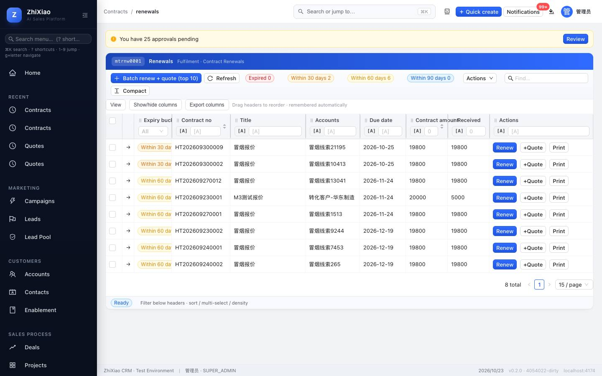

### 6.3 E-sign progress

Menu: **Revenue → E-Sign Progress**. A board of contracts waiting for seal, signed by one party, and signed by both, so you can chase signatures.

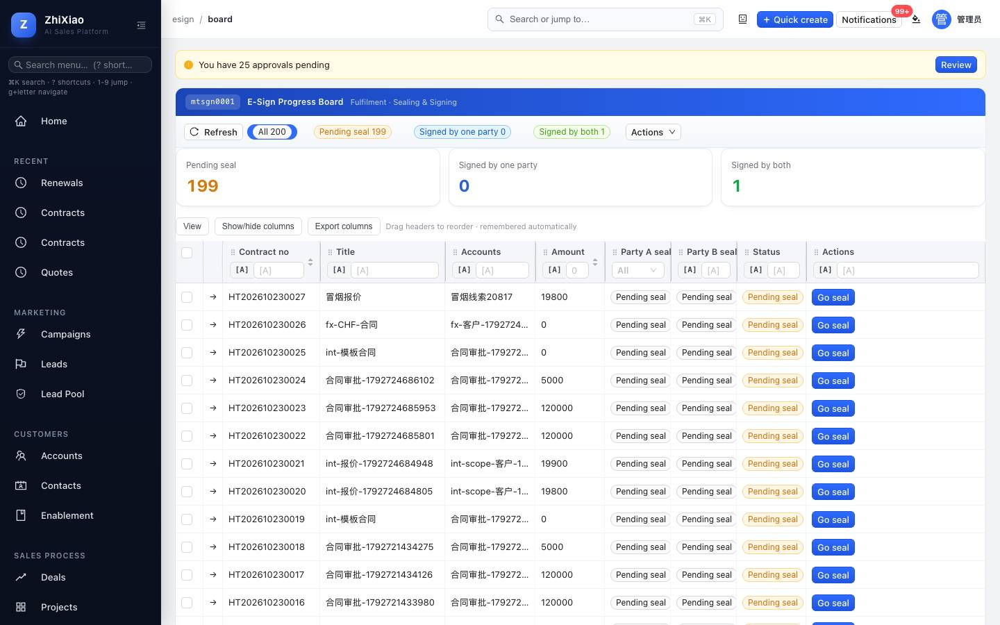

### 6.4 Receivables aging

Menu: **Revenue → Receivables Aging**. Total overdue receivables, open payment plans, overdue aging buckets and upcoming payments by due date.

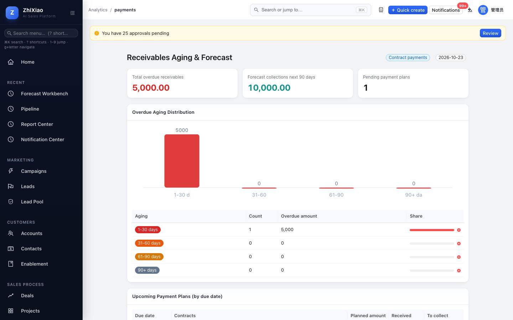

### 6.5 Products

Menu: **Revenue → Products**. The product and service catalog, with standard, channel, VIP, promotional and other price books. Quotes pick products from here.

### 6.6 Service tickets

Menu: **Revenue → Service Tickets**.

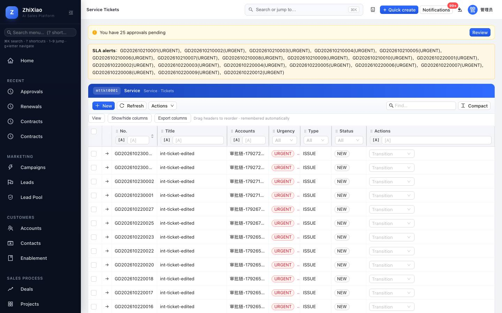

- **Type**: incident, inquiry, request, defect; **Priority**: low, medium, high, urgent
- **Status**: New → Processing → Waiting on customer → Resolved → Closed
- SLAs are calculated by priority; tickets close to breaching are flagged at the top of the page and their owners are notified

### 6.7 Forecast workbench, 6.8 Weekly sales brief

- **Forecast Workbench**: pipeline total, goal progress, forecast accuracy, leaderboard. See [7.4](#74-forecast-workbench).
- **Weekly Sales Brief**: summarizes this week's new leads, new deals, wins, revenue, collections and follow-ups; **Copy text**, **Print**, or **Share with everyone** (in-app notification, written in each recipient's language).

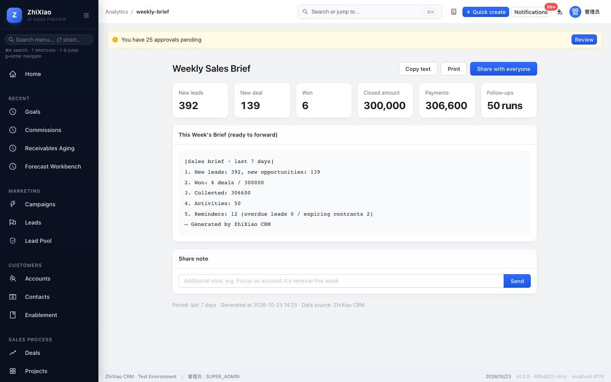

### 6.9 Data import

Menu: **Revenue → Data import**. A wizard imports **leads / contacts / accounts** from CSV files:

1. Choose what to import (leads / contacts / accounts).
2. Prepare the CSV: the first row is the header; Chinese and English column names both work, such as `名称/name`, `联系人/contactName`, `手机/phone`, `邮箱/email`, `来源/source`, `备注/remark`.
3. **Select CSV file**; the system previews the data.
4. Confirm the import. When it finishes you see how many rows succeeded and failed, and can **View list**. Duplicates are skipped automatically by name / email / phone.

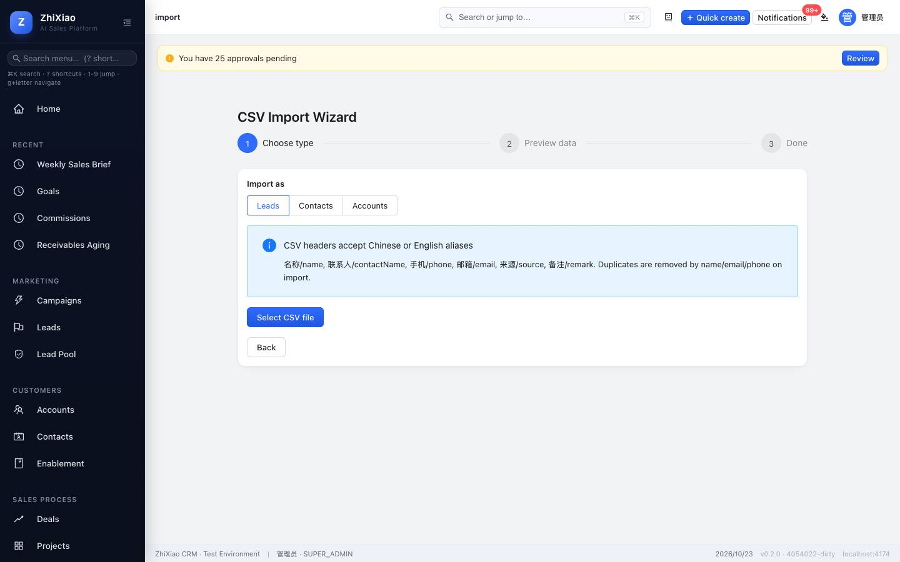

> Save CSV files as UTF-8; in Excel, use "CSV UTF-8".

### 6.10 Segment dashboard

Menu: **Revenue → Segment Dashboard**. Groups accounts by stage (Prospect / Active / At risk / Churned) and other conditions, shows the members of each segment, and turns on automatic outreach (for example, follow-up tasks for at-risk accounts).

---

## 7. Analytics

### 7.1 Report center

Menu: **Analytics → Report Center** (shortcut `8`).

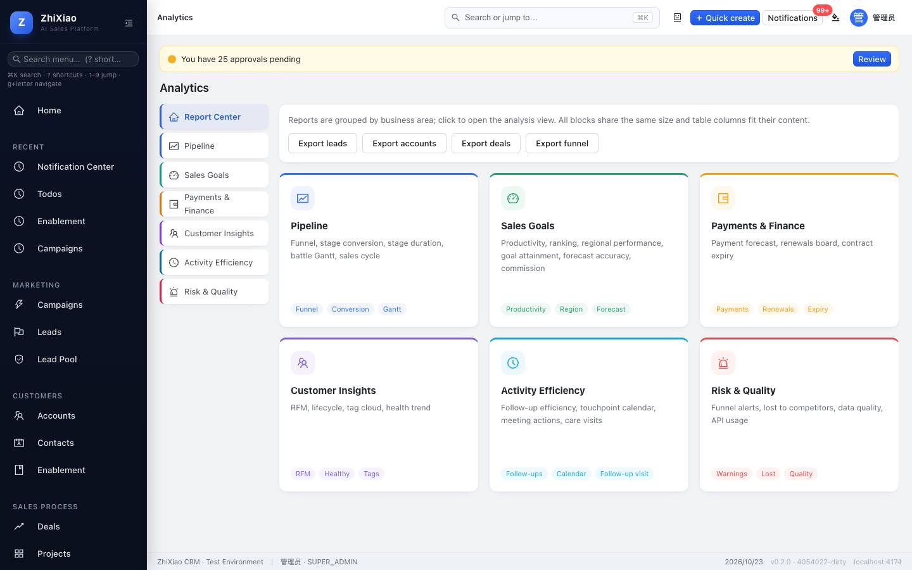

| Category | Main reports |
|----------|--------------|
| Pipeline | Sales funnel, funnel health, stage conversion, time in stage, sales cycle, win-rate scoring |
| Sales Goals | Rep comparison, goal attainment, commission accrual, forecast accuracy |
| Payments & Finance | Collection forecast, receivables aging, renewal estimate, contract expiry |
| Customer Insights | Customer value tiers (RFM), lifecycle, lead source conversion, account health trend |
| Activity Efficiency | Follow-up efficiency, suggested call-backs, meeting action tracking, customer care |
| Risk & Quality | Funnel alerts, loss analysis, competitor battles, data quality, win reviews |

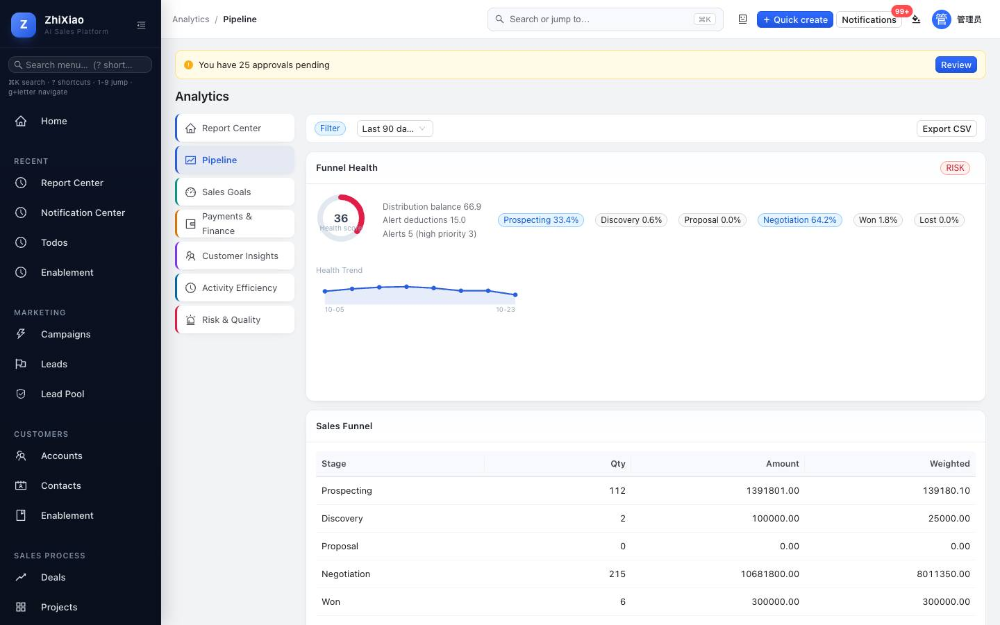

Export CSV at the top right of each report. You only see data within your data scope. All amounts in reports are in the base currency.

### 7.2 Quotas

Menu: **Analytics → Quotas**. Set company, team and individual goals (revenue, new deals, won amount) by month, quarter or year, and see attainment, weighted pipeline and the gap.

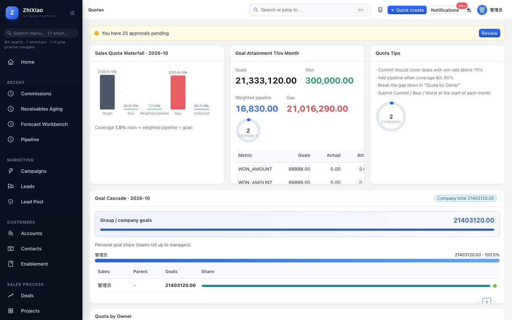

### 7.3 Commissions

Entry: **Report Center → Sales Goals → Commission accrual → Commission Center**, or search "commission" with ⌘K.

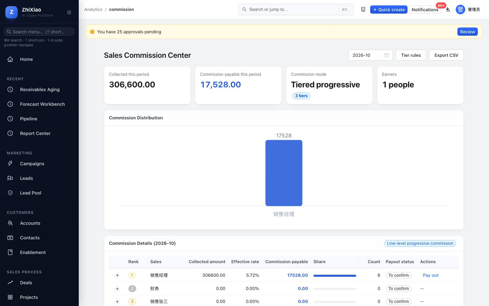

- Commissions are calculated on **confirmed payments**, using **tiered progressive** or **flat rate** mode as set by your administrator in **Tier rules**; tiered mode is applied line by line on contract lines.
- Payout status: Pending → Confirmed → Paid; export CSV for finance.

### 7.4 Forecast workbench

Menu: **Revenue → Forecast Workbench**.

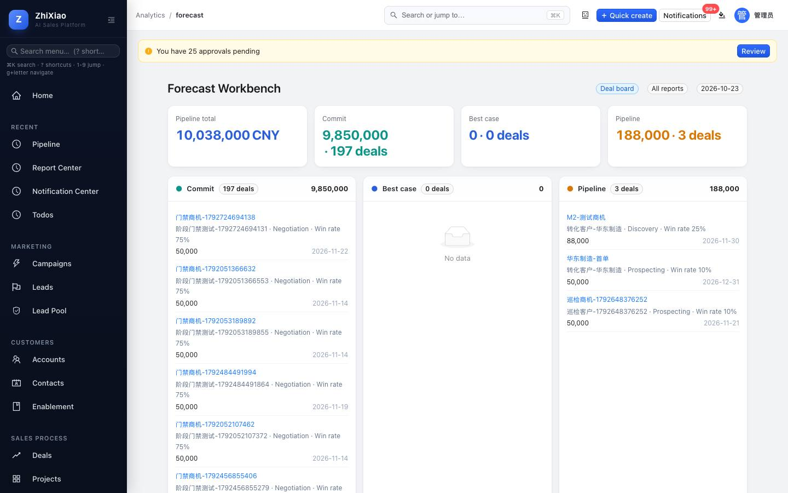

---

## 8. Collaboration

### 8.1 Todos

Menu: **Collaboration → Todo Center** (shortcut `9`). Today's todos, overdue tasks, pending approvals and smart reminders in one place. Drag to reorder, mark priority, or **Remind me later**.

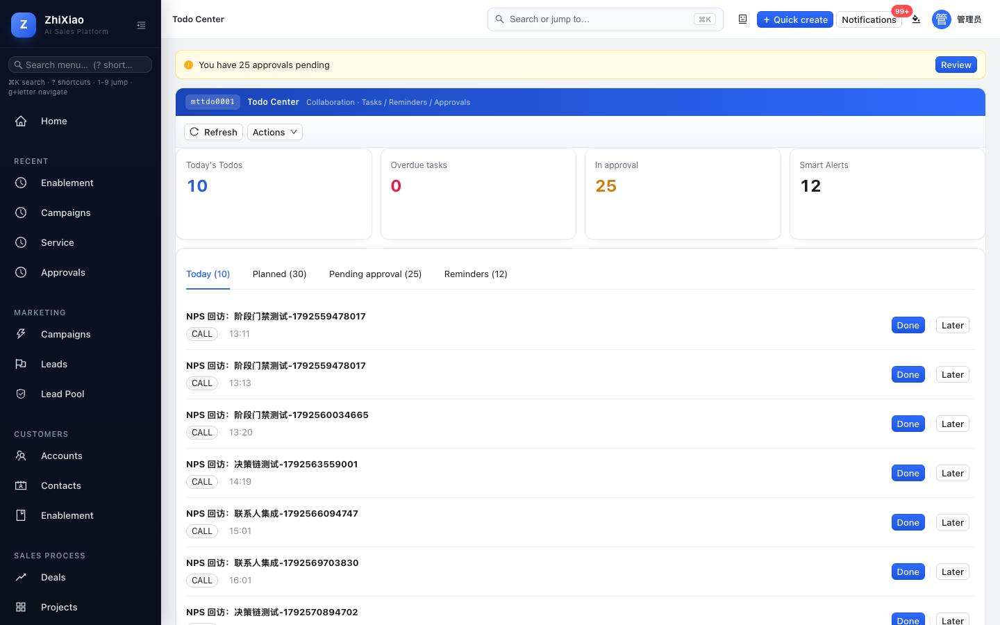

### 8.2 Approvals

Menu: **Collaboration → Approval Center**.

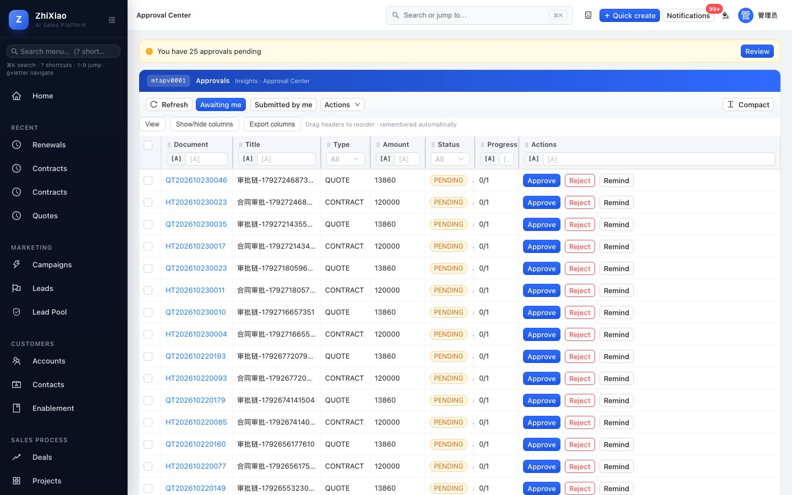

- Quotes, contracts, payments, change orders and other items waiting for your approval are listed here; open one to see the document.
- Quote approval has two levels: first the applicant's direct manager, then that manager's manager; the same person is never asked twice. When it is your turn you get a "New approval waiting for you" notification.
- **Approve** or **Reject**; **a rejection requires a comment**.
- On a phone you can select all and approve in bulk.

### 8.3 Notifications

Click **Notifications** in the top bar to open the Notification Center.

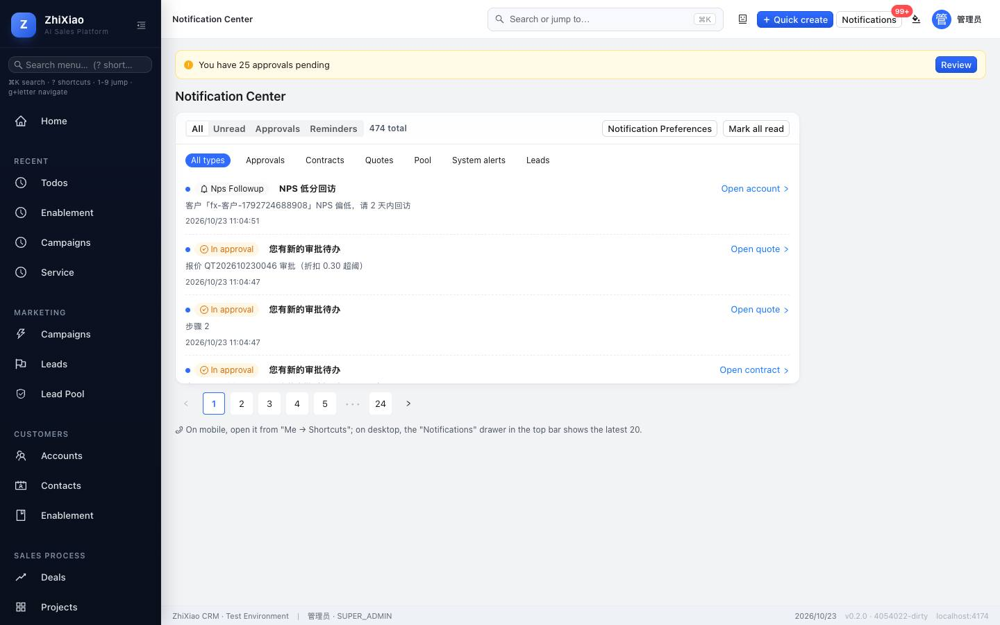

- Categories: pending approvals, approval results, lead assignment, follow-ups due, payment confirmation, SLA alerts, renewal deals, stalled deals, health alerts and more
- **Notification Preferences**: mute the categories you don't need
- Notifications are written in your interface language. If your administrator has set it up, they also reach your phone as push notifications and appear in the team's WeCom / DingTalk / Feishu group

### 8.4 Me and changing your password

- **Me** in the bottom bar on a phone, or the avatar at the top right on desktop: profile, appearance (theme color), shortcuts; the current version is shown at the bottom of the page.
- **Change password**: left menu **Platform** (Settings) → **Security & Workflow** → **Change Password**; enter your current password and a new one (at least 8 characters).
- **Linked accounts**: on the **Me** page, click **Link** and scan with WeCom, DingTalk or Feishu; you can then sign in by scanning. Click **Unlink** when you no longer need it. Only platforms enabled by your administrator are shown.

> Every role can change its own password. If you forget it, ask your administrator to reset it under **Users**.

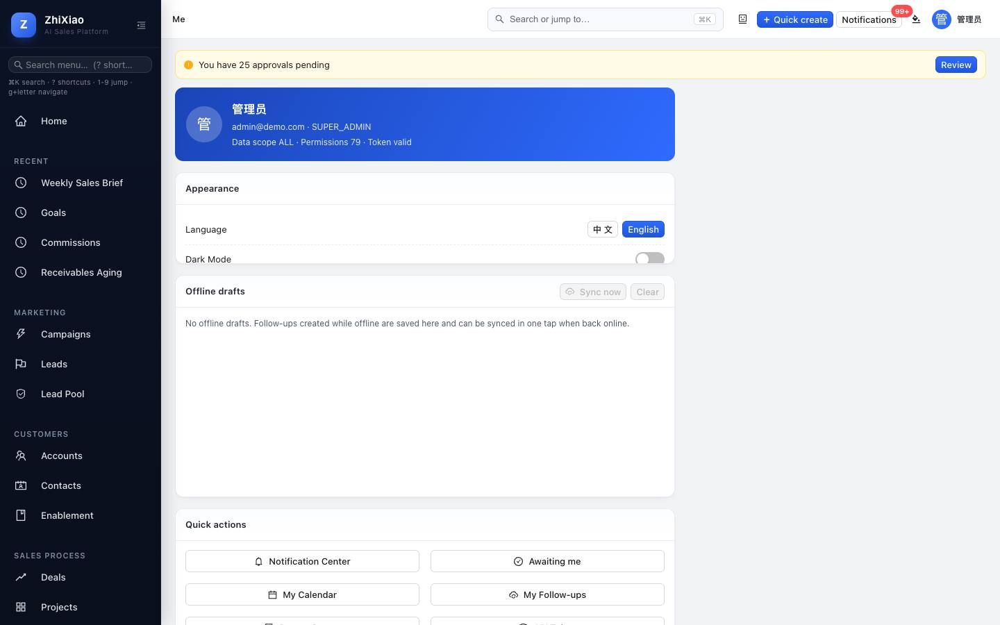

### 8.5 Help Center

Menu: **Collaboration → Help Center**. Read this guide and the Administrator Guide inside the system, in your interface language; click an entry in the contents to jump to that section. The guides are updated with each release.

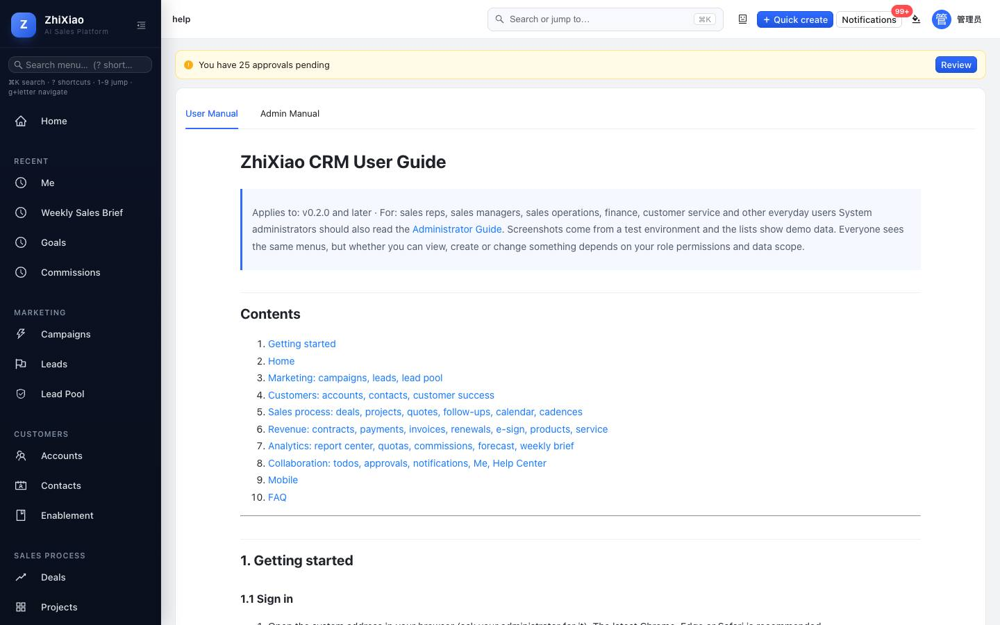

---

## 9. Mobile

Open the same address in your phone's browser. If the Android / iOS / HarmonyOS apps have been released, ask your administrator how to install them. The apps offer the same features as the web version, plus push notifications.

| Home | Deals | Follow-ups |
|------|-------|------------|
| 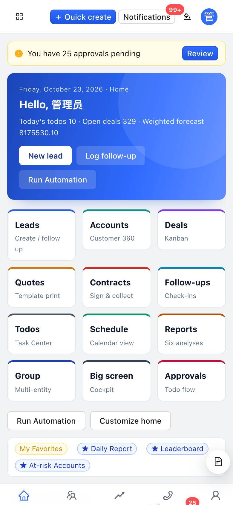 | 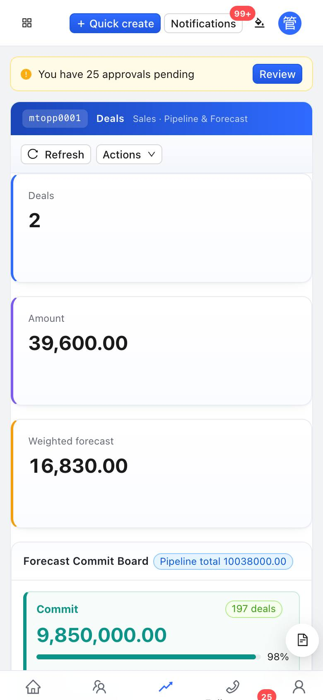 | 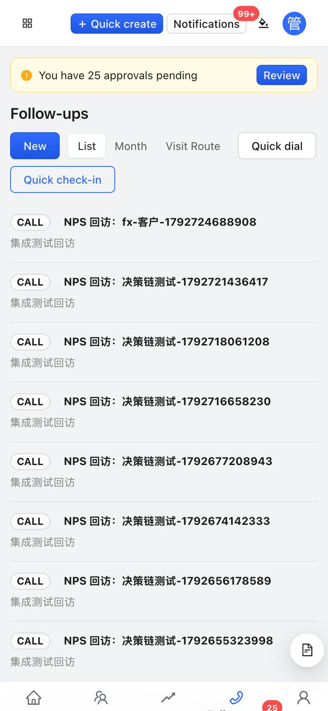 |

- **Bottom tabs**: Home · Accounts · Deals · Follow-ups · Me
- **Add to home screen**: in Safari tap Share → Add to Home Screen; in Chrome use the menu's Add to Home screen / Install app, then open it from your home screen like an app
- **Swipe left on a card**: reveals quick actions (call, log follow-up, etc.)
- **Visit check-in**: allow location access; if it fails, enter the address manually
- **Phone numbers**: tap to call
- **Push notifications**: the app asks for permission after you sign in; tap a notification to open the related record

---

## 10. FAQ

| Problem | What to do |
|---------|------------|
| Sign-in says the email or password is wrong | Check your email and password; if you forgot your password, ask your administrator |
| "Too many requests" (429) | Wait one minute and try again |
| You can't see some accounts or deals | Your data scope limits what you see (own / team / department / all); ask the owner to share it or contact your administrator |
| A page says you lack permission, or saving fails with "missing permission" | Menus are visible to everyone, but actions depend on your role; ask your administrator to adjust your role |
| A deal can't move to the next stage | Fill in what the stage gate asks for (amount, expected close date, next step, contacts, quote) |
| A quote can't be sent or accepted | The discount or amount exceeds the threshold; submit it for approval first |
| A foreign currency can't be selected or saved | Your administrator hasn't added an exchange rate for that currency yet |
| The imported CSV shows garbled text | Save it again as "CSV UTF-8" |
| The page is blank or looks wrong | Force refresh with Ctrl+F5 (Mac: ⌘+Shift+R); if that doesn't help, send your administrator a screenshot and the version number from the status bar |
| A printed contract or quote looks wrong | See **Platform → Template Guide**, or ask your administrator to check the template |
