# 智销 CRM 用户手册

> 适用版本：v0.2.0 及以后 · 适用对象：销售、销售经理、商务、财务、客服等日常使用者
> 系统管理员请同时阅读《[管理员手册](admin-manual.md)》。
> 文中截图来自测试环境，列表里的数据是演示数据。所有人看到的菜单相同，但能否查看、新建、修改由你的角色权限与数据范围决定。

## 目录

1. [入门](#1-入门)
2. [工作台](#2-工作台)
3. [营销获客：营销、线索、公海查重](#3-营销获客)
4. [客户资产：客户、联系人、销售赋能](#4-客户资产)
5. [销售过程：商机、项目、报价、跟进、日程、跟进计划](#5-销售过程)
6. [商务履约：合同、回款、发票、续签、电子签、产品、服务](#6-商务履约)
7. [分析报表：报表中心、目标、佣金、预测、周报](#7-分析报表)
8. [协作办公：待办、审批、通知、我的、帮助中心](#8-协作办公)
9. [手机端](#9-手机端)
10. [常见问题](#10-常见问题)

---

## 1. 入门

### 1.1 登录

1. 浏览器打开系统地址（向管理员索取），推荐 Chrome、Edge 或 Safari 最新版。
2. 输入**邮箱**和**密码**，点 **确认**。
3. 首次登录后建议修改初始密码（见 [8.4](#84-我的与修改密码)）。
4. 管理员启用了企业微信、钉钉或飞书登录时，登录框下方会出现 **企业微信扫码登录** 等按钮，用手机 App 扫码即可登录，无需输入密码。

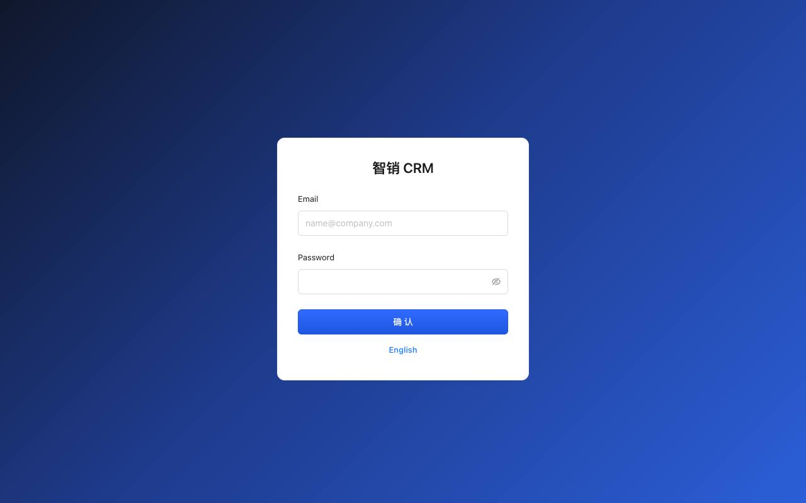

右下角 **English / 中文** 可切换界面语言，切换后立即生效。

### 1.2 界面布局

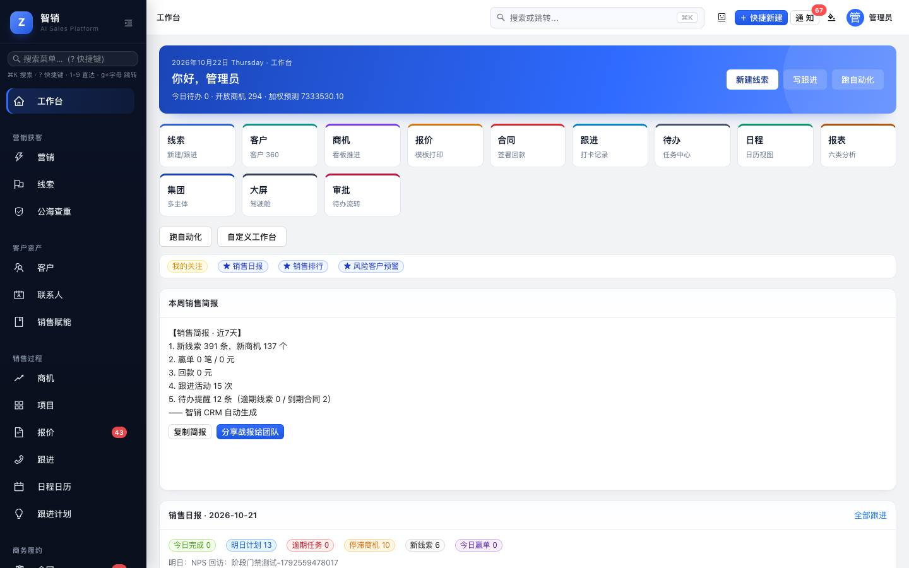

| 区域 | 说明 |
|------|------|
| 左侧菜单 | 按业务分组：营销获客、客户资产、销售过程、商务履约、分析报表、协作办公、平台管理。顶部「最近访问」记录你常去的页面；菜单上方的搜索框可按名称或拼音找菜单 |
| 顶栏搜索 | 搜索客户、线索、商机、联系人等记录，或直接跳转页面（快捷键 ⌘K / Ctrl+K） |
| **快捷新建** | 一键新建线索、客户、联系人、商机、跟进 |
| **通知** | 红色数字为未读通知数，点开进入通知中心 |
| 头像 | 个人信息、主题、退出登录 |
| 底部状态栏 | 当前用户、角色、日期、系统版本号（反馈问题时请一并提供） |

### 1.3 列表的通用操作

系统里的大部分列表（线索、客户、商机、合同…）操作方式相同：

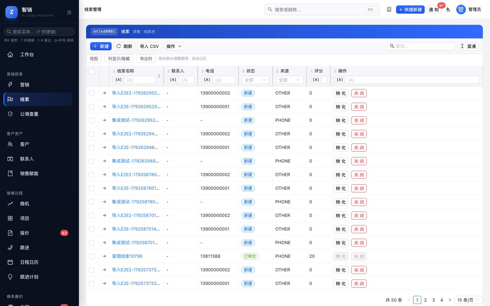

| 操作 | 方法 |
|------|------|
| 打开 / 编辑一条记录 | 点名称进入详情；点行首 **→** 打开编辑弹窗 |
| 按列筛选 | 每列表头下方的输入框；左侧 `[A]` 徽标可切换运算符（等于 / 包含 / 为空 等） |
| 排序 | 点列标题 |
| 调整列 | 拖动表头调整顺序，拖动列边线调整宽度；**列显示/隐藏** 选择显示哪些列。设置会自动记住 |
| 保存视图 | **视图** → 保存当前筛选与列设置，可共享给团队 |
| 批量操作 | 勾选左侧复选框，顶部出现批量按钮（批量关闭、批量删除草稿等） |
| 导出 | **导出列** 选择导出字段；**操作** 菜单中可导出 CSV / Word / PDF |
| 紧凑 / 宽松 | 右上角 **紧凑** 切换行高 |

筛选条件会写入浏览器地址，复制地址发给同事即可打开同样的筛选结果。

### 1.4 快捷键

按 `?` 可随时查看快捷键说明。

| 快捷键 | 作用 |
|--------|------|
| ⌘K / Ctrl+K | 命令面板：搜索记录、跳转页面、快捷新建 |
| 1 – 9 | 直达：1 工作台、2 线索、3 客户、4 商机、5 报价、6 合同、7 项目、8 报表中心、9 待办 |
| g 再按 h / l / a / o / c / r / t | 跳到 工作台 / 线索 / 客户 / 商机 / 日历 / 报表中心 / 跟进（1.5 秒内连按） |
| c | 快捷新建 |
| Esc | 关闭弹窗或抽屉 |

在输入框里打字时快捷键自动失效。

---

## 2. 工作台

登录后的首页，汇总你今天需要关注的事情：

- **顶部横幅**：今日待办数、开放商机数、加权预测金额；**新建线索**、**写跟进**、**跑自动化**（立即执行一次提醒与自动分配）
- **快捷卡片**：线索、客户、商机、报价、合同、跟进、待办、日程、报表、集团、大屏、审批
- **我的关注**：你在各记录上点了 ☆ 关注后，会集中显示在这里
- **功能块**：本周销售简报、待办中心、销售日报、智能提醒、客户健康、数据质量、销售排行、本月目标进度、客户满意度、风险客户预警、漏斗预警、阶段转化等

点 **自定义工作台** 可选择显示哪些功能块及其顺序。

---

## 3. 营销获客

### 3.1 营销

菜单：**营销获客 → 营销**。登记市场活动（展会、线上推广等），记录预算、时间与状态（计划中 / 进行中 / 已结束）。通过活动表单收集的线索会自动进入线索列表，并记录来源活动，便于在报表中统计活动转化。

### 3.2 线索

菜单：**营销获客 → 线索**（快捷键 `2`）。线索是尚未确认的潜在客户。

**线索状态**：新建 → 已接受 → 培育中 → 已转化 / 已关闭

| 我要… | 操作 |
|--------|------|
| 新建线索 | 列表左上 **新建**，必填 **线索名称** 与 **来源**（官网表单、电话、转介绍、展会、陌生拜访、广告、渠道伙伴、其他） |
| 批量导入 | **导入 CSV**，或使用 **商务履约 → 数据导入** 向导（见 [6.9](#69-数据导入)） |
| 分配给销售 | 经理勾选线索，在顶部 **批量分配给…** 选择销售；长时间无人跟进的新线索也会被系统自动重新分配。被分配人会收到通知 |
| 写跟进 | 进入线索详情，在 **快速跟进** 区记录电话、拜访、备注，并设置下次跟进时间 |
| 转化 | 列表行内 **转化**，或详情页 **转化**：选择 **新建客户** 或 **关联已有客户**，可同时创建联系人和商机 |
| 关闭 | 列表行内 **关闭** 并填写原因；多条可勾选后 **批量关闭** |

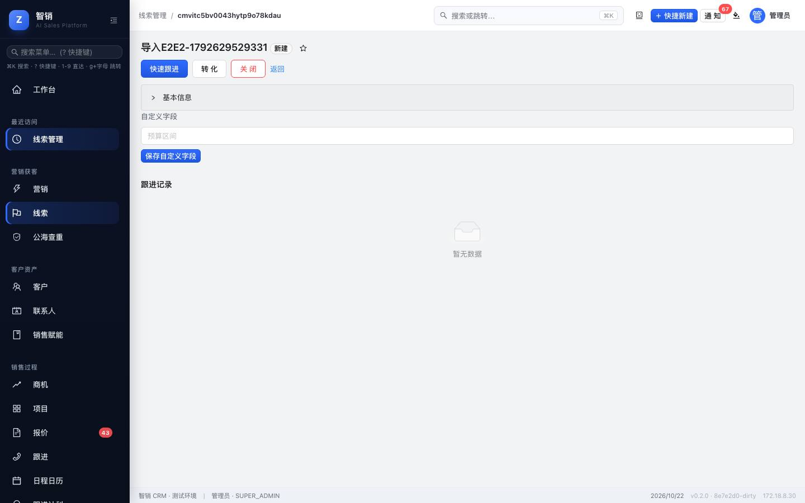

> **自动回收**：线索 7 天未跟进会自动回到公海，请按时更新跟进记录与「下次跟进」时间。

### 3.3 公海查重

菜单：**营销获客 → 公海查重**。

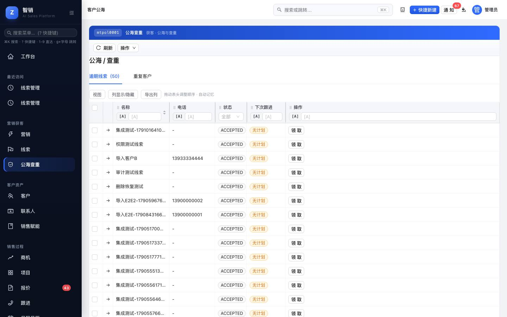

- **公海**：无人负责或被自动回收的线索 / 客户，任何有权限的销售都可以 **领取**。
- **查重**：按名称、电话等识别疑似重复的客户，可进入 **重复客户合并向导** 合并为一条。合并后联系人、商机、合同等都会挂到保留的那条客户下。

> 客户 30 天无任何活动也会被回收到公海。

---

## 4. 客户资产

### 4.1 客户

菜单：**客户资产 → 客户**（快捷键 `3`）。

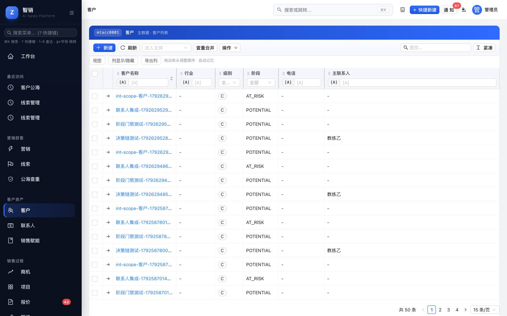

列表顶部可按客户阶段（潜在 / 活跃 / 风险 / 流失）快速切换，**分配我** 只看自己负责的客户。

**客户 360 详情**：点客户名称进入。

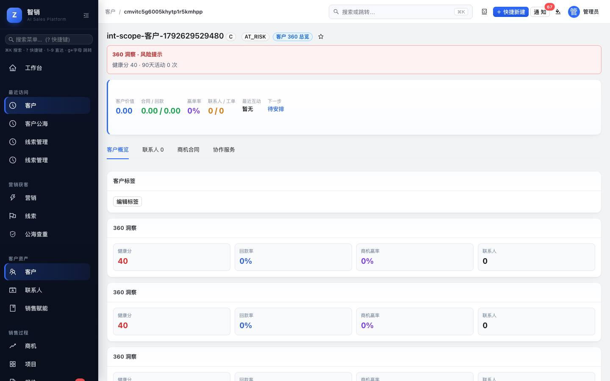

| 页签 | 内容 |
|------|------|
| 客户概览 | 基本信息、360 洞察（健康度、回款率、赢率、联系人）、客户层级、标签、互动时间线、互动日历、客户旅程、NPS 满意度 |
| 商机合同 | 该客户的商机、合同、回款与财务摘要（待收、回款率） |
| 协作服务 | 联系人与决策链、服务工单、共享成员 |

常用操作：

- **编辑标签**：概览页「客户标签」卡片 → 编辑
- **共享**：把客户共享给同事（协作者可编辑，查看者只读）
- **关注**：标题旁 ☆，关注后出现在工作台「我的关注」
- **自定义字段**：管理员配置的扩展字段在详情中填写

### 4.2 联系人

菜单：**客户资产 → 联系人**。

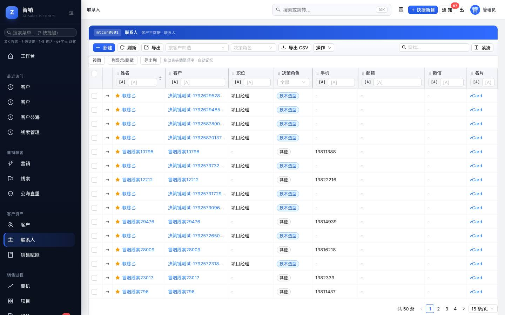

- 联系人必须挂在某个客户下；在客户详情里新建最方便。
- **决策角色**：经济决策人、使用者、技术把关、内部教练、其他。商机推进到「谈判」前要求至少有一位联系人（决策链）。
- 每个客户可设一位 **主联系人**，用于报价、合同等单据默认带出。
- 手机上点电话号码可直接拨打。

### 4.3 销售赋能

菜单：**客户资产 → 销售赋能**。

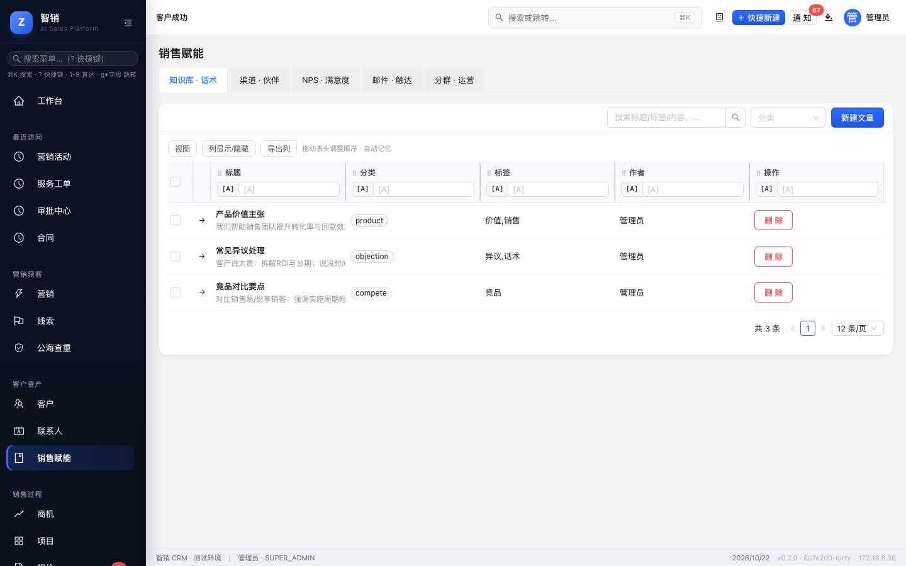

| 页签 | 用途 |
|------|------|
| 知识库 · 话术 | 产品介绍、异议处理、竞品对比等文章，按分类和标签检索 |
| 渠道 · 伙伴 | 渠道伙伴名录及其带来的线索、商机业绩 |
| NPS · 满意度 | 记录客户回访评分；低分会触发预警与回访任务 |
| 邮件 · 触达 | 邮件模板；可追踪打开与点击 |
| 分群 · 运营 | 按条件把客户分群，配合自动触达（详见 [6.10](#610-客户分群看板)） |

---

## 5. 销售过程

### 5.1 商机

菜单：**销售过程 → 商机**（快捷键 `4`）。

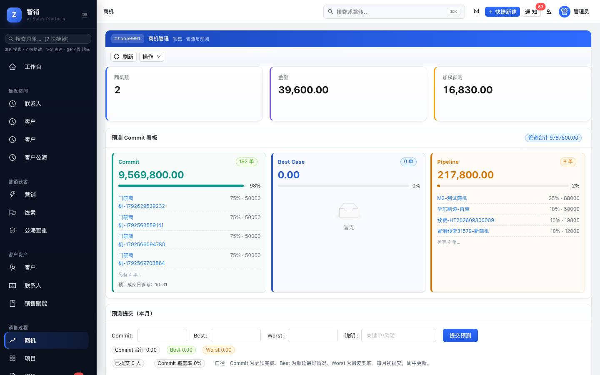

**标准阶段**：初步接洽 → 需求确认 → 方案/报价 → 谈判 → 赢单 / 输单

**推进阶段**：在看板中把卡片拖到下一列，或在详情页左上角下拉选择阶段。系统会校验必填信息（**阶段门禁**），缺什么会一次性提示：

| 推进到 | 需要先补齐 |
|--------|------------|
| 需求确认 | 商机金额 |
| 方案/报价 | 商机金额、预计成交日、至少一张报价 |
| 谈判 | 商机金额、预计成交日、下一步动作、客户联系人（决策链） |
| 赢单 | 商机金额 |

> 管理员可调整以上规则，以系统提示为准。

**赢单 / 输单**：详情页 **赢单** 或 **输单** 按钮；输单需选择原因，用于输单分析。

**预测提交**：经理在商机页 **提交预测**，按 Commit / Best / Pipeline 提交本月预测，用于预测准确性统计。

**商机详情**：

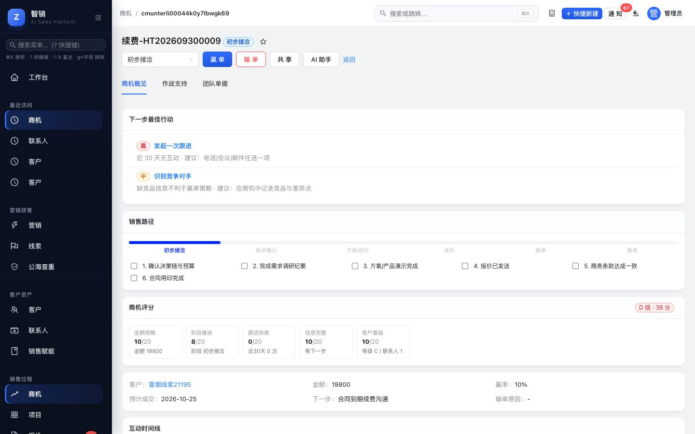

| 页签 | 内容 |
|------|------|
| 商机概览 | 下一步最佳行动、销售路径清单（逐项勾选）、商机评分、基本信息、互动时间线 |
| 作战支持 | 采购决策链、竞品、销售陪练、销售作战室、**AI 助手**（生成摘要、下一步建议、风险提示，需管理员开启） |
| 团队单据 | 商机团队成员、关联报价与合同 |

**共享**：详情页 **共享** 把商机加给协作人。

### 5.2 项目

菜单：**销售过程 → 项目**（快捷键 `7`）。适用于一个客户下有多张报价、合同的项目制销售。项目页汇总报价合计、合同合计、已回款、毛利，提供预算偏差预警、项目健康度、里程碑与甘特进度，以及项目日历。

### 5.3 报价

菜单：**销售过程 → 报价**（快捷键 `5`）。

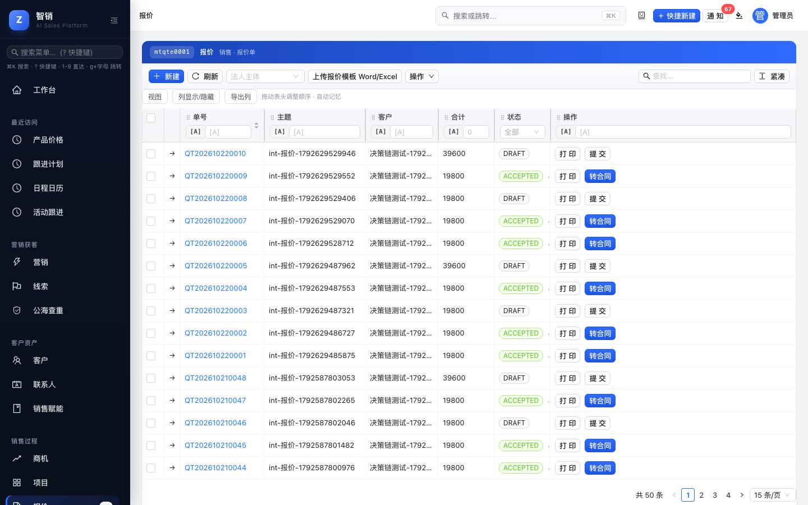

**报价状态**：草稿 → 待审批 → 已批准 → 已发送 → 客户接受；审批不通过为已驳回

1. **新建**：选择客户、商机，添加产品行（数量、折扣），系统实时计算合计；可选用报价模板。
2. **提交**：任一行折扣率超过阈值（默认 20%），或报价总额达到金额阈值（默认 20 万），会进入审批，审批通过后才能发送与接受；都不满足的直接批准。
   审批依次交给你的**直属上级**和**上级的上级**；没有上级时交给超级管理员。你不能审批自己提交的报价。
3. **发送**：发邮件给客户，或生成 **分享链接 / 二维码**，客户可在线查看并确认。
4. **接受**：客户确认后标记为「客户接受」。
5. **转合同**：「客户接受」的报价一键生成合同，产品行自动带入。

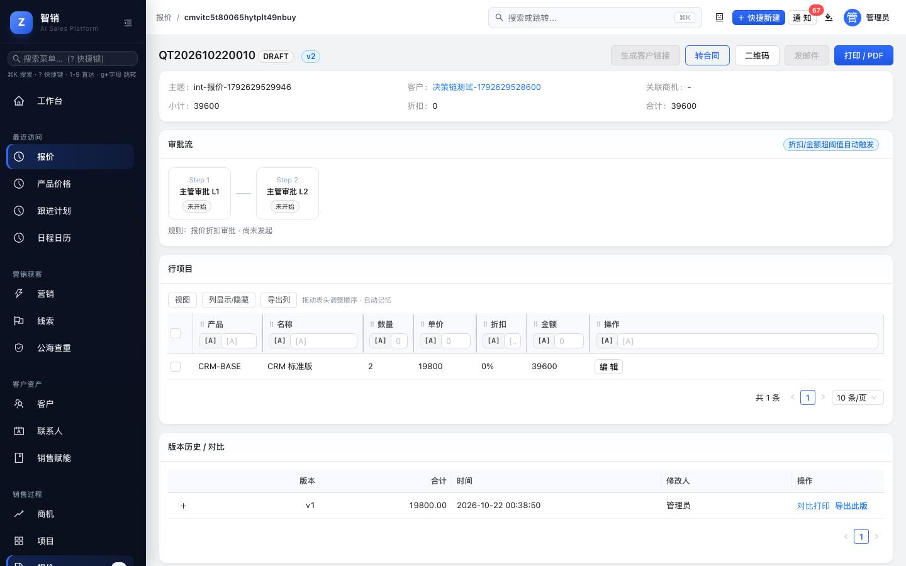

报价详情中可查看审批流、行项目、**版本历史 / 对比**，以及 **打印 / PDF**、导出 Word。报价模板在列表 **操作 → 报价模板管理** 中维护（上传 Word/Excel 格式文件的方法见 **平台管理 → 模板使用说明**）。

### 5.4 跟进

菜单：**销售过程 → 跟进**（快捷键 `g` `t`）。记录与客户的每一次互动。

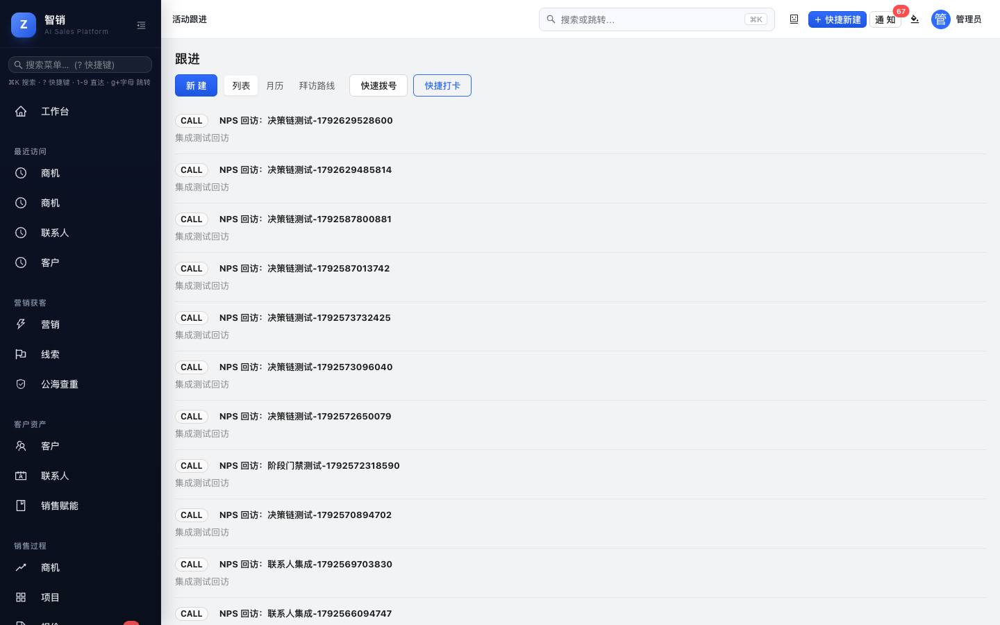

- **类型**：任务、拜访、电话、邮件、备注
- **状态**：计划中、已完成、已取消
- **拜访打卡**：手机上新建拜访时点 **打卡**，允许定位后自动记录位置；定位失败可 **手工打卡地址**
- 视图：**列表**、**月历**、**拜访路线**（当天计划拜访的先后顺序，以及已签到位置的分布示意）

### 5.5 日程日历

菜单：**销售过程 → 日程日历**（快捷键 `g` `c`）。按 **月视图** 或 **议程** 查看所有计划中的跟进、会议与任务，可按类型（电话、拜访、邮件、任务、会议）筛选。

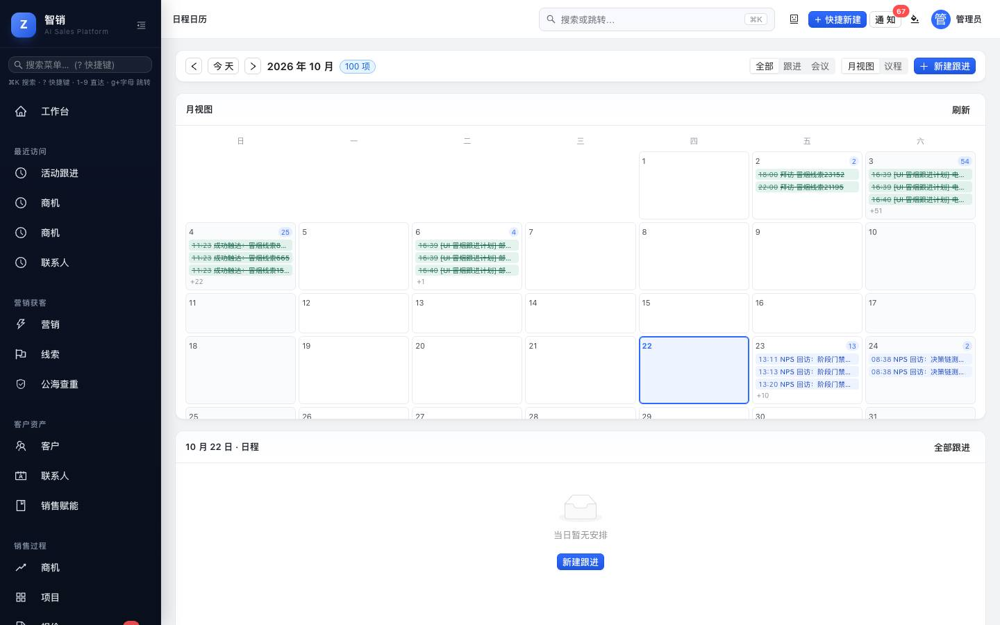

### 5.6 跟进计划

菜单：**销售过程 → 跟进计划**。预先编排一组按天展开的跟进步骤（如「第 1 天电话、第 3 天发资料、第 7 天拜访」），对线索或客户 **启动计划** 后自动生成对应的计划任务，出现在日历和待办中。计划可设为 **团队共享**。

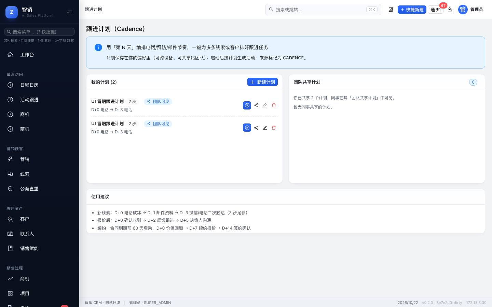

---

## 6. 商务履约

### 6.1 合同

菜单：**商务履约 → 合同**（快捷键 `6`）。

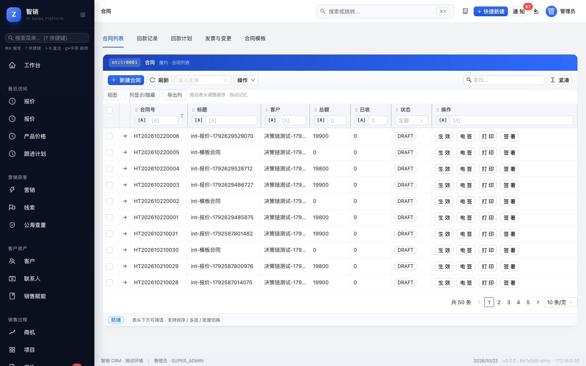

**合同状态**：草稿 → 审批中 → 生效中 → 已完结；也可能为已驳回或已终止。

**回款状态**：草稿 → 已提交 → 已确认 → 已核销（或已驳回）。

页面顶部页签：

| 页签 | 用途 |
|------|------|
| 合同列表 | 合同主表 |
| 回款记录 | 每一笔实际到账 |
| 回款计划 | 按期应收（未付 / 部分付 / 已付 / 逾期） |
| 发票与变更 | 发票登记与作废/红冲、合同变更单 |
| 合同模板 | 标准、渠道、定制等合同模板 |

**典型流程**：

1. **新建合同**（或由报价转合同），选择模板，编辑条款与产品行。
2. **生效**：草稿合同确认无误后，由有「合同生效」权限的人（如销售经理）点 **生效**。合同额达到审批金额（默认 10 万）时会先进入「审批中」，由上级审批通过后自动生效；被驳回可修改后 **重新提交**。
3. **签署 / 用印**：在合同签署页上传附件、加盖电子印章，打印合同。

   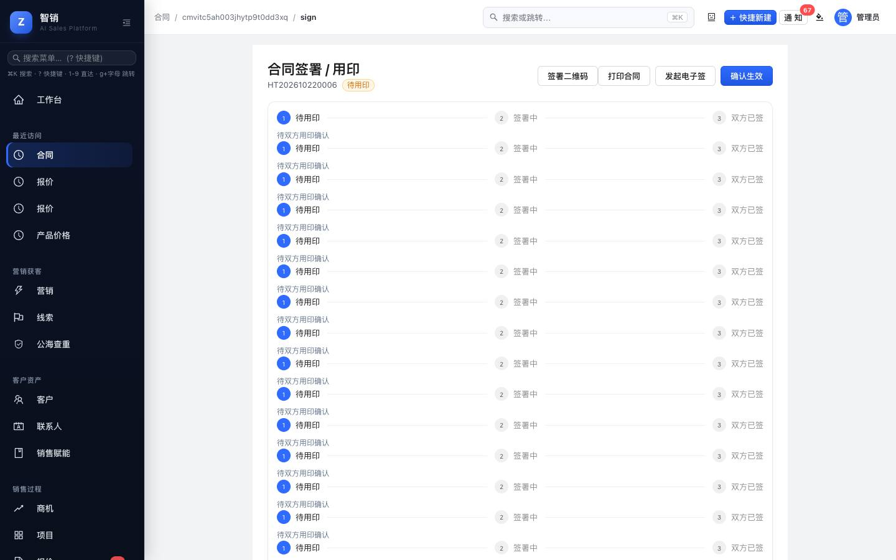

4. 生效后 **配置回款计划**，按期登记回款；财务 **确认** 并 **核销**。
5. **登记发票**：开票金额累计不能超过合同金额；系统会对「合同 / 开票 / 回款」三方差异预警。
6. **合同变更单**：金额、条款变化时登记变更单，审批通过后自动调整合同金额。
7. 全部履约后标记 **完结**。

### 6.2 续签工作台

菜单：**商务履约 → 续签工作台**。按「已过期 / 30 天内 / 60 天内 / 90 天内」列出即将到期的合同，可一键生成续签报价。

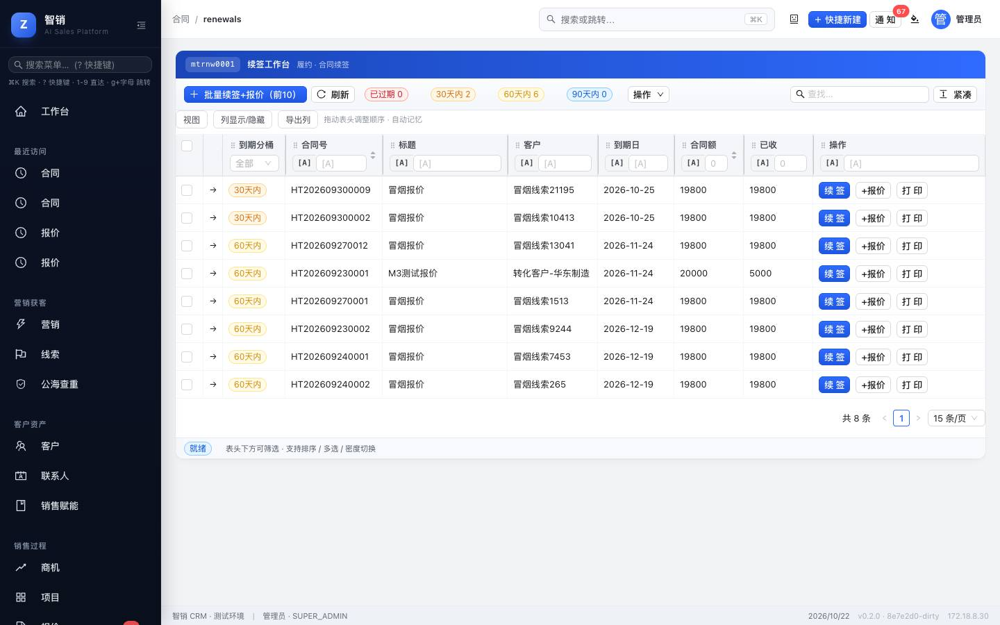

### 6.3 电子签进度

菜单：**商务履约 → 电子签进度**。看板展示待用印、单方已签、双方已签的合同，便于跟进签署进度。

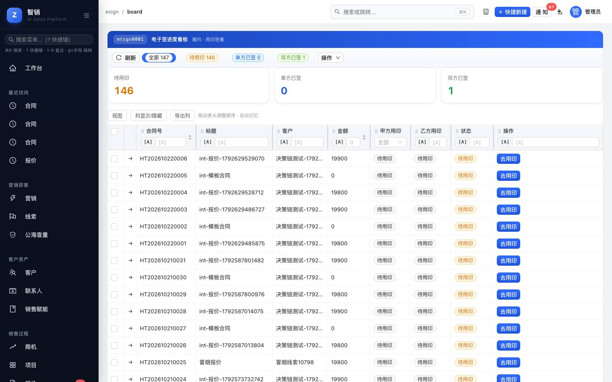

### 6.4 回款账龄分析

菜单：**商务履约 → 回款账龄分析**。逾期应收合计、待回款计划数、逾期账龄分布、未来回款计划（按到期日）。

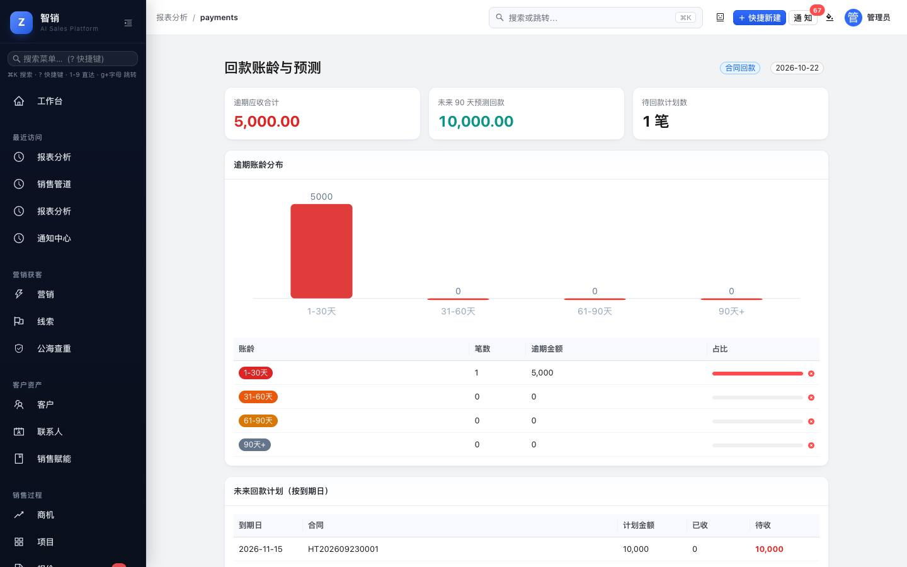

### 6.5 产品价格

菜单：**商务履约 → 产品价格**。产品与服务目录，以及标准、渠道、VIP、促销等价目。报价时从这里选产品。

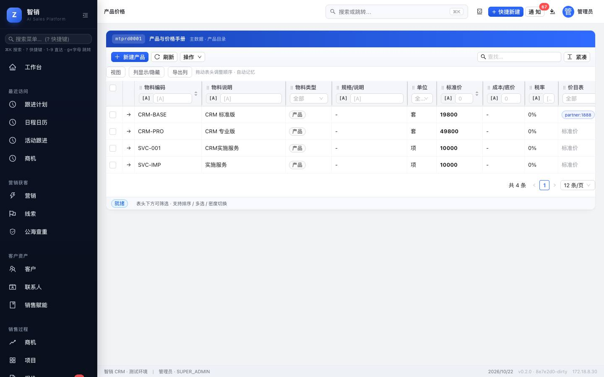

### 6.6 服务（工单）

菜单：**商务履约 → 服务**。

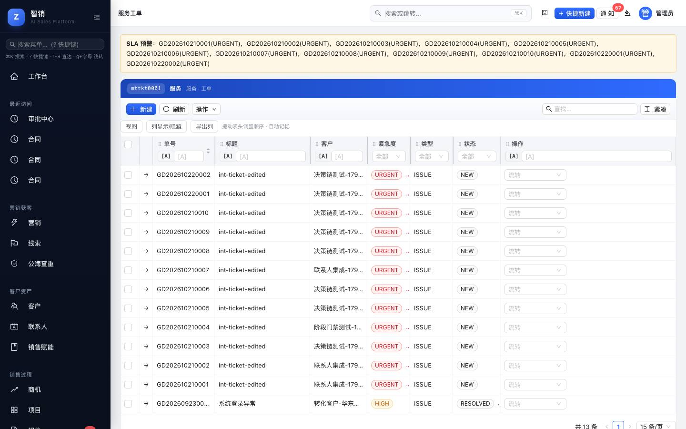

- **类型**：故障、咨询、需求、缺陷；**优先级**：低、中、高、紧急
- **状态**：新建 → 处理中 → 待客户反馈 → 已解决 → 已关闭
- 系统按优先级计算 SLA，即将超时的工单在页面顶部预警并通知负责人

### 6.7 销售预测工作台、6.8 销售周报

- **销售预测工作台**：管道合计、目标达成进度、预测准确性、销售排行。见 [7.4](#74-销售预测工作台)。
- **销售周报**：自动汇总本周新线索、新商机、赢单、成交额、回款、跟进；可 **复制文本**、**打印**，或 **分享给全员**（站内通知）。

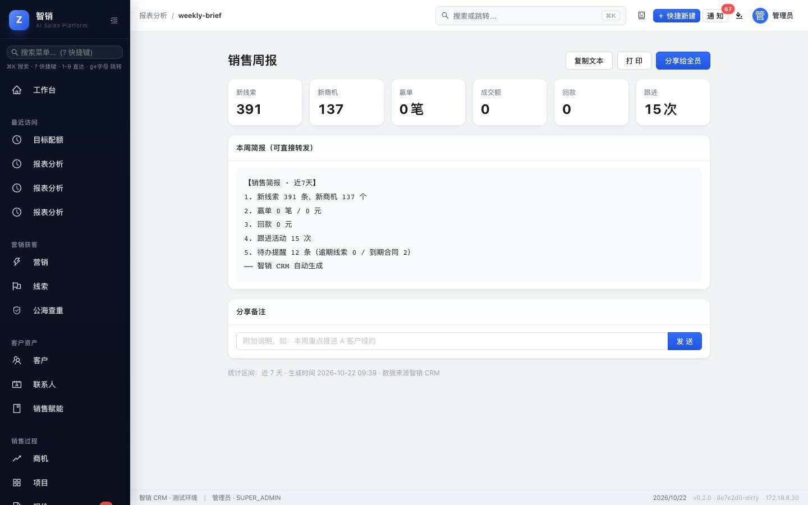

### 6.9 数据导入

菜单：**商务履约 → 数据导入**。按向导导入 **线索 / 联系人 / 客户** 的 CSV 文件：

1. 选择导入对象（线索 / 联系人 / 客户）。
2. 准备 CSV：第一行为表头，支持中英文列名，如 `名称/name`、`联系人/contactName`、`手机/phone`、`邮箱/email`、`来源/source`、`备注/remark`。
3. **选择 CSV 文件**，系统预览数据。
4. 确认导入，完成后显示成功与失败条数，可 **查看列表**。导入时按名称 / 邮箱 / 手机自动去重。

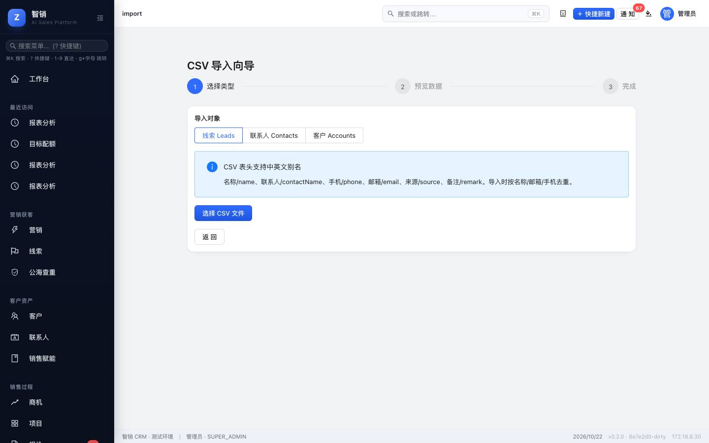

> CSV 请用 UTF-8 编码；Excel 另存为「CSV UTF-8」即可。

### 6.10 客户分群看板

菜单：**商务履约 → 客户分群看板**。按客户阶段（潜在 / 活跃 / 风险 / 流失）等条件分群，查看各分群成员，并开启自动触达（如风险客户自动生成回访任务）。

---

## 7. 分析报表

### 7.1 报表中心

菜单：**分析报表 → 报表中心**（快捷键 `8`）。

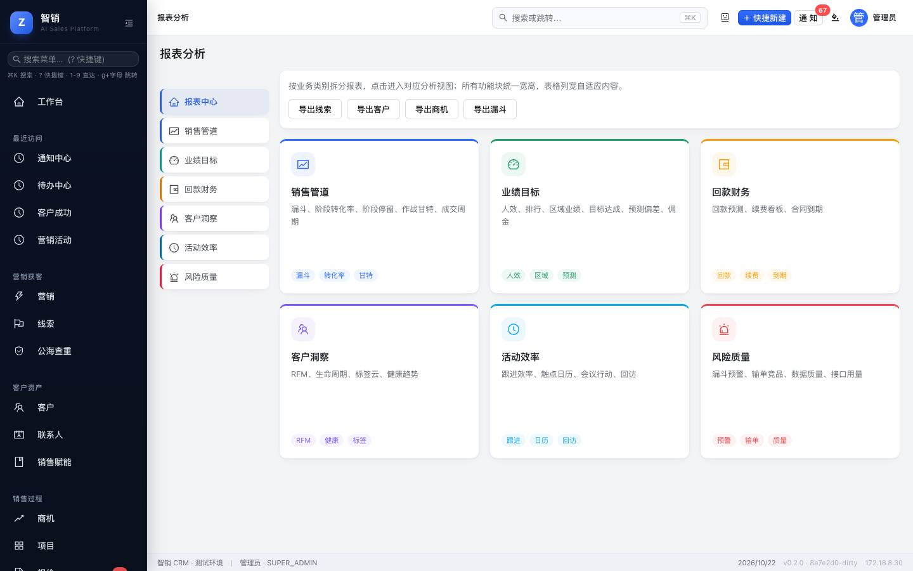

| 分类 | 主要报表 |
|------|----------|
| 销售管道 | 销售漏斗、漏斗健康度、阶段转化、阶段停留时长、成交周期、赢率评分 |
| 业绩目标 | 人效对比、目标达成、佣金计提、预测准确性 |
| 回款财务 | 回款预测、应收账龄、续费预估、合同到期 |
| 客户洞察 | 客户价值分层（RFM）、生命周期、线索来源转化、客户健康趋势 |
| 活动效率 | 跟进效率、建议回访、会议行动跟踪、客户关怀 |
| 风险质量 | 漏斗预警、输单分析、竞品对抗、数据质量、赢单复盘 |

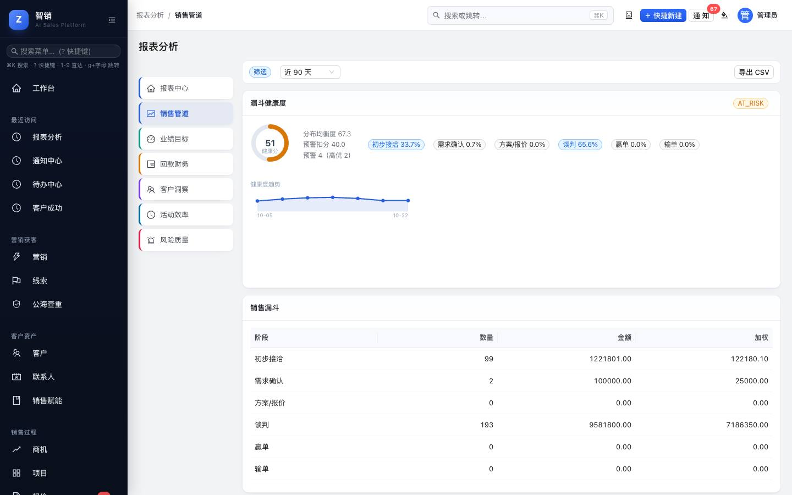

报表右上角可导出 CSV；看到的数据范围受你的数据权限限制。

### 7.2 目标配额

菜单：**分析报表 → 目标配额**。按月 / 季 / 年设置公司、团队、个人目标（收入、新增商机、赢单金额），查看达成、加权在途与缺口。

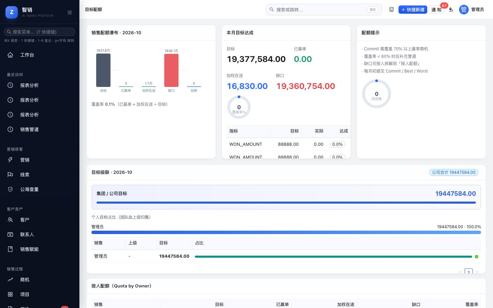

### 7.3 佣金管理

入口：**报表中心 → 业绩目标 → 佣金计提 → 佣金中心**，或 ⌘K 搜索「佣金」。

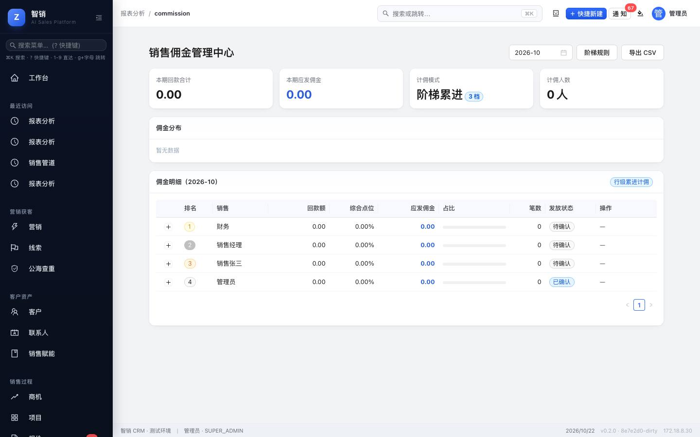

- 佣金按 **已确认回款** 计算，计佣模式为 **阶梯累进** 或 **固定费率**，由管理员在 **阶梯规则** 中设置；阶梯模式按合同行逐行累进计算。
- 发放状态：待确认 → 已确认 → 已发放；可导出 CSV 交财务。

### 7.4 销售预测工作台

菜单：**商务履约 → 销售预测工作台**。

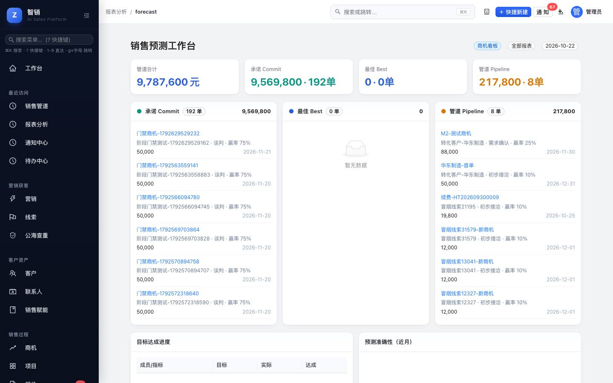

---

## 8. 协作办公

### 8.1 待办

菜单：**协作办公 → 待办**（快捷键 `9`）。汇总今日待办、逾期任务、待审批与智能提醒。可拖动排序、标记优先级、**稍后提醒**。

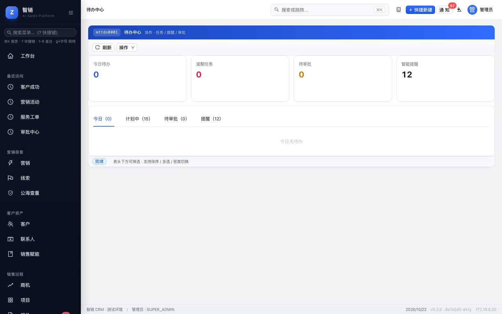

### 8.2 审批

菜单：**协作办公 → 审批**。

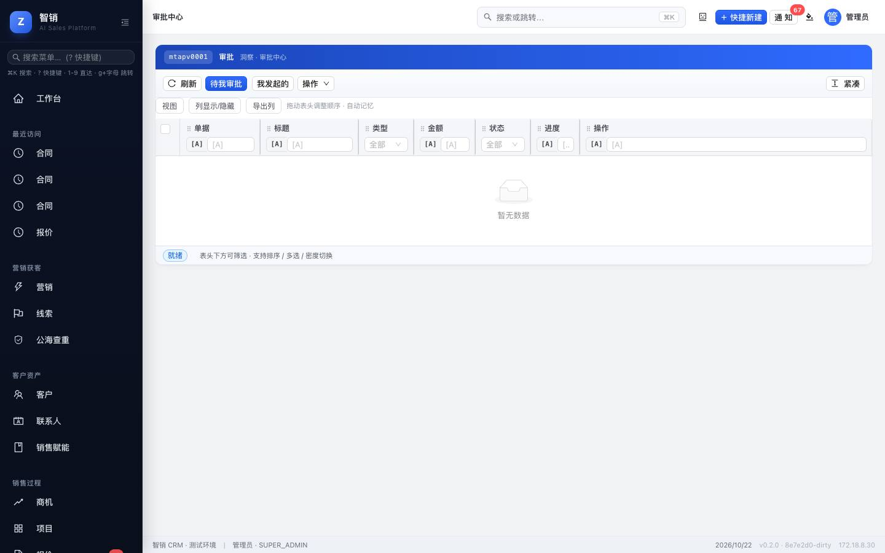

- 需要你审批的报价、合同、回款、变更单等都在这里；点进可查看单据详情。
- 报价审批分两级：先由申请人的直属上级审批，再由上级的上级审批；同一人不会被安排审批两次。轮到你时会收到「您有新的审批待办」通知。
- **同意** 或 **驳回**；**驳回必须填写意见**。
- 手机上支持批量全选审批。

### 8.3 通知

点顶栏 **通知** 进入通知中心。

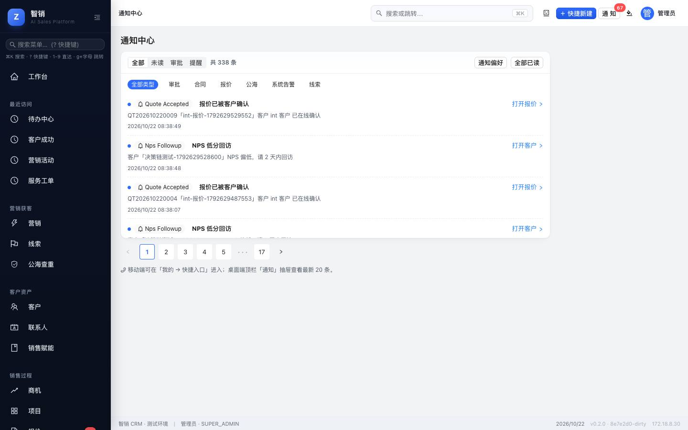

- 分类：待审批、审批完成、线索分配、跟进到期、回款确认、SLA 预警、续费商机、漏斗停滞、健康预警等
- **通知偏好**：可对不需要的类别静音

### 8.4 我的与修改密码

- 手机底部 **我的**，或桌面右上角头像：个人信息、外观偏好（主题色）、快捷入口；页面底部显示当前版本号。
- **修改密码**：左侧菜单 **平台管理**（系统设置）→ **安全与流程** → **修改密码**，输入当前密码和新密码（至少 8 位）。
- **第三方账号绑定**：在 **我的** 页面点 **绑定**，用企业微信 / 钉钉 / 飞书扫码，之后就能扫码登录；不需要时点 **解绑**。只显示管理员已启用的平台。

> 所有角色都可以修改自己的密码。忘记密码请联系管理员在「用户」中为你重置。

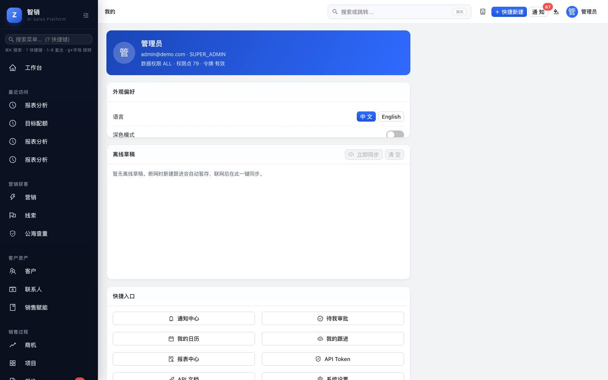

### 8.5 帮助中心

菜单：**协作办公 → 帮助中心**。在系统内直接查看本手册与《管理员手册》，点目录可跳到对应章节。手册随系统版本更新。

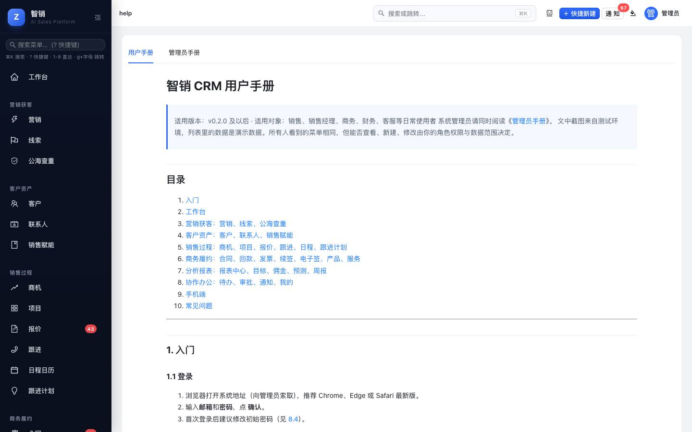

---

## 9. 手机端

手机浏览器打开同一地址即可使用；Android / iOS / 鸿蒙客户端如已发布，可向管理员索取安装方式。App 与网页功能相同。

| 工作台 | 商机 | 跟进 |
|--------|------|------|
| 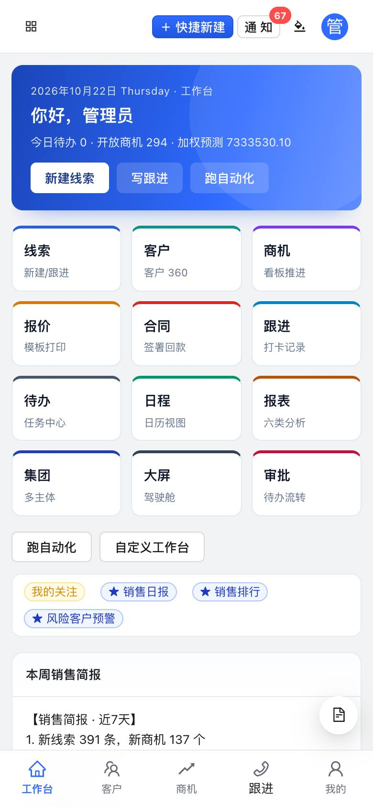 | 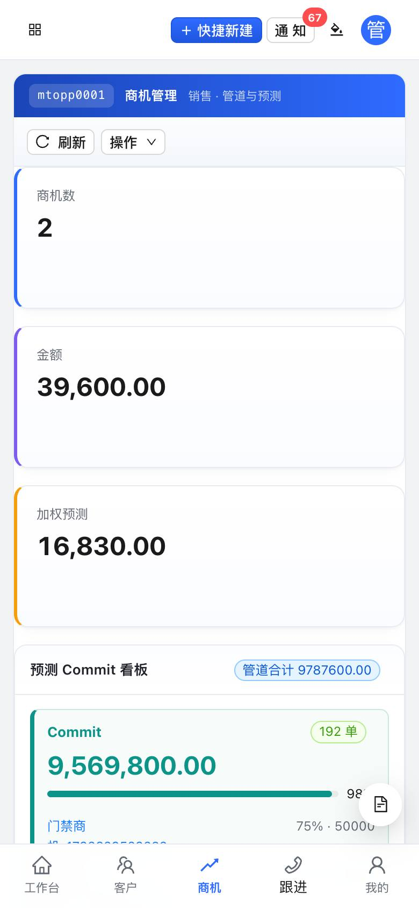 | 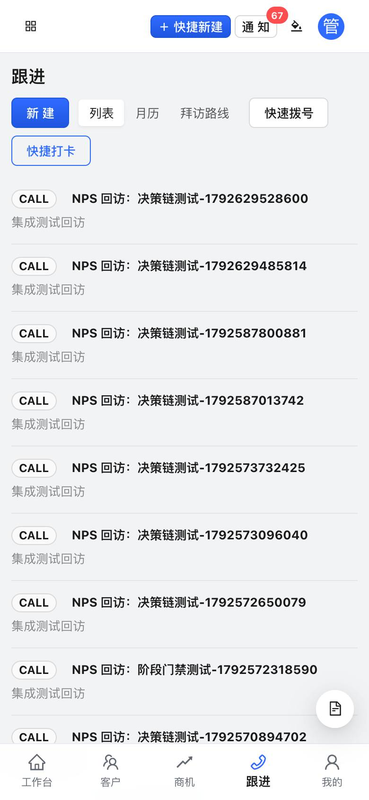 |

- **底部 Tab**：工作台 · 客户 · 商机 · 跟进 · 我的
- **添加到主屏幕**：Safari 点「分享 → 添加到主屏幕」；Chrome 点菜单「添加到主屏幕 / 安装应用」，之后像 App 一样从桌面打开
- **卡片左滑**：列表卡片向左滑出快捷操作（打电话、写跟进等）
- **拜访打卡**：允许定位；定位失败可手工填地址
- **电话**：点号码直接拨打

---

## 10. 常见问题

| 问题 | 处理 |
|------|------|
| 登录提示账号或密码错误 | 确认邮箱与密码；忘记密码请联系管理员 |
| 提示「操作过于频繁」（429） | 等 1 分钟后再试 |
| 看不到某些客户或商机 | 受数据权限限制（本人 / 团队 / 部门 / 全部），请负责人共享给你或联系管理员 |
| 打开某个页面提示无权限，或保存时报「missing permission」 | 菜单对所有人可见，但具体操作受角色权限控制；需要该功能请联系管理员调整角色 |
| 商机无法推进阶段 | 按提示补齐阶段门禁要求的信息（金额、预计成交日、下一步、联系人、报价） |
| 报价无法发送 / 接受 | 折扣或金额超过阈值，需先提交审批并通过 |
| 导入 CSV 乱码 | 用「CSV UTF-8」格式重新保存 |
| 页面空白或显示异常 | 按 Ctrl+F5（Mac：⌘+Shift+R）强制刷新；仍不行请把底部状态栏的版本号与截图发给管理员 |
| 打印合同 / 报价格式不对 | 参考 **平台管理 → 模板使用说明**，或请管理员检查模板 |
